# 🛰️ ORBIT FIELD ACADEMY
## MISSION 01 · GROUND CONTROL
### Regions, Availability Zones, the AWS Console, IAM in depth, and CloudShell

> **LEVEL:** Recruit · **TARGET TIME:** 60–75 minutes (plus optional challenges) · **ENVIRONMENT:** AWS Management Console and AWS CloudShell
> **THE STORY:** Welcome to the ORBIT spaceport. Before anyone lets you fly an AI agent, you learn the ground: *where* things live (Regions and Availability Zones), *who* you are (IAM identities), *what* you are allowed to do (policies), and *how* every instruction reaches the control tower (the console, the CLI, and signed API requests). By the end you will have solved an IAM puzzle, built the first role your agent's tools will use, and sent a hand-signed request to AWS.

**You already know cloud, so this mission is about the AWS way of doing it.** Nothing here costs money and nothing can break a classmate's work: most of the mission is reading and reasoning, and the one thing you create is an IAM role with your own name on it.

> [!NOTE]
> **This guide was verified against the live AWS Console on October 21, 2026** in the US West (Oregon) Region, as a participant with the example ID `s07x42`. The screenshots show exactly what that participant saw. AWS changes its console regularly; if a button has moved, look for the same words nearby.

---

## 🎯 Mission outcomes

By the end, you will be able to:

- Explain **account → Region → Availability Zone**, and why every mission in this course lives in one Region.
- Find anything in the **AWS Console** in under ten seconds (search, favourites, Region selector, account menu).
- Read an **IAM policy** statement by statement: `Effect`, `Action`, `Resource`, `Condition`, and the three-step evaluation rule (*explicit deny → allow → implicit deny*).
- Tell a **trust policy** from a **permissions policy** and explain why an execution role needs both.
- **Create an IAM role** that AWS Lambda can assume (you use it in Mission 02).
- Run the **AWS CLI in CloudShell**, and show that every API call to AWS is a **signed HTTPS request**.

---

## 📖 Before you start: the concepts in this mission

### The three boxes: account, Region, Availability Zone

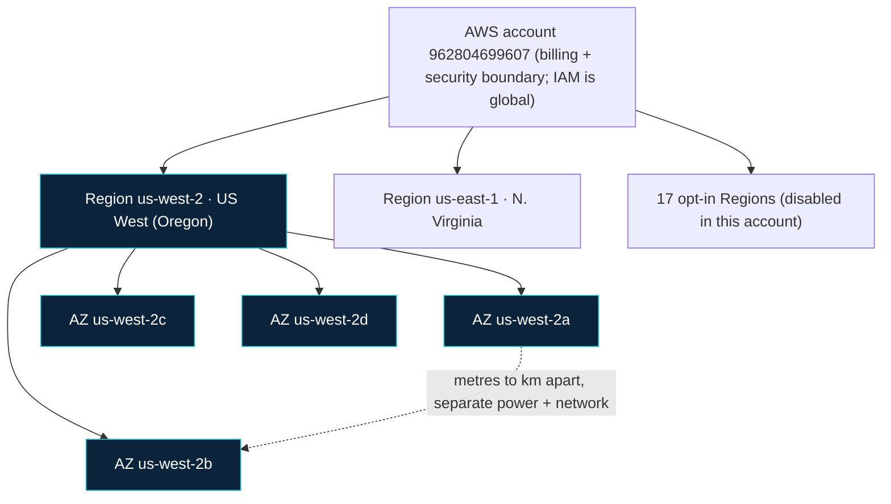

| Term | What it means in plain language | Why an agent builder cares |
|---|---|---|
| **AWS account** | The billing and security boundary. Everything you create is owned by one account. In this class **up to 30 people share one account**, so every resource name carries your personal ID. | Permissions, quotas and bills are counted per account. |
| **Region** | A geographic cluster of data centres with its own copy of most services, for example **US West (Oregon)** = `us-west-2`. Resources in one Region are invisible from another. | Bedrock models, AgentCore and Lambda are **regional**. A knowledge base in Oregon cannot be attached to an agent in Virginia. |
| **Availability Zone (AZ)** | One or more data centres inside a Region with independent power, cooling and networking. Oregon has four: `us-west-2a` to `2d`. | Managed services such as Lambda and Bedrock spread across AZs for you. When you build your own clusters (OpenSearch, Mission 02), *you* choose how many AZs. |
| **Global services** | A few services have one namespace for the whole account: **IAM**, Route 53, CloudFront, and the AWS Global View console. The Region selector shows **Global** when you are in one of them. | An IAM role you create in Oregon works in every Region. A Lambda function does not. |
| **Opt-in Regions** | Newer Regions (Cape Town, Milan, Jakarta…) are disabled until an administrator enables them. | Model availability differs by Region, so always check before planning a deployment. |

### IAM: identities, policies, and the evaluation rule

**IAM (Identity and Access Management)** answers one question for every single API call: *is this principal allowed to perform this action on this resource right now?*

- **Principals** are the things that make requests: **IAM users** (people or scripts with long-term credentials), **IAM roles** (identities *assumed* for a short time by a person, a service, or another account), and **groups** (a bag of users that share policies).
- **Policies** are JSON documents that grant or deny permissions. An **identity-based policy** is attached to a user, group or role. A **resource-based policy** is attached to the resource itself (a bucket, a secret, an OpenSearch domain) and names the principals it accepts.
- Every role has **two** policy documents:
  - the **trust policy** says *who may assume* the role (for example `lambda.amazonaws.com`);
  - the **permissions policy** says *what the role may do* once assumed.
  A role with a trust policy but no permissions can be assumed and then do nothing. A role with permissions but the wrong trust policy can never be assumed by the service that needs it. **Both are needed.**

A policy statement has five parts:

```json
{
  "Sid": "InvokeNovaLiteOnly",                              
  "Effect": "Allow",                                        
  "Action": "bedrock:InvokeModel",                          
  "Resource": "arn:aws:bedrock:us-west-2::foundation-model/amazon.nova-lite-v1:0",
  "Condition": {"StringEquals": {"aws:RequestedRegion": "us-west-2"}}
}
```

| Part | Meaning |
|---|---|
| `Sid` | A label for humans. Optional. |
| `Effect` | `Allow` or `Deny`. |
| `Action` | `service:Operation`, wildcards allowed (`logs:*`, `bedrock:Invoke*`). |
| `Resource` | The **ARN** (Amazon Resource Name) the statement applies to. `*` means everything. |
| `Condition` | Extra tests on the request: Region, source account, tags, time of day… |

**The evaluation rule** (memorise this; it explains every permission error you will ever see):

1. Start from **implicit deny**: nothing is allowed by default.
2. If any applicable statement **allows** the action on the resource, it is allowed…
3. …unless any applicable statement **explicitly denies** it. **An explicit Deny always wins**, even against `AdministratorAccess`.

Two more ideas you will meet today:

- **Least privilege:** grant the exact actions on the exact resources a workload needs. `"Resource": "*"` is the thing reviewers ask you to justify.
- **`iam:PassRole`:** when you tell Lambda "run this function as role X", *you* must be allowed to hand role X to Lambda. That is why creating a Lambda function needs permissions on IAM as well as on Lambda.

### ARNs

`arn:aws:iam::962804699607:role/orbit-academy/orbit-academy-mystery-role` reads as *partition : service : Region : account : resource*. IAM ARNs have an empty Region because IAM is global. Bedrock foundation-model ARNs have an empty account because AWS owns the models (`arn:aws:bedrock:us-west-2::foundation-model/amazon.nova-lite-v1:0`).

### How a request reaches AWS

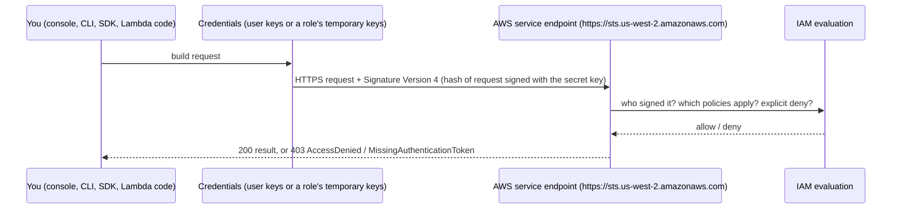

Every console click, every CLI command and every Lambda call to Bedrock becomes one of these signed HTTPS requests. **CloudShell** is a browser-based Linux shell with the AWS CLI pre-installed and *your own console credentials* already injected, which makes it the easiest place to watch this happen.

---

## 🪪 Phase 0 — Sign in and claim your namespace (5 minutes)

1. Sign in to the AWS Console with the IAM user name and password your instructor gave you. The account is called **Training** (`962804699607`).
2. In the top-right **Region selector** choose **United States (Oregon)**, `us-west-2`. Every mission uses this Region. The console remembers a Region *per service*, so glance at the selector each time you open a new service.
3. Choose your unique identifier, `MY_ID`: your **class seat number plus two random digits**, all lowercase, no spaces, for example `s07x42`. Write it down. **Keep it for the whole course.**

**Naming convention for this mission** (replace `MY_ID`):

| What | Name you will type | Rule |
|---|---|---|
| IAM role for your Mission 02 Lambda function | `orbit-MY_ID-lambda-role` | letters, numbers, `+=,.@-_`, max 64 characters |

> [!CAUTION]
> **Shared-account rules.** Never open *Edit* or *Delete* on anything that does not contain *your* `MY_ID`. Shared resources that the instructor created start with `orbit-academy-`; you read them, you never change them. The IAM console shows **365 roles** from many courses; filter before you click.

**Resource ledger** (fill in as you go):

| Property | Your value |
|---|---|
| AWS account ID | `962804699607` |
| Region | `us-west-2` |
| `MY_ID` | |
| Your IAM user ARN (Phase 3) | |
| Your Lambda role ARN (Phase 5) | |

---

## 🧭 Phase 1 — Orientation: the console in five clicks (10 minutes)

**Concept:** The console is one web app for 200+ services. You never browse it; you *search* it, you *pin* it, and you *check the Region*.

1. You land on **Console Home**. The **Recently visited** widget fills up as you work; the **Cost and usage** widget shows the account's current-month spend (shared by everyone in the account, so do not panic at the number).

   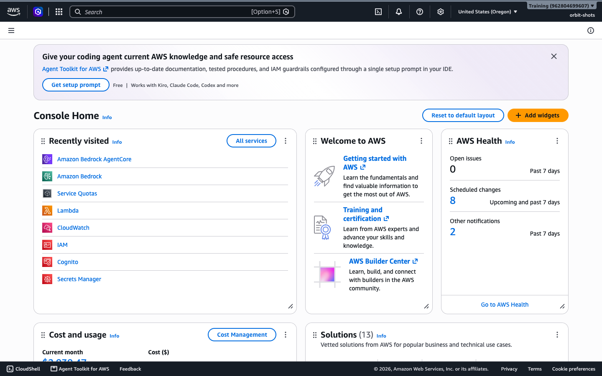

2. Open the **Region selector** (top right, *United States (Oregon)*). Note the Region **codes** beside the names. Scroll to the bottom: *There are 17 Regions that are not enabled for this account.* Those are the opt-in Regions.

   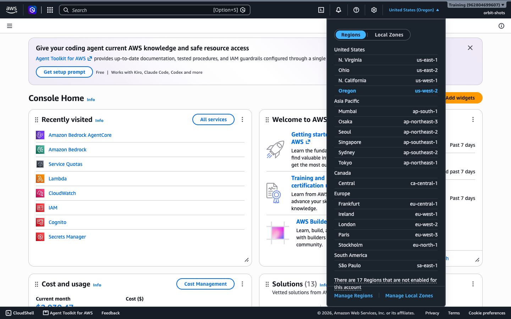

3. Open the **account menu** (top right, *Training (962804699607)*). It shows the **account ID**, your sign-in name, and the **Sign out** link. Record your user name in the ledger.

   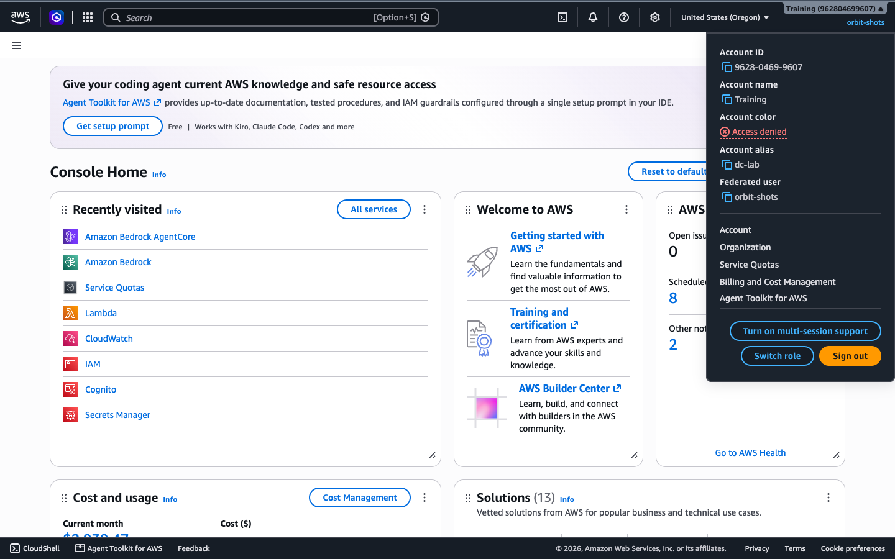

4. Click into the **search box** (or press `Option+S` / `Alt+S`) and type `IAM`. The results list services, features, documentation and the Marketplace. Press `Enter` on the first result to open the service. Use the **star** beside a service name in the results or in **All services** to add it to the favourites bar.

   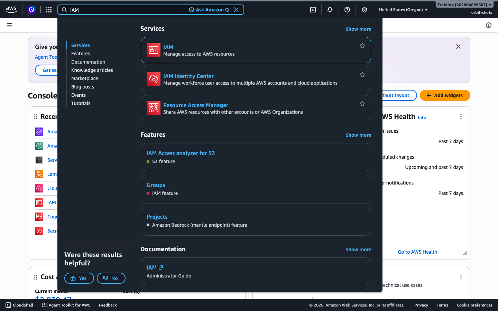

5. Look at the icons left of the Region selector: a **terminal icon** (CloudShell, Phase 6), a **bell** (notifications), a **question mark** (help), and a **gear** (settings such as language and default Region).

**🧩 Investigation checkpoint**

- [ ] I can state the account ID, my user name and the Region code without looking.
- [ ] I found the Region selector and know what "17 Regions not enabled" means.
- [ ] I have added **IAM**, **Lambda**, **CloudWatch**, **Amazon Bedrock** and **Amazon Bedrock AgentCore** to my favourites bar (search each, click the star).

---

## 🌍 Phase 2 — Regions and Availability Zones, on the map (10 minutes)

**Concept:** A Region is a *choice* you make per resource; an Availability Zone is a *fault boundary* inside it. The **AWS Global View** console shows both for the whole account.

1. Search for `Global View` and open **AWS Global View**, or open **EC2** and choose **AWS Global View** in its left navigation. In the left navigation choose **Regions and Zones**.
2. The **Regions** tab lists every Region with its **Status** (*Enabled by default* or *Disabled*), **Region code**, and how many **Availability Zones**, **Local Zones** and **Wavelength Zones** it has. Find **US West (Oregon)**: four Availability Zones.

   

3. Open the **Availability Zones** tab. Each zone has a **Zone name** (`us-west-2a`) and a **Zone ID** (`usw2-az1`). Zone *names* are shuffled per account so that customers spread load evenly; zone *IDs* are the physical truth. Two accounts' `us-west-2a` can be different buildings.

   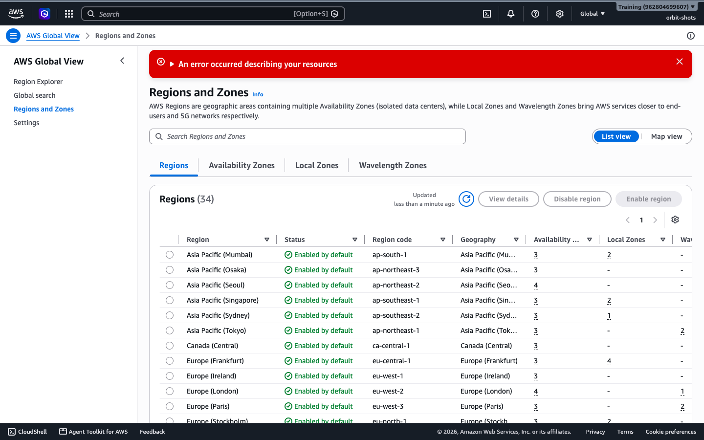

4. Switch to **Map view** for the picture you will draw on a whiteboard one day.

   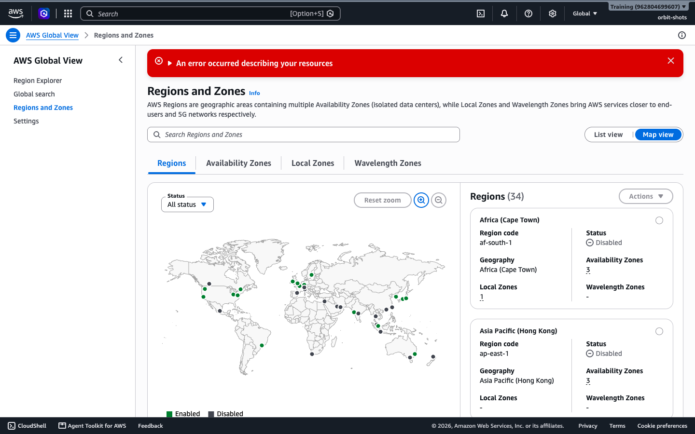

5. Search for `Health` and open the **AWS Health Dashboard**. **Your account health** lists open issues and scheduled changes that affect *this* account; the **Service health** tab shows AWS-wide status per Region. When an agent "suddenly" fails in production, this page is the first place a responder looks.

   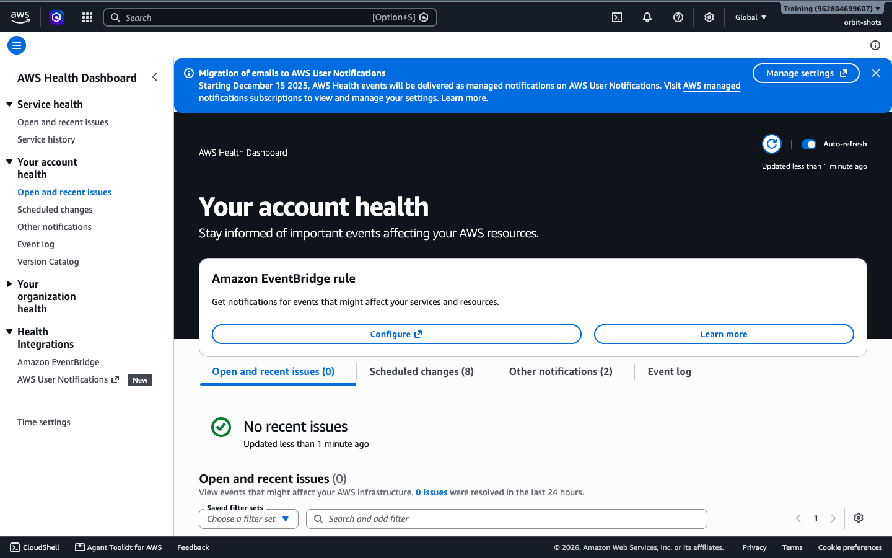

**🧩 Investigation checkpoint**

- [ ] Oregon has **4** Availability Zones; N. Virginia has **6**. (Check the table.)
- [ ] I can explain why `us-west-2a` in this account may not be the same building as `us-west-2a` in another account.
- [ ] I can name two services that are **global** and two that are **regional**.

**Mini-debrief:** Later in the course you create an AgentCore agent, a Lambda function, a Cognito pool and a knowledge base. All four must be in the same Region to talk to each other with the least friction, and the IAM roles that connect them are global. That is the whole reason this course pins everything to Oregon.

---

## 🪪 Phase 3 — IAM: who am I, and what may I do? (15 minutes)

**Concept:** You are an **IAM user**. Your permissions come from policies attached to you directly and through groups. IAM is global, so the Region selector reads **Global** while you are here.

### Step A: Find yourself

1. Open **IAM**. The **Dashboard** shows the account's identity counts and security recommendations (the console nags about MFA and root access keys; those are instructor matters in a training account).

   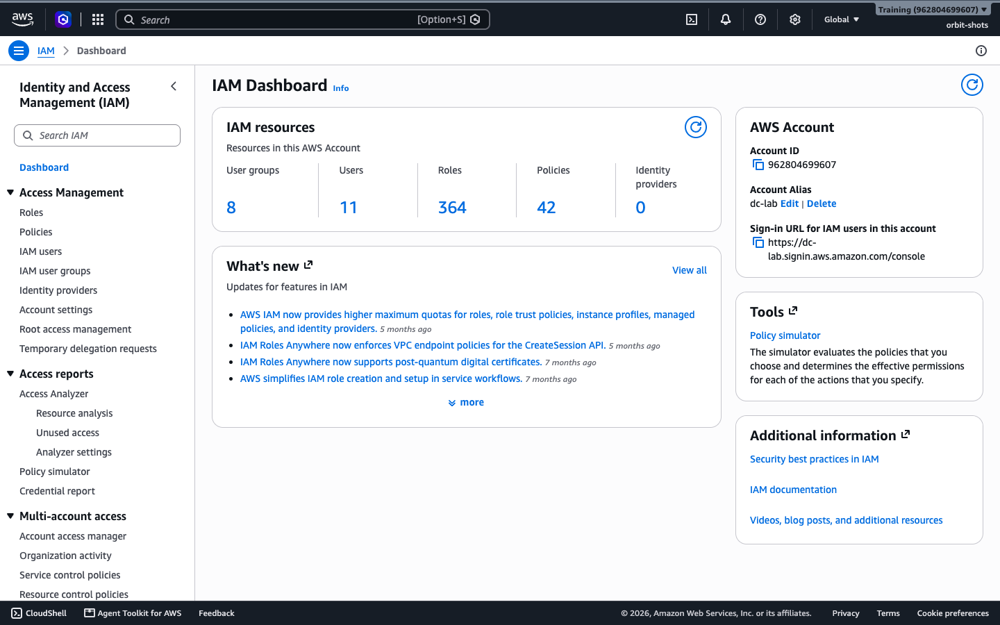

2. In the left navigation choose **IAM users**. This is the shared account, so you see your classmates and several other courses. Type your user name in the search box and open it.

   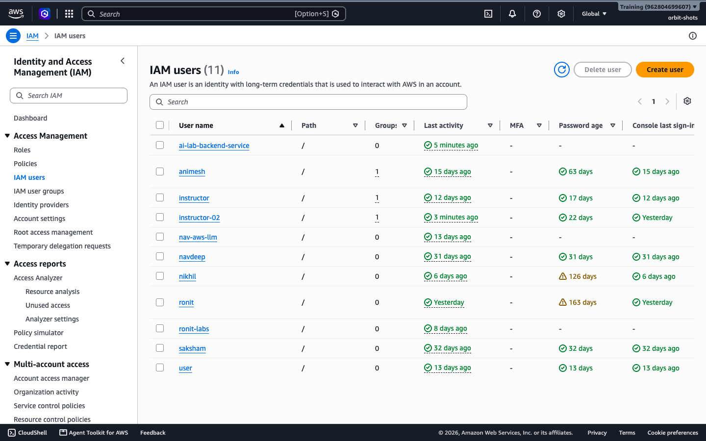

3. On your user page read the **Summary**: your **ARN** (copy it into the ledger), whether **console access** is enabled, and your **access keys** (CLI credentials; you may have none, and CloudShell does not need any).
4. Open the **Permissions** tab. The **Permissions policies** table lists every policy that applies to you and whether it is attached **Directly** or **via a group**. Your list will differ from the screenshot (the verified run used an instructor user with `AdministratorAccess`); a student user typically shows one customer-managed policy via the course group.

   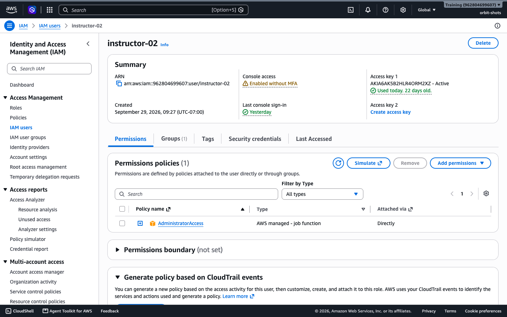

5. Open the **Groups** tab, then the **Last Accessed** tab. *Last Accessed* (also called Access Advisor) shows which services this identity actually used and when, the raw material for trimming permissions down to least privilege.

   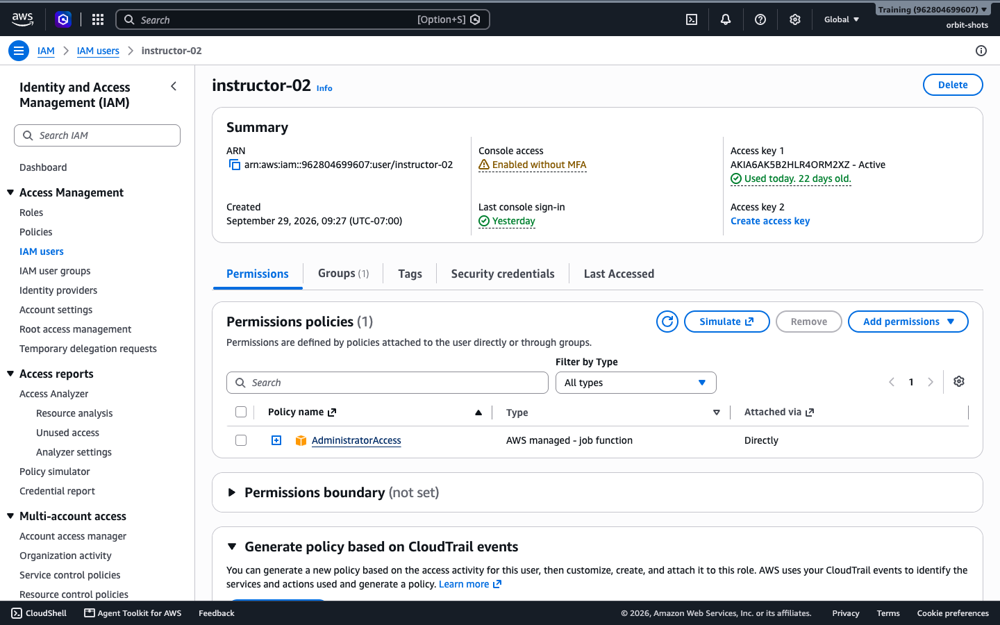

### Step B: Read a policy like a reviewer

6. In the left navigation choose **Policies**, search for `AWSLambdaBasicExecutionRole`, and open the **AWS managed** one (not the customer-managed copies with random suffixes that old Lambda wizards left behind).
7. The **Permissions** tab opens in **Summary** view: *CloudWatch Logs · Limited: Write · All resources*. Switch to **JSON**:

   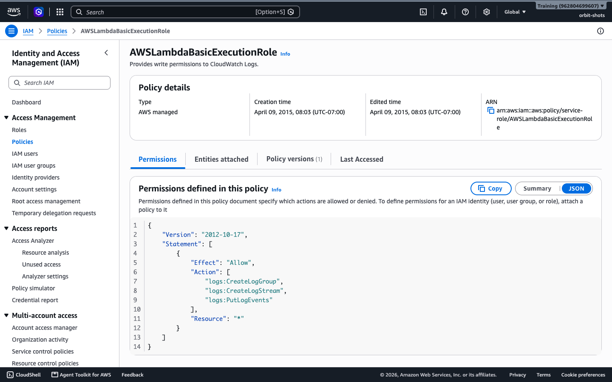

   ```json
   {
     "Version": "2012-10-17",
     "Statement": [
       {
         "Effect": "Allow",
         "Action": ["logs:CreateLogGroup", "logs:CreateLogStream", "logs:PutLogEvents"],
         "Resource": "*"
       }
     ]
   }
   ```

   Three actions, every resource, no condition. This is the policy you attach to a Lambda role so the function can write its own logs, and it is the policy you will attach in Phase 5.

**🧩 Investigation checkpoint**

- [ ] I recorded my own user ARN.
- [ ] I can say which of my policies are attached directly and which come through a group.
- [ ] In `AWSLambdaBasicExecutionRole`, I can point to the `Effect`, the three `Action`s and the `Resource`, and explain what `"Resource": "*"` allows (writing to *any* log group in the account).

---

## 🕵️ Phase 4 — The mystery role: an IAM puzzle (15 minutes)

**Concept:** Production agents run under **execution roles**. Reading one tells you exactly what an agent can touch. The instructor has planted a role that looks like an AgentCore execution role. Your job is to answer ten questions about it using only what IAM shows you.

1. Choose **Roles** in the left navigation and search for `orbit-academy-mystery-role`. Open it. The **Summary** shows its ARN (note the path `/orbit-academy/` inside it) and the **Maximum session duration** (one hour: temporary credentials for a role expire).

   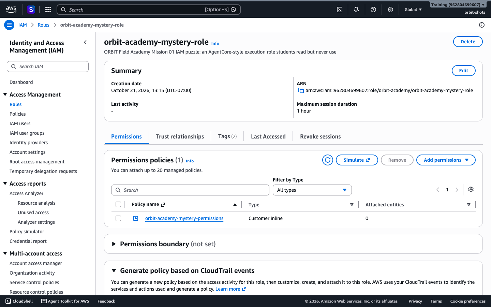

2. Open the **Trust relationships** tab. This is the trust policy: *who may become this role*.

   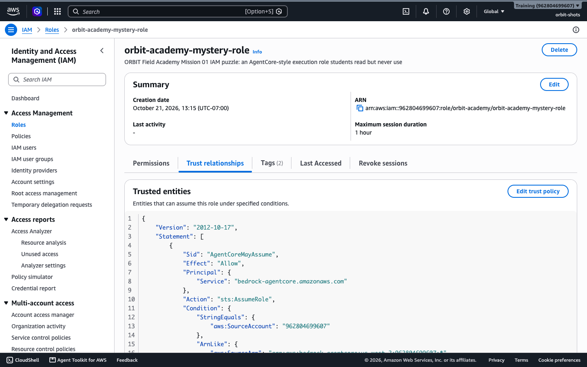

3. Back on **Permissions**, click the policy name **`orbit-academy-mystery-permissions`**. It opens in a new tab in the policy editor (you are only reading; do **not** choose *Next* or *Save*). Choose **JSON** and read all seven statements.

   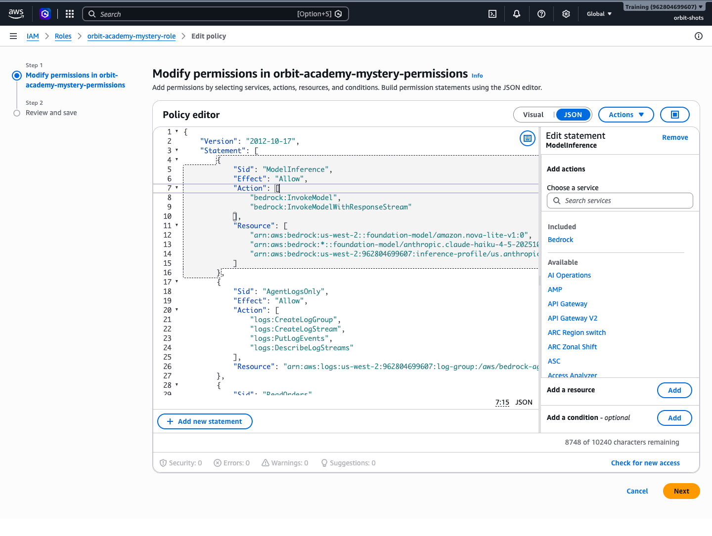

4. Fill in the worksheet. Decide each answer from the JSON first; then prove it in Step 5.

| # | Question | Your answer (Allowed / Denied / Not applicable) and the statement that decides it |
|---|---|---|
| 1 | Which AWS service may assume this role, and from where? | |
| 2 | Could a **Lambda function** use this role as its execution role? | |
| 3 | May the agent call **Amazon Nova Lite**? **Amazon Nova Pro**? | |
| 4 | May it call **Claude Haiku 4.5** through the `us.` inference profile? | |
| 5 | May it read the secret `orbit/dev/api-key`? And `orbit/prod/api-key`? | |
| 6 | May it **look up** an order in the DynamoDB table `orbit-orders`? May it **change** one? | |
| 7 | May it write logs to the log group `/aws/lambda/anything`? | |
| 8 | May it call an AgentCore Gateway from **us-east-1**? From **us-west-2**? | |
| 9 | In one sentence: what is the difference between the two policy documents on this role? | |
| 10 | Bonus: why does one model ARN use `*` for the Region? | |

5. **Prove it.** You have two tools:

   - **The IAM policy simulator (console).** Open **Policy simulator** in the left navigation (or choose **Simulate** on the role's Permissions tab). In the new simulator: **Add identity** → search `orbit-academy-mystery` → tick the role → **Add identities**. Then **Add actions** → choose the service **Bedrock** → search `InvokeModel` → tick **InvokeModel** → **Add actions**. Choose **Simulate**, then expand the result row.

     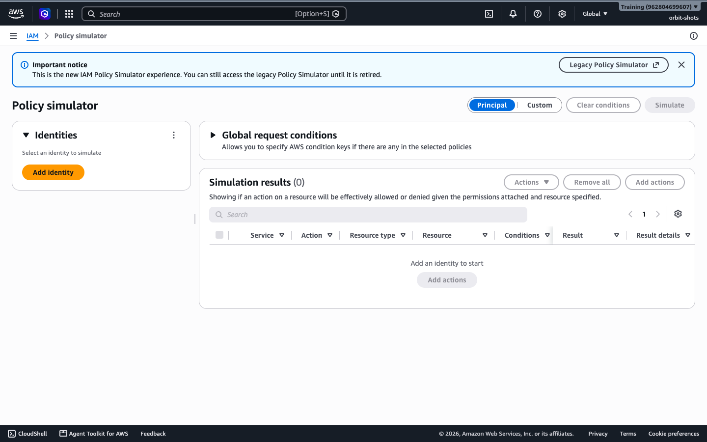

     With the default resource `*` every resource type reports **Denied · Implicit deny due to no statement(s) matching**, because the policy only allows *specific* model ARNs, and `*` is not one of them. That is the lesson in one screen: the simulator evaluates the exact resource you give it. Expand the row, replace `*` for the **foundation-model** resource type with `arn:aws:bedrock:us-west-2::foundation-model/amazon.nova-lite-v1:0`, and simulate again to see **Allowed**; try the Nova Pro ARN to see the implicit deny stay.

     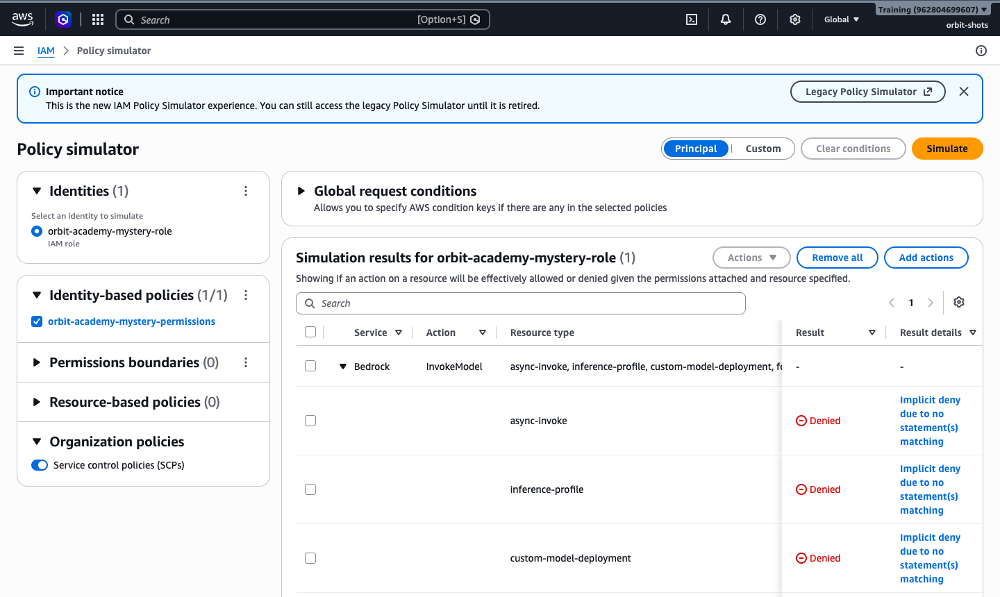

   - **The CLI in CloudShell** (you set it up in Phase 6; come back for this if you prefer). One command per question:

     ```bash
     ROLE=arn:aws:iam::962804699607:role/orbit-academy/orbit-academy-mystery-role
     aws iam simulate-principal-policy --policy-source-arn $ROLE \
       --action-names bedrock:InvokeModel \
       --resource-arns arn:aws:bedrock:us-west-2::foundation-model/amazon.nova-pro-v1:0 \
       --query 'EvaluationResults[].[EvalActionName,EvalDecision]' --output table
     aws iam simulate-principal-policy --policy-source-arn $ROLE \
       --action-names secretsmanager:GetSecretValue \
       --resource-arns arn:aws:secretsmanager:us-west-2:962804699607:secret:orbit/prod/api-key-AbCdEf \
       --query 'EvaluationResults[].[EvalActionName,EvalDecision]' --output table
     ```

     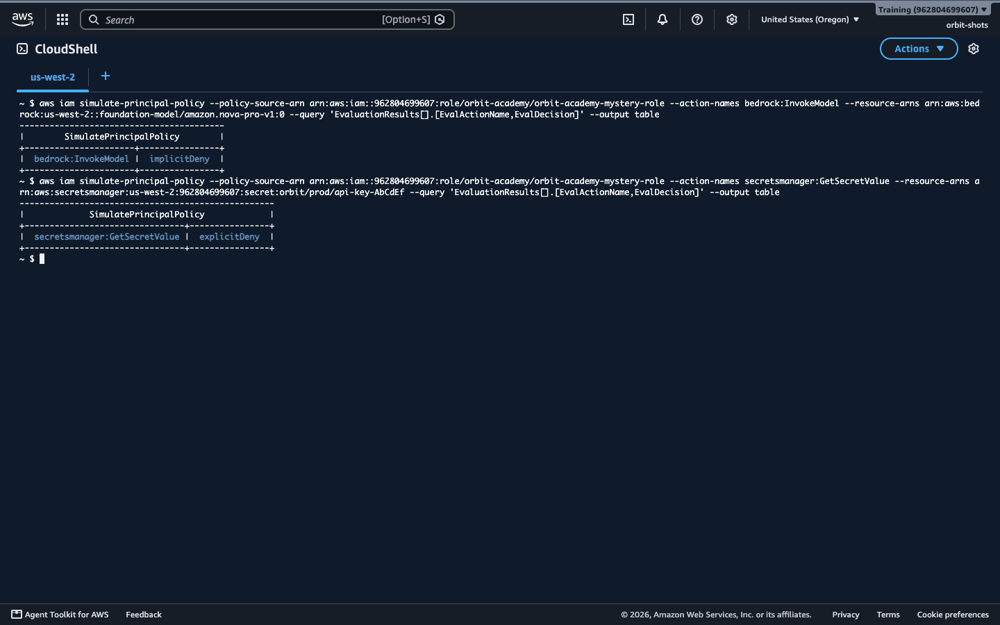

**Mini-debrief:** Notice the three different "no" answers. Nova Pro is an **implicit deny** (nobody mentioned it). The production secret is an **explicit deny** (a statement forbids it, and no Allow can override that). Lambda cannot use the role at all because the **trust policy** never lets it in; permissions never enter the picture. When an agent fails with *AccessDenied* in a later mission, your first question is always: *which of the three is this?*

---

## 🔧 Phase 5 — Build the role your Lambda function will wear (10 minutes)

**Concept:** In Mission 02 you create a Lambda function that writes logs and calls a Bedrock model. The function needs an **execution role**: a trust policy that lets `lambda.amazonaws.com` assume it, and a permissions policy that (for now) only allows logging. You build it here so that Mission 02 can focus on code.

1. **Roles → Create role.**
2. **Step 1, Select trusted entity:** keep **AWS service**. Under **Service or use case** open the dropdown, type `Lambda`, and choose **Lambda**. The console will write the trust policy for you. Choose **Next**.

   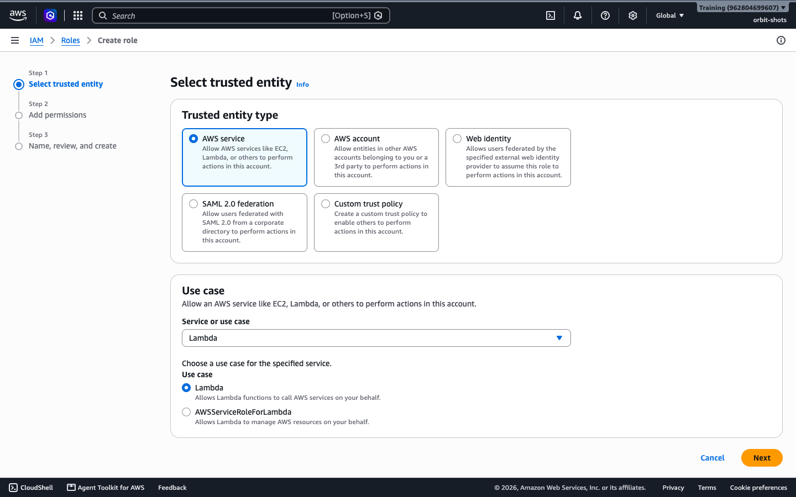

3. **Step 2, Add permissions:** keep **Use existing policy**. In the search box type `AWSLambdaBasicExecutionRole`, press Enter, and tick the **AWS managed** row (the first one; ignore the customer-managed copies). Choose **Next**.

   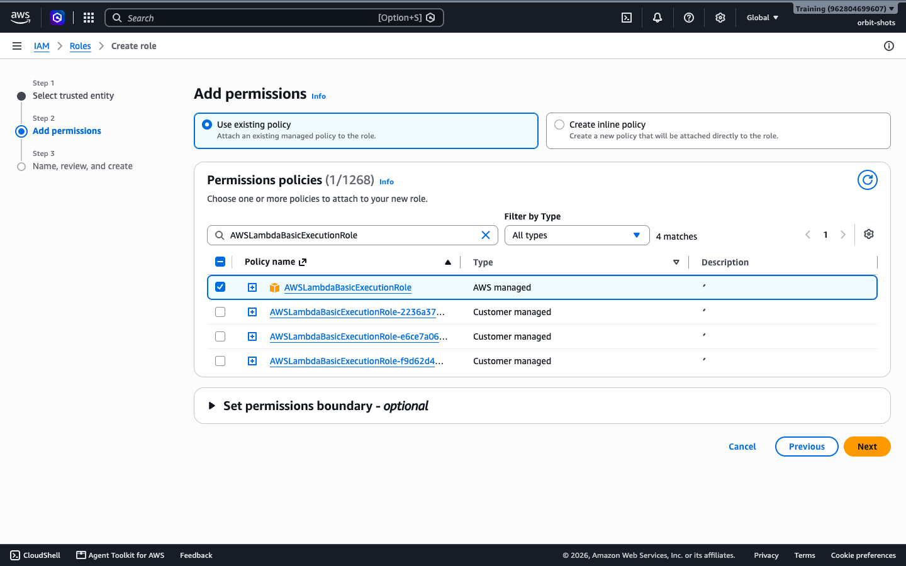

4. **Step 3, Name, review, and create:**
   - **Role name:** `orbit-MY_ID-lambda-role`
   - **Description:** `ORBIT Mission 01: execution role for my first Lambda function (logs only for now)`
   - Read the generated **Trust policy** on this page: `"Principal": {"Service": ["lambda.amazonaws.com"]}` and `"Action": ["sts:AssumeRole"]`.

   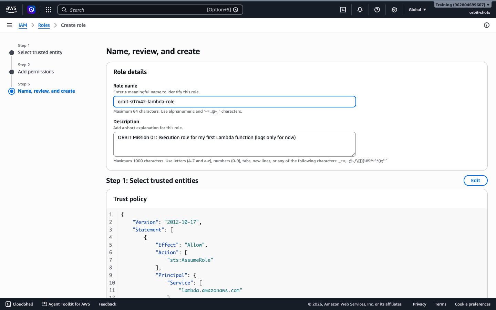

5. Choose **Create role**. A green banner confirms *Role orbit-MY_ID-lambda-role created*. Choose **View role**, copy the **ARN** into your ledger, and open **Trust relationships** to see the policy you just read, now attached.

   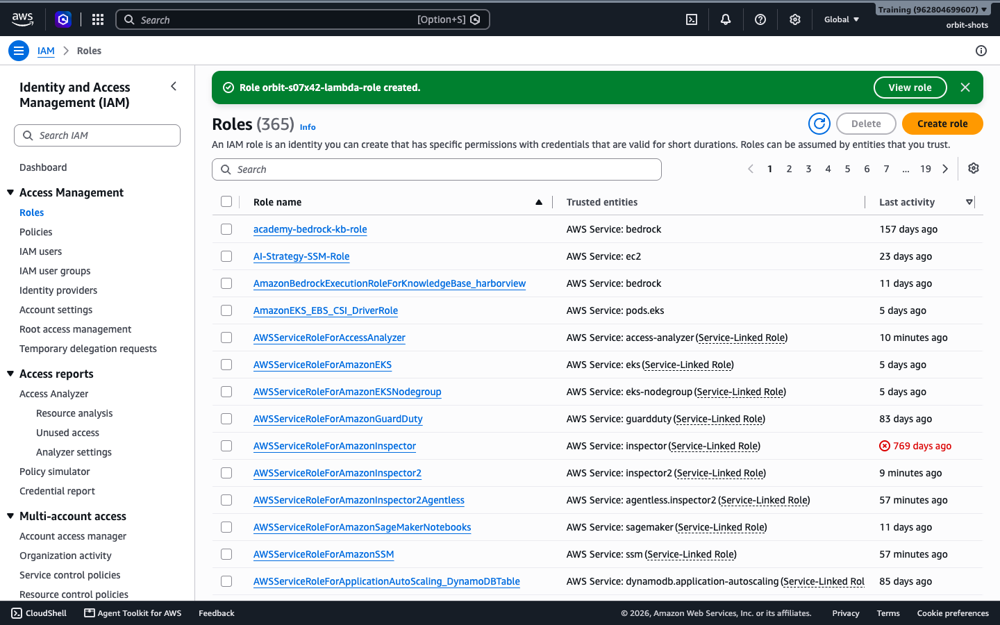

   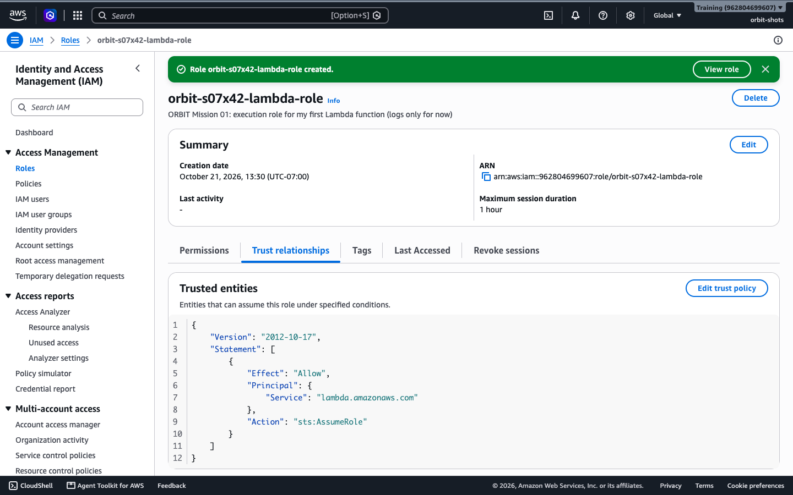

> [!TIP]
> **If Create role fails with an IAM error**, your sign-in identity is not allowed to create roles with that name. Check that the name starts with `orbit-` and contains your `MY_ID`; the student policy only allows role names in that pattern. If it still fails, ask the instructor.

**🧩 Investigation checkpoint**

- [ ] My role exists, its trust policy names `lambda.amazonaws.com`, and its only permissions policy is `AWSLambdaBasicExecutionRole`.
- [ ] I can predict what will happen in Mission 02 when code running under this role calls Amazon Bedrock. (Write your prediction down; you will test it.)

---

## 💻 Phase 6 — CloudShell: the same AWS, from a terminal (10 minutes)

**Concept:** **AWS CloudShell** is a free, browser-based shell (Amazon Linux, AWS CLI, Python, Node.js) that runs *inside* a Region with *your* console credentials. Anything the console can do, the CLI can do, and the CLI makes the request/response shape visible.

> [!IMPORTANT]
> **Shared-account quota: 10 concurrent CloudShell sessions per account per Region.** If the shell refuses to start with a quota message, you are the eleventh. Close your tab when you are done, and if the instructor announces waves, wait for yours. Everything in this phase also has a console equivalent, so nobody is blocked.

1. Click the **terminal icon** in the top bar (or search for `CloudShell`). The first start takes 30–60 seconds; a **Welcome to AWS CloudShell** dialog explains the pre-installed tools and the **1 GB of persistent storage per Region**. Choose **Close**. The prompt `~ $` appears in a tab named `us-west-2`.

   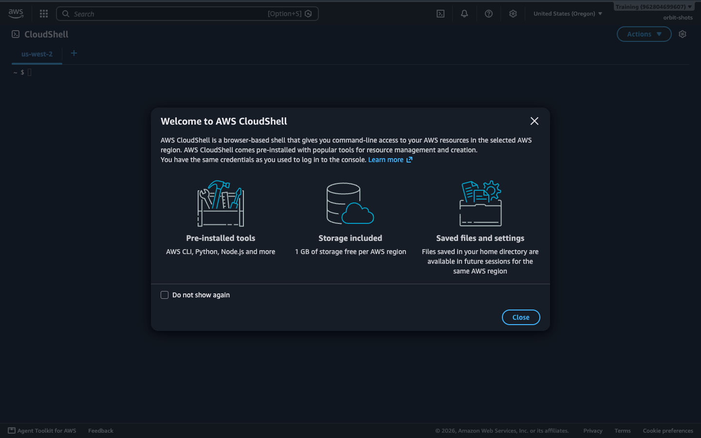

2. Ask AWS who you are, list the Availability Zones, and read your new role, all from the CLI:

   ```bash
   aws sts get-caller-identity
   aws ec2 describe-availability-zones --query 'AvailabilityZones[].[ZoneName,ZoneId,State]' --output table
   aws iam get-role --role-name orbit-MY_ID-lambda-role --query 'Role.AssumeRolePolicyDocument.Statement[0].Principal'
   ```

   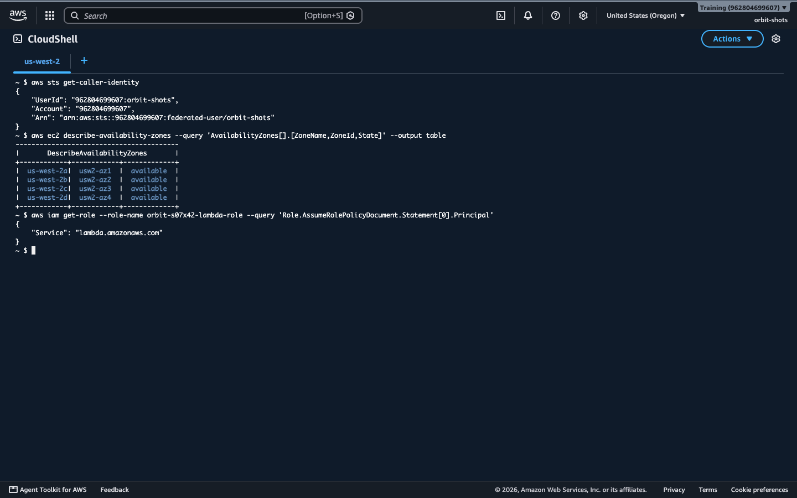

   The first command returns your user ARN: the shell signs requests as *you*. The second shows the zone-name-to-zone-ID map you saw in Global View. The third prints `{"Service": "lambda.amazonaws.com"}` from the trust policy you created.

3. **See the signature.** Call the STS endpoint directly with `curl`, first unsigned, then signed:

   ```bash
   # 1. Unsigned: AWS refuses it
   curl -s 'https://sts.us-west-2.amazonaws.com/?Action=GetCallerIdentity&Version=2011-06-15'

   # 2. Export the shell's temporary credentials into environment variables
   eval $(aws configure export-credentials --format env)

   # 3. Signed with Signature Version 4: AWS answers
   curl -s --aws-sigv4 aws:amz:us-west-2:sts \
     --user "$AWS_ACCESS_KEY_ID:$AWS_SECRET_ACCESS_KEY" \
     -H "x-amz-security-token: $AWS_SESSION_TOKEN" \
     'https://sts.us-west-2.amazonaws.com/?Action=GetCallerIdentity&Version=2011-06-15'
   ```

   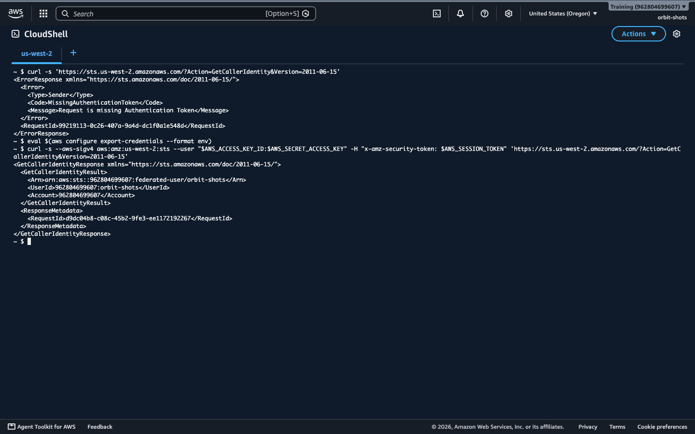

   The unsigned call returns `<Code>MissingAuthenticationToken</Code>`. The signed call returns your ARN. Everything the console does, the CLI does, and your Lambda code will do in Mission 02 is this: an HTTPS request with a Signature Version 4 header computed from a secret key that AWS never sees on the wire.

4. Type `exit` or close the tab. (Your home directory survives for the next session; the session itself ends after 20–30 minutes of inactivity.)

**🧩 Investigation checkpoint**

- [ ] I can explain why `aws sts get-caller-identity` works in CloudShell without configuring any keys.
- [ ] I can say what `MissingAuthenticationToken` means and what `AccessDenied` would mean instead (unsigned vs. signed-but-not-allowed).

---

## 🏆 Phase 7 — Challenge exercises (optional, for recruits who finish early)

Pick any. Each one is answerable with the console and CloudShell; none creates anything that costs money.

### Challenge A · Policy forensics (IAM)

The mystery role must be allowed to read `orbit/prod/*` secrets for a new feature. A colleague proposes adding a new `Allow` statement for `secretsmanager:GetSecretValue` on `orbit/prod/*`. Will it work? Prove your answer with the simulator (console or CLI), then write the *smallest* change that would work and explain its blast radius.

### Challenge B · Least-privilege author (IAM + CLI)

Write a permissions policy for `orbit-MY_ID-lambda-role` that allows **only** `bedrock:InvokeModel` on Nova Lite and the three `logs:` actions on **its own** log group `/aws/lambda/orbit-MY_ID-hello`. Do not attach it; test it from CloudShell with a custom-policy simulation:

```bash
cat > /tmp/least.json <<'JSON'
{"Version":"2012-10-17","Statement":[
 {"Effect":"Allow","Action":"bedrock:InvokeModel","Resource":"arn:aws:bedrock:us-west-2::foundation-model/amazon.nova-lite-v1:0"},
 {"Effect":"Allow","Action":["logs:CreateLogGroup","logs:CreateLogStream","logs:PutLogEvents"],"Resource":"arn:aws:logs:us-west-2:962804699607:log-group:/aws/lambda/orbit-MY_ID-hello:*"}
]}
JSON
aws iam simulate-custom-policy --policy-input-list "$(cat /tmp/least.json)" \
  --action-names bedrock:InvokeModel \
  --resource-arns arn:aws:bedrock:us-west-2::foundation-model/amazon.nova-lite-v1:0 \
  --query 'EvaluationResults[].[EvalActionName,EvalDecision]' --output table
aws iam simulate-custom-policy --policy-input-list "$(cat /tmp/least.json)" \
  --action-names bedrock:InvokeModel \
  --resource-arns arn:aws:bedrock:us-west-2::foundation-model/amazon.nova-pro-v1:0 \
  --query 'EvaluationResults[].[EvalActionName,EvalDecision]' --output table
```

Expected: `allowed` for Nova Lite, `implicitDeny` for Nova Pro. Keep the file; Mission 02 asks you to attach a policy like it.

### Challenge C · Trust policy surgery (IAM design)

A teammate suggests one "universal" role trusted by both `lambda.amazonaws.com` and `bedrock-agentcore.amazonaws.com` so that the agent and its tool share permissions. List three concrete risks, then explain how the `aws:SourceAccount` and `aws:SourceArn` conditions in the mystery role's trust policy reduce the *confused deputy* risk.

### Challenge D · Region hunt (CLI)

```bash
aws ec2 describe-regions --all-regions --query 'Regions[?OptInStatus==`not-opted-in`].RegionName' --output text
for r in us-west-2 us-east-1 eu-north-1 ca-central-1; do printf "%s: " $r; aws bedrock list-foundation-models --region $r --query 'length(modelSummaries)' --output text; done
```

How many opt-in Regions are there (the Region selector told you)? How many foundation models does Bedrock list in Oregon versus Stockholm? What does that imply for a company that must keep data in the EU?

### Challenge E · ARN detective

Without the console, decode each ARN into *service, Region, account, resource type, resource name* and say whether it is global or regional:

1. `arn:aws:iam::962804699607:role/orbit-academy/orbit-academy-mystery-role`
2. `arn:aws:bedrock:us-west-2::foundation-model/amazon.nova-lite-v1:0`
3. `arn:aws:bedrock:us-west-2:962804699607:inference-profile/us.anthropic.claude-haiku-4-5-20251001-v1:0`
4. `arn:aws:logs:us-west-2:962804699607:log-group:/aws/lambda/orbit-s07x42-hello:*`
5. `arn:aws:cognito-idp:us-west-2:962804699607:userpool/us-west-2_TZHtlxeIE`

---

## 🏁 Mission completion · Earn the Ground Control Badge

Write, in your own words, one line each:

1. **Region vs. Availability Zone** — what each isolates.
2. **User vs. role** — who uses which, and why roles have an expiry.
3. **Trust policy vs. permissions policy** — the two questions they answer.
4. **Explicit deny** — what it beats.
5. **SigV4** — what is signed and why the secret never travels.

- [ ] I completed the mystery-role worksheet and verified at least two answers with a simulator.
- [ ] `orbit-MY_ID-lambda-role` exists with the Lambda trust policy and `AWSLambdaBasicExecutionRole`.
- [ ] I ran a signed and an unsigned request from CloudShell and can explain the difference.
- [ ] My ledger has my user ARN and my role ARN for Mission 02.

---

## 🧯 Shared-account guardrails, costs, and cleanup

**Keep your role.** Mission 02 uses `orbit-MY_ID-lambda-role`. Delete it only at the end of the course: IAM → Roles → search your `MY_ID` → select **only your role** → **Delete**.

**What this mission costs:** nothing. IAM, AWS Global View, the Health Dashboard, the policy simulator and CloudShell are free. CloudShell usage counts toward the account's monthly quota of **200 hours per Region**, which a class of 30 doing one hour each stays well inside.

**Quotas that matter with 20+ people at once:**

| Quota | Value in the training account | What to do |
|---|---|---|
| CloudShell concurrent sessions | **10 per account per Region** (adjustable) | Close your shell when done; follow the instructor's waves; use the console equivalents |
| CloudShell monthly usage | 200 hours per Region | Fine for the course; the instructor monitors it |
| IAM roles per account | 1,000 | 365 exist today; 30 more is fine |

**If something fails**

| Symptom | Check |
|---|---|
| A page shows *You are not authorized* | Region is Oregon; you are reading, not editing, an `orbit-academy-` resource; ask the instructor if a read is blocked |
| Create role fails | Name must be `orbit-MY_ID-lambda-role`; the trusted service must be Lambda |
| CloudShell shows a quota error | The 10-session limit; wait for a classmate to close, or do Phase 6 later |
| `curl --aws-sigv4` prints nothing | Run the `eval $(aws configure export-credentials --format env)` line first; copy the command exactly, including the token header |
| Simulator says *Implicit deny* for everything | You selected a different role or user; check the Identities panel |

**AWS docs to consult:** [Regions and Availability Zones](https://docs.aws.amazon.com/global-infrastructure/latest/regions/aws-regions.html) · [IAM policy evaluation logic](https://docs.aws.amazon.com/IAM/latest/UserGuide/reference_policies_evaluation-logic.html) · [IAM JSON policy elements](https://docs.aws.amazon.com/IAM/latest/UserGuide/reference_policies_elements.html) · [Roles terms and concepts](https://docs.aws.amazon.com/IAM/latest/UserGuide/id_roles_terms-and-concepts.html) · [Testing IAM policies with the simulator](https://docs.aws.amazon.com/IAM/latest/UserGuide/access_policies_testing-policies.html) · [AWS CloudShell quotas](https://docs.aws.amazon.com/cloudshell/latest/userguide/limits.html) · [Signature Version 4](https://docs.aws.amazon.com/IAM/latest/UserGuide/reference_sigv.html).

*End of Mission 01 · Next: Mission 02, IGNITION — your first Lambda function, its logs in CloudWatch, a model call that fails until IAM says yes, and a tour of the services an agent depends on.*
