# 🛰️ ORBIT FIELD ACADEMY
## MISSION 02 · IGNITION
### AWS Lambda, Amazon CloudWatch, a Bedrock model call from code, and the services an agent depends on

> **LEVEL:** Recruit · **TARGET TIME:** 60–75 minutes (plus optional challenges) · **ENVIRONMENT:** AWS Management Console (CloudShell for two challenges)
> **THE STORY:** Ground Control cleared you for ignition. Today you run your first code in the cloud, read its telemetry, call a foundation model from that code, and hit the permission wall every agent builder hits once. Then you walk the launch complex: Amazon Bedrock, AgentCore, Amazon Cognito, and Amazon OpenSearch Service, the four systems the ORBIT support agent will depend on in the missions ahead.

**You already created the role for this mission.** Mission 01 left you with `orbit-MY_ID-lambda-role`, trusted by Lambda and allowed only to write logs. Keep the ledger from Mission 01 at hand.

> [!NOTE]
> **Verified against the live AWS Console on October 21, 2026** in US West (Oregon) as participant `s07x42`. The Lambda console now opens a **VS Code-based editor** inside the browser and calls functions **Event Functions**; both are reflected below. The OpenSearch domain steps in Phase 8 were written from the console's documented layout; if a label differs, look for the nearest equivalent.

---

## 🎯 Mission outcomes

By the end, you will be able to:

- Create and test an **AWS Lambda** function in the console, and explain *handler*, *event*, *context*, *execution role*, *timeout* and *cold start*.
- Find a function's **CloudWatch** log group, read a `REPORT` line, and run a **Logs Insights** query.
- Call an **Amazon Bedrock** model from code with the Converse API, read the **AccessDenied** message like a pro, and fix it with a **least-privilege inline policy**.
- Navigate the **Bedrock** model catalog and the **AgentCore** console, and explain what an **execution role for an AgentCore workload** must look like.
- Inspect a **Cognito user pool** and explain how it issues the JWTs that authenticate agent callers.
- Inspect an **OpenSearch** domain and explain its role in retrieval (index, document, vector field).

---

## 📖 Before you start: the concepts in this mission

### The launch complex: what an agent depends on

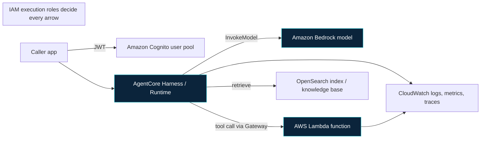

### AWS Lambda in six terms

| Term | Meaning |
|---|---|
| **Function** | Your code plus its configuration (runtime, memory, timeout, role). Billed per request and per millisecond. |
| **Handler** | The function Lambda calls: `lambda_function.lambda_handler`. Receives `event` (the JSON input) and `context` (facts about the run: request ID, time remaining, memory). |
| **Execution role** | The IAM role the running code *becomes*. Lambda assumes it (the trust policy you read in Mission 01) and gives the code temporary credentials. Every AWS call your code makes is authorised against **this** role, not against you. |
| **Timeout** | Default **3 seconds**. A model call can take longer, so you raise it. Maximum 15 minutes. |
| **Cold start / Init** | The first invocation builds the execution environment (`INIT_START` … `Init Duration` in the log). Later calls reuse it. |
| **Deploy** | In the console editor, saving a file is not enough: **Deploy** (⇧⌘U on Mac, Ctrl+Shift+U on Windows) ships the code. |

### Amazon CloudWatch in four terms

**Log group** (one per function, `/aws/lambda/<name>`) → **log streams** (one per execution environment) → **log events** (each line your code prints, plus Lambda's own `START`, `END`, `REPORT`). **Metrics** (Invocations, Duration, Errors, Throttles) are emitted automatically; **alarms** watch a metric; **Logs Insights** is a query language over log events (`fields`, `filter`, `stats`, `sort`).

### Amazon Bedrock in four terms

- **Model catalog:** every foundation model available in the Region, with its **model ID** (`amazon.nova-lite-v1:0`), modalities, pricing and status.
- **On-demand vs. inference profile:** some models accept the plain model ID in this Region; others are reached through a **cross-Region inference profile** (`us.amazon.nova-micro-v1:0`), which routes to several Regions. An IAM policy for a profile must allow the profile ARN *and* the model ARN in every Region it can route to.
- **Converse API:** one request shape for every chat model: `system`, `messages`, `inferenceConfig`. Your Lambda uses it.
- **Tokens:** the unit of billing. The response reports `inputTokens` and `outputTokens`.

### AgentCore execution roles

An AgentCore Harness or Runtime runs *as* an IAM role, exactly like Lambda does. Its trust policy names **`bedrock-agentcore.amazonaws.com`** (the mystery role from Mission 01 is the pattern), and its permissions policy typically allows `bedrock:InvokeModel*` on the models it may use, `bedrock-agentcore:InvokeGateway` on its gateways, `logs:*` on its own log groups, and nothing else. Mission 04 creates these roles for real.

### Amazon Cognito in four terms

**User pool** (a user directory and OAuth 2.0 / OpenID Connect server) → **app client** (an application registered with the pool; public clients have no secret, confidential clients do) → **hosted login pages** on a **domain** (where users sign in) → **tokens** (JWTs: an ID token about the person, an access token about the permission scopes). The pool publishes its **issuer** URL, a **discovery document** and its **JWKS** public keys so that any service, including AgentCore, can verify a token without calling Cognito. Mission 05 wires this into an agent.

### Amazon OpenSearch Service in four terms

A **domain** is a managed OpenSearch cluster (nodes in one or more AZs). It holds **indexes** of JSON **documents**; an index **mapping** declares each field's type, including `knn_vector` for embeddings. Retrieval-augmented agents embed the question, run a **k-NN** search for the nearest vectors, and hand the matching documents to the model. Access is controlled by the domain's **resource-based access policy** plus IAM (and optionally fine-grained access control).

---

## 🪪 Phase 0 — Preflight (5 minutes)

1. Sign in, set the Region to **United States (Oregon)**, and have your `MY_ID` and ledger from Mission 01 ready.
2. Naming for this mission:

| What | Name you will type |
|---|---|
| Lambda function | `orbit-MY_ID-hello` |
| Test event | `ignition-check` |
| Inline policy on your role | `orbit-MY_ID-bedrock-invoke` |
| (Challenge) CloudWatch alarm | `orbit-MY_ID-hello-errors` |

3. **Instructor values** (fill in from the whiteboard):

| Item | Value |
|---|---|
| Cognito hosted login URL | |
| Your recruit user name (`recruitNN`) | |
| Temporary password | |
| OpenSearch domain name | `orbit-academy-search` |

> [!CAUTION]
> `orbit-academy-pool` and `orbit-academy-search` are **shared, read-only**. Look, never edit. Your student permissions explicitly deny changes to them, so an *Access denied* on those pages means you clicked something you were not meant to.

**Resource ledger**

| Property | Your value |
|---|---|
| Function ARN | |
| Log group name | `/aws/lambda/orbit-MY_ID-hello` |
| Request ID of your first successful Bedrock call | |

---

## 🚀 Phase 1 — Create your function (10 minutes)

**Concept:** A function is *code + configuration + role*. You bring the role; the console builds the rest.

1. Search for `Lambda` and open it. In the left navigation choose **Event Functions**, then **Create function** (the console calls them *Event Functions* now; they are ordinary Lambda functions).

   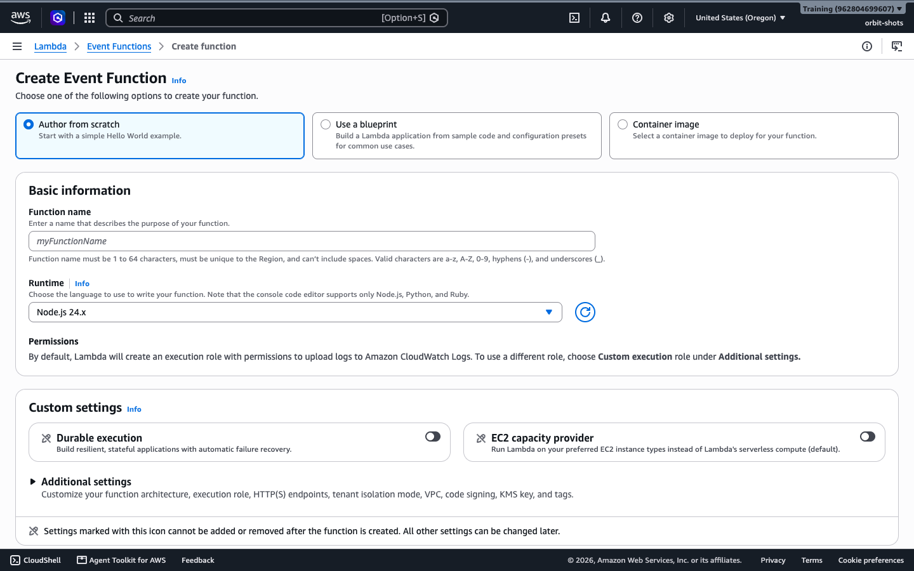

2. Keep **Author from scratch** and fill in **Basic information**:
   - **Function name:** `orbit-MY_ID-hello`
   - **Runtime:** open the dropdown, type `Python`, choose **Python 3.13** (any non-Preview Python works; 3.13 is what the verified run used).
3. Expand **Additional settings** at the bottom. Under **General**, switch on **Custom execution role**. A side panel **Configure custom execution role** opens: under **Execution role** choose **`orbit-MY_ID-lambda-role`** from the dropdown and choose **Save**.

   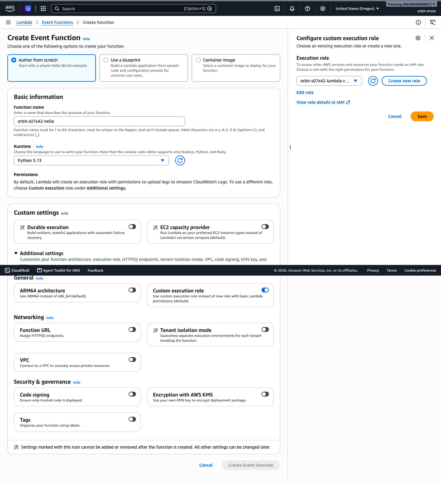

   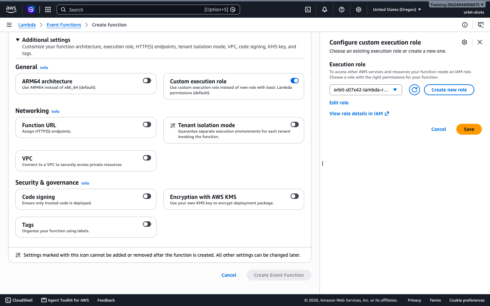

   Why not let the console create a role? It would, and it would be fine, but you would learn nothing about trust policies. The role you built by hand is the one the function will assume.

4. Choose **Create Event Function**. After a few seconds the function page opens with the green banner *Successfully created the function*. A **Getting started** dialog offers local development paths; choose **Dismiss**.

   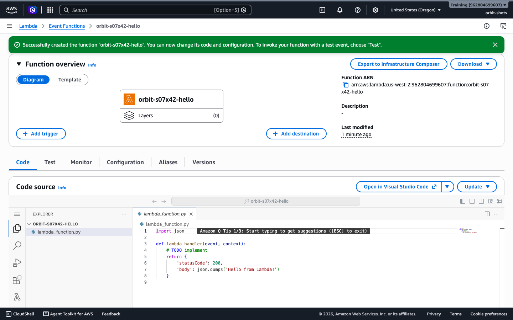

5. Record the **Function ARN** in your ledger. Note the **Runtime settings** card at the bottom: Handler `lambda_function.lambda_handler`, architecture `x86_64`.

**🧩 Investigation checkpoint**

- [ ] The function's **Configuration → Permissions** tab shows the execution role `orbit-MY_ID-lambda-role` (open it to check).
- [ ] I can explain why creating a function needed `iam:PassRole` on that role.

---

## 💻 Phase 2 — Write, deploy, test (10 minutes)

**Concept:** The in-browser editor is VS Code. Edits are local until you **Deploy**. **Test** invokes the function with a JSON event you define and shows the response, a billing summary and the log tail.

1. On the **Code** tab the editor shows `lambda_function.py` with the default *Hello from Lambda* code. Click inside the editor, select all (⌘A / Ctrl+A), delete, and paste this:

   ```python
   # ORBIT Field Academy - Mission 02 - Step 1
   # Runs ONLY inside AWS Lambda. No external dependencies.
   import json
   import os
   import time


   def lambda_handler(event, context):
       """Lambda calls this function once per invocation.
       event   = the JSON input (whatever invoked us sent)
       context = facts about this run (function name, request ID, time left)
       """
       recruit = (event or {}).get("recruit", "unknown recruit")
       print(f"ORBIT telemetry: event received for {recruit}")
       print("ORBIT telemetry: raw event =", json.dumps(event))

       return {
           "statusCode": 200,
           "mission": "02-IGNITION",
           "greeting": f"Ground Control to {recruit}: ignition confirmed.",
           "function_name": context.function_name,
           "request_id": context.aws_request_id,
           "region": os.environ.get("AWS_REGION"),
           "memory_mb": context.memory_limit_in_mb,
           "ms_remaining": context.get_remaining_time_in_millis(),
           "unix_time": int(time.time()),
       }
   ```

2. **Deploy:** press ⇧⌘U (Mac) or Ctrl+Shift+U (Windows), or use the **DEPLOY** section in the editor's left panel. The status changes to **✓ Current · Lambda Deployed** and a banner says *Successfully updated the function*.

   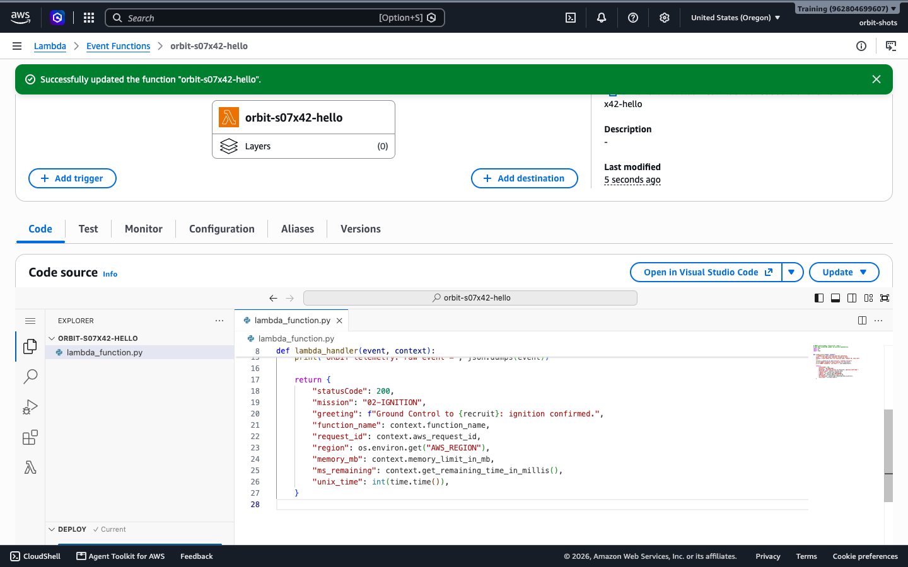

3. Open the **Test** tab (the tab next to *Code*, outside the editor). Under **Test event**:
   - **Test event action:** Create new event
   - **Event name:** `ignition-check`
   - **Event JSON:** replace the template with

     ```json
     {
       "recruit": "MY_ID",
       "question": "In one sentence, what does a Lambda execution role do?"
     }
     ```
   - Choose **Save** (so the event survives page reloads), then the orange **Test**.

   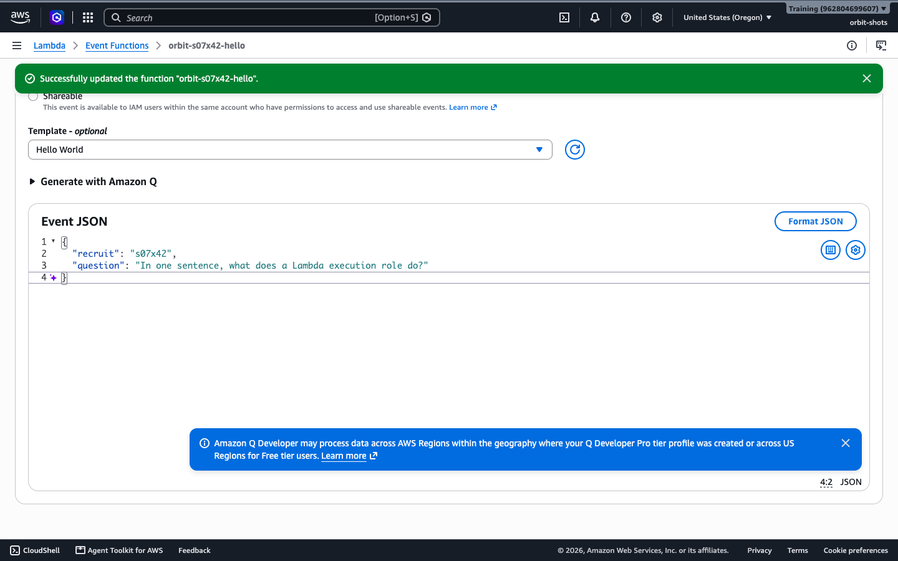

4. A green panel appears: **Executing function: succeeded**. Expand **Details**:
   - **Response:** your JSON, including the greeting and the request ID. Copy the request ID to your ledger.
   - **Summary:** *Duration* (a few milliseconds of your code), *Billed duration*, *Resources configured* 128 MB, *Max memory used* about 36 MB, and on the first run an **Init duration** (the cold start).
   - **Log output:** `START`, your two `ORBIT telemetry` lines, `END`, `REPORT`.

   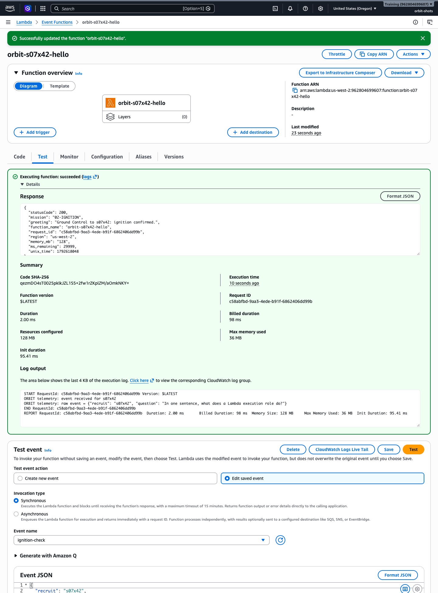

5. Choose **Test** again. No *Init duration* this time: the execution environment was reused.

**🧩 Investigation checkpoint**

- [ ] I can point to the `event` and the `context` values in the response.
- [ ] I know the difference between *Duration* and *Billed duration*, and what *Init duration* was.

---

## 📈 Phase 3 — Telemetry: CloudWatch logs, metrics, and Logs Insights (10 minutes)

**Concept:** Everything your function prints goes to CloudWatch Logs through the execution role's `logs:*` permissions (that is what `AWSLambdaBasicExecutionRole` was for). Metrics come free. This is where you will debug agents later.

1. Open the **Monitor** tab. The graphs (Invocations, Duration, Error count and success rate, Throttles…) fill within a minute or two of your tests.

   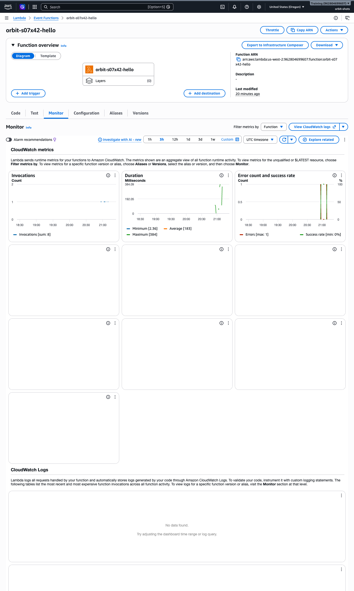

2. Choose **View CloudWatch logs** (top right of the Monitor tab), or search for `CloudWatch` → **Log management** → `/aws/lambda/orbit-MY_ID-hello`. The log group page lists **log streams**, one per execution environment; the stream name contains the date and `[$LATEST]`.

   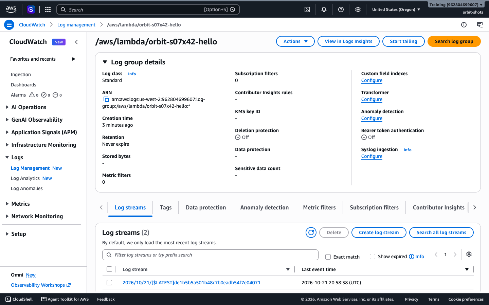

3. Open the newest stream. Each row is a log event. Read the `REPORT` line: `Duration`, `Billed Duration`, `Memory Size`, `Max Memory Used`, and (first run) `Init Duration`. This line is the raw material for every Lambda cost and performance question.

   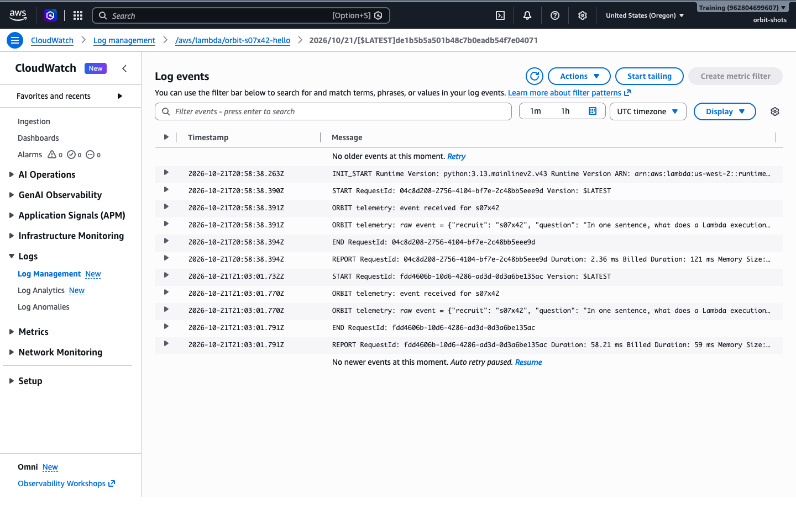

4. In the CloudWatch left navigation choose **Logs → Log Analytics** (the console's new name for Logs Insights). Under **Query scope** keep *1h* and set **Log group =** `/aws/lambda/orbit-MY_ID-hello`, paste the query below into the editor, and choose **Run** (⌘+Enter / Ctrl+Enter). Two `REPORT` rows appear, newest first, with the durations you saw on the Test tab:

   ```
   fields @timestamp, @message
   | filter @message like /REPORT/
   | sort @timestamp desc
   ```

   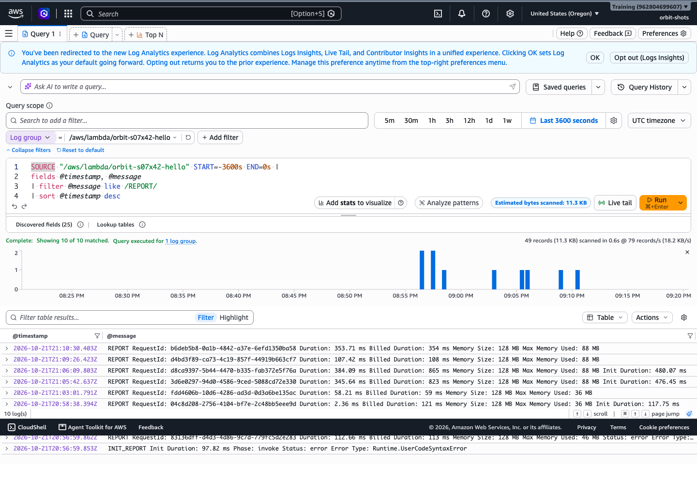

   Try a second one that computes statistics (challenge B does more of this):

   ```
   filter @type = "REPORT"
   | stats count() as invocations, avg(@duration) as avg_ms, max(@maxMemoryUsed)/1024/1024 as max_mb
   ```

**🧩 Investigation checkpoint**

- [ ] I can navigate from a function to its log group to a log stream in under a minute.
- [ ] I can explain why two test invocations landed in the **same** log stream (same execution environment).

---

## 🧠 Phase 4 — Call a foundation model from code, and hit the wall (15 minutes)

**Concept:** Code running under an execution role can call any AWS API **that the role allows**. Your role allows logging and nothing else. Watch what happens when the code asks Bedrock for an answer, read the error the way IAM wrote it, then grant exactly one permission.

1. Back on the **Code** tab, replace the whole file with:

   ```python
   # ORBIT Field Academy - Mission 02 - Step 2
   # Runs ONLY inside AWS Lambda. Uses the boto3 that Lambda already bundles.
   import json
   import os

   import boto3

   MODEL_ID = "amazon.nova-lite-v1:0"          # cheapest text model in US West (Oregon)
   bedrock = boto3.client("bedrock-runtime")   # credentials come from the execution role


   def lambda_handler(event, context):
       recruit = (event or {}).get("recruit", "unknown recruit")
       question = (event or {}).get("question", "In one sentence, what does a Lambda execution role do?")
       print(f"ORBIT telemetry: {recruit} asked: {question}")

       response = bedrock.converse(
           modelId=MODEL_ID,
           system=[{"text": "You are Ground Control for ORBIT Field Academy. Answer in at most two sentences."}],
           messages=[{"role": "user", "content": [{"text": question}]}],
           inferenceConfig={"maxTokens": 120, "temperature": 0.2},
       )

       answer = response["output"]["message"]["content"][0]["text"]
       usage = response["usage"]
       print(f"ORBIT telemetry: tokens in={usage['inputTokens']} out={usage['outputTokens']}")

       return {
           "statusCode": 200,
           "mission": "02-IGNITION",
           "recruit": recruit,
           "model": MODEL_ID,
           "answer": answer,
           "input_tokens": usage["inputTokens"],
           "output_tokens": usage["outputTokens"],
           "region": os.environ.get("AWS_REGION"),
       }
   ```

   **Deploy** (⇧⌘U / Ctrl+Shift+U).

   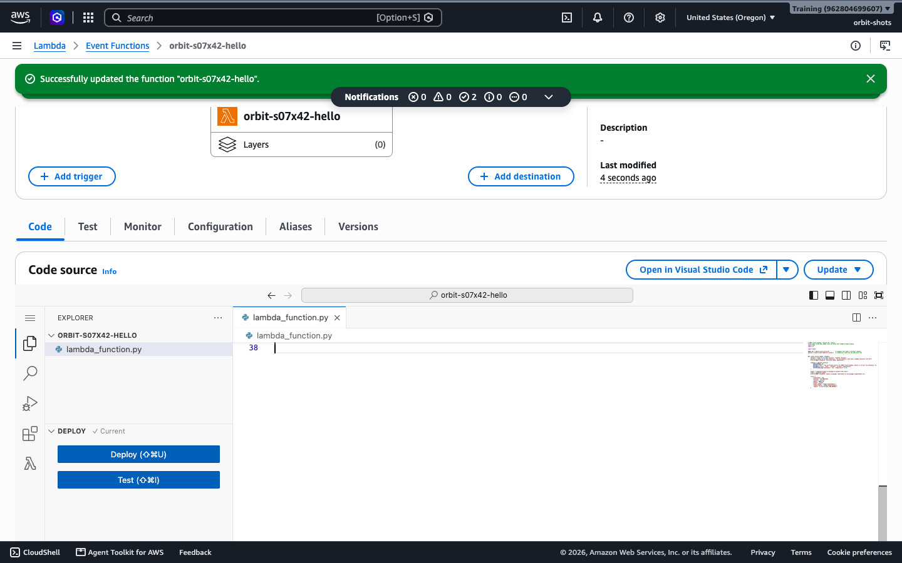

2. **Raise the timeout.** Open **Configuration → General configuration → Edit**. Set **Timeout** to `0` min `30` sec and choose **Save**. (A model call usually takes under a second, but the 3-second default leaves no margin for a slow cold start.)

   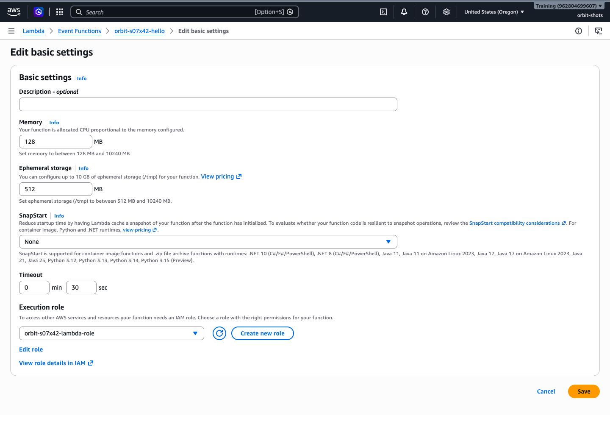

3. Open the **Test** tab and choose **Test** with your saved `ignition-check` event. **It fails.** Expand **Details** and read the **Response**:

   ```
   An error occurred (AccessDeniedException) when calling the Converse operation:
   User: arn:aws:sts::962804699607:assumed-role/orbit-MY_ID-lambda-role/orbit-MY_ID-hello
   is not authorized to perform: bedrock:InvokeModel
   on resource: arn:aws:bedrock:us-west-2::foundation-model/amazon.nova-lite-v1:0
   because no identity-based policy allows the bedrock:InvokeModel action
   ```

   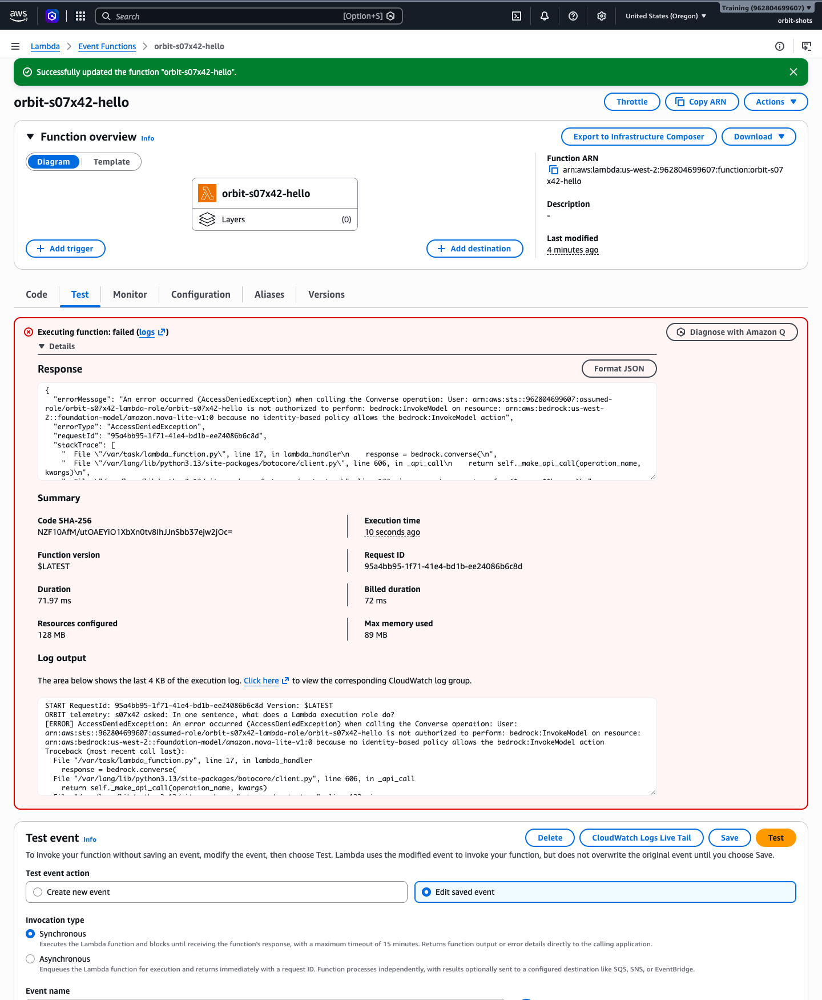

   Read it as four facts. **Who:** the *assumed role* session of your Lambda role (not you). **What:** `bedrock:InvokeModel`. **On which resource:** the Nova Lite model ARN. **Why:** *no identity-based policy allows* it, an **implicit deny** in Mission 01's vocabulary. The fix is therefore an Allow on the role, for that action, on that resource.

4. **Grant exactly that.** Open **IAM → Roles → `orbit-MY_ID-lambda-role` → Add permissions → Create inline policy**. Switch the policy editor to **JSON**, replace the contents with:

   ```json
   {
     "Version": "2012-10-17",
     "Statement": [
       {
         "Sid": "InvokeNovaLiteOnly",
         "Effect": "Allow",
         "Action": "bedrock:InvokeModel",
         "Resource": "arn:aws:bedrock:us-west-2::foundation-model/amazon.nova-lite-v1:0"
       }
     ]
   }
   ```

   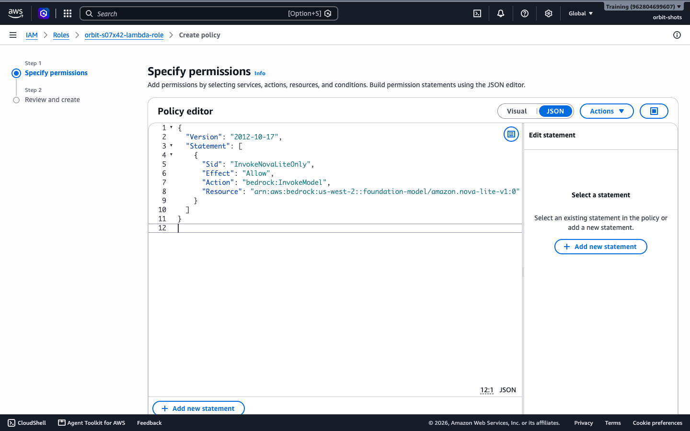

   Choose **Next**. **Policy name:** `orbit-MY_ID-bedrock-invoke`. The review table shows *Bedrock · Limited: Read · region string like us-west-2*. Choose **Create policy**.

   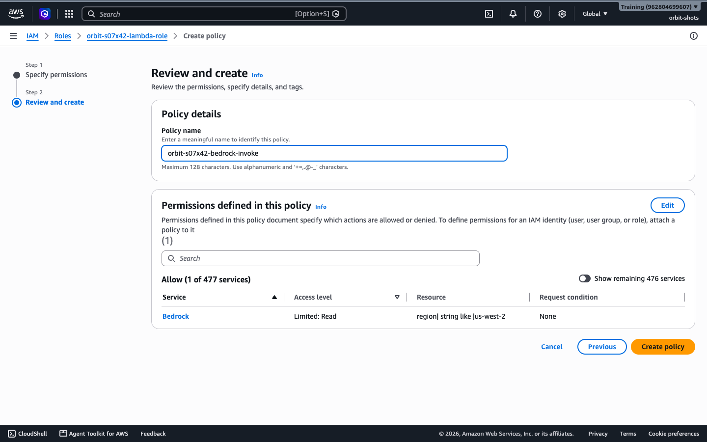

   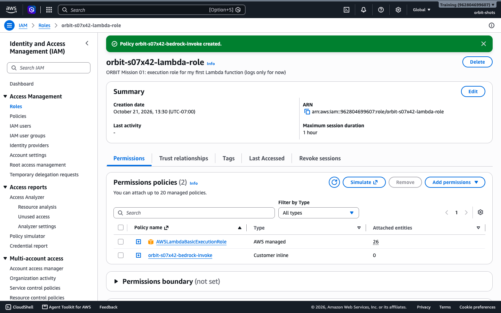

5. Back in Lambda, **Test** again. **Executing function: succeeded.** The response carries the model's answer and the token counts; in the verified run Nova Lite answered *"A Lambda execution role grants AWS Lambda permissions to access AWS resources."* using 30 input and 16 output tokens, and the whole invocation took about 350 ms.

   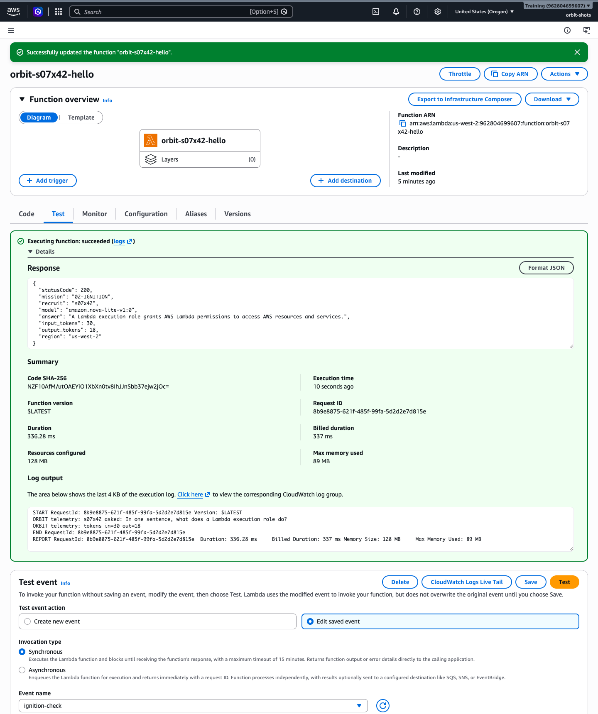

   Record the **Request ID** in your ledger.

**Mini-debrief:** You never gave *yourself* permission to call Bedrock, and you never gave the role `"Resource": "*"`. One action, one model ARN. Change `MODEL_ID` to `amazon.nova-pro-v1:0` and the same error comes back, which is exactly what least privilege is supposed to do. IAM changes propagate in seconds; if the second test still fails, wait ten seconds and test again.

**🧩 Investigation checkpoint**

- [ ] I can recite the four facts in an AccessDenied message.
- [ ] I can say why the policy went on the **role** and not on my user.
- [ ] I know what would have to change in the policy to use a model through a `us.` inference profile (see the concepts section).

---

## 🧭 Phase 5 — Scouting Amazon Bedrock (5 minutes)

1. Search for `Bedrock` and open **Amazon Bedrock**. In the left navigation choose **Model catalog**. Filter by provider **Amazon** and find **Nova Lite**. Each card shows the modalities (text, image, video in), context length and whether the model is available in this Region.

   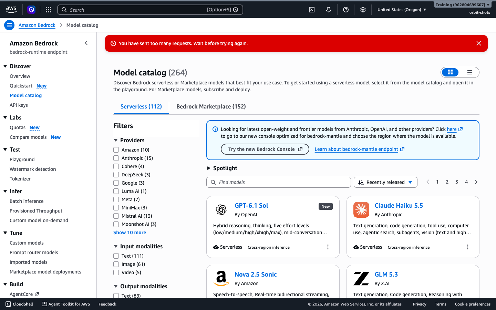

2. Open **Nova Lite**. The detail page shows the **Model ID** you used in code (`amazon.nova-lite-v1:0`), the input modalities (text, image, video), the 300K-token context window, **Deployment type: Serverless** (on-demand in this Region), a pricing link, and under *Usage* a code example for the very Converse call your function makes. Models that are only reachable through a cross-Region profile show the `us.` profile ID here instead.

   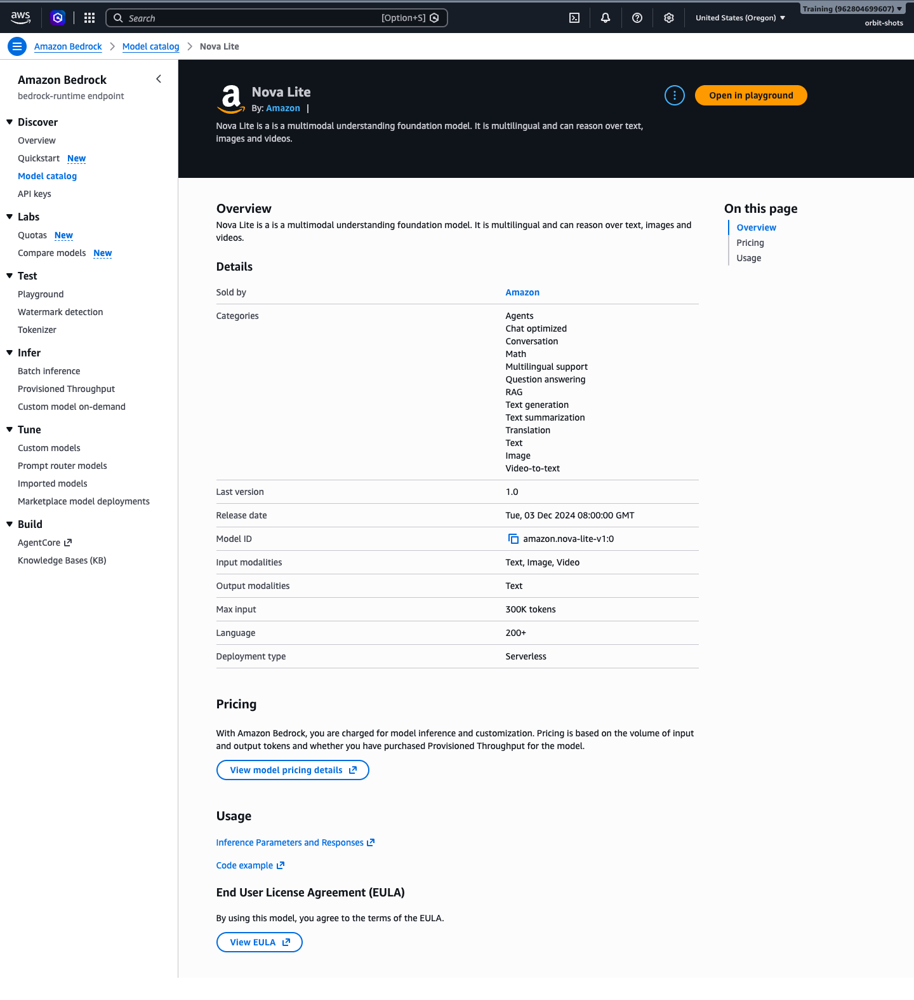

3. Choose **Model access** in the left navigation. In this account the Amazon and Anthropic models the course uses are **Available**. If a model is not, this is where an administrator requests access; no code or policy can bypass it.

   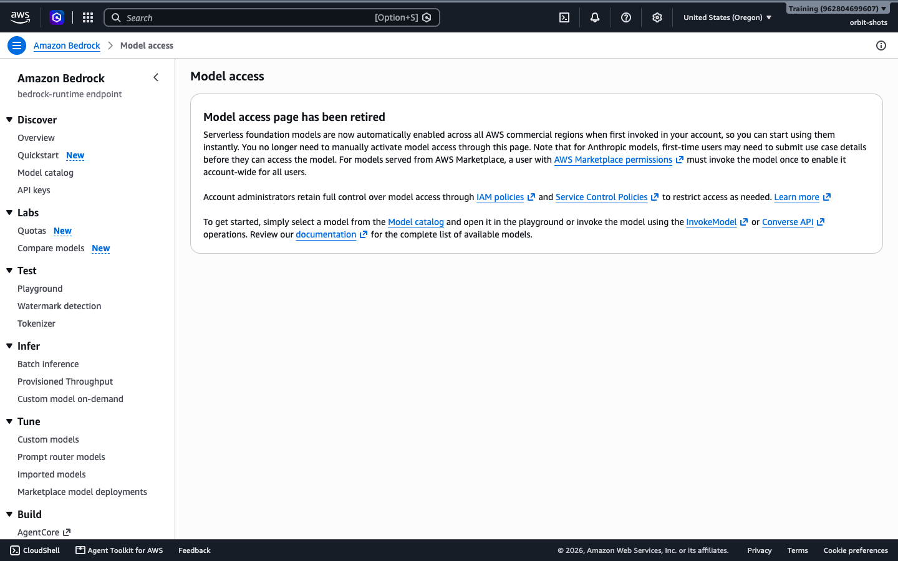

**🧩 Investigation checkpoint**

- [ ] I can find a model's ID and ARN in the catalog without guessing.
- [ ] I can explain the two gates a model call passes: **model access** (account level) and **IAM** (role level).

---

## 🤖 Phase 6 — Scouting AgentCore and its execution roles (10 minutes)

**Concept:** Amazon Bedrock AgentCore is where the ORBIT agent will live from Mission 04 on. Today you learn the map and the one security idea that carries over from Lambda: **an agent runs as a role**.

1. Search for `AgentCore` and open **Amazon Bedrock AgentCore**. The **Overview** lists the building blocks: **Harness** (an agent defined by configuration), **Runtime** (the secure micro-VMs it runs in), **Gateways** (tools exposed through the Model Context Protocol), **Memory**, **Policy**, **Identity**, **Built-in tools** (Browser, Code Interpreter, Knowledge Bases), and under *Assess*, **Observability** and **Evaluations**.

   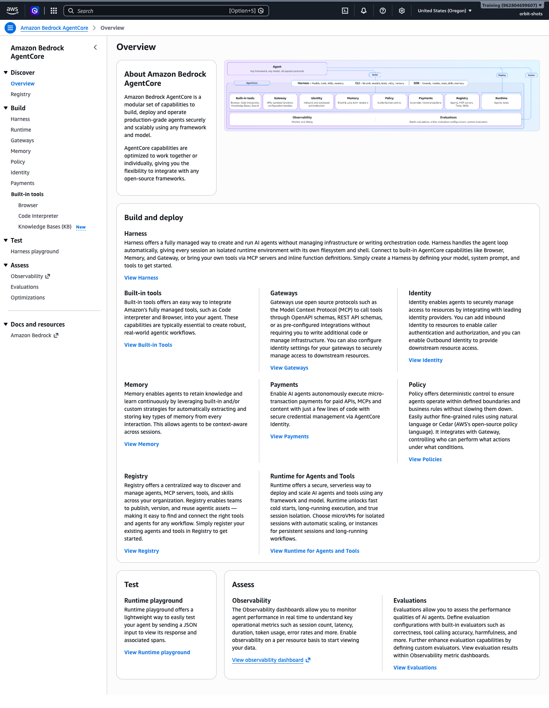

2. Open **Harness**. The list is where your agent will appear in Mission 04. Read the three cards: create, test in the playground, assess with observability.

   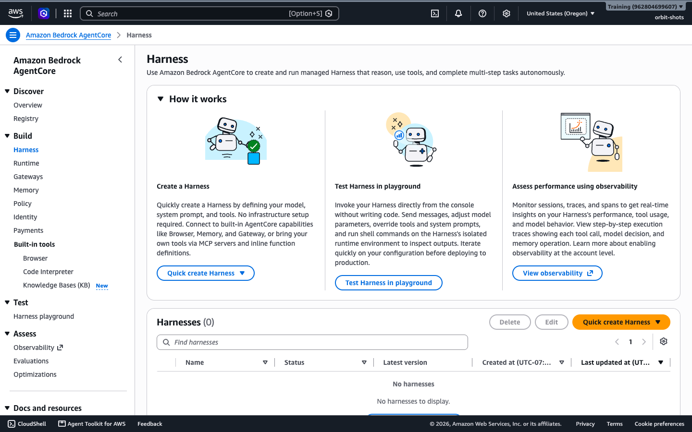

3. Open **Identity**. This is where **inbound** authentication (who may call the agent: IAM or a JWT from a pool like the Cognito one you inspect next) and **outbound** credentials (how the agent authenticates to other APIs) are configured.

   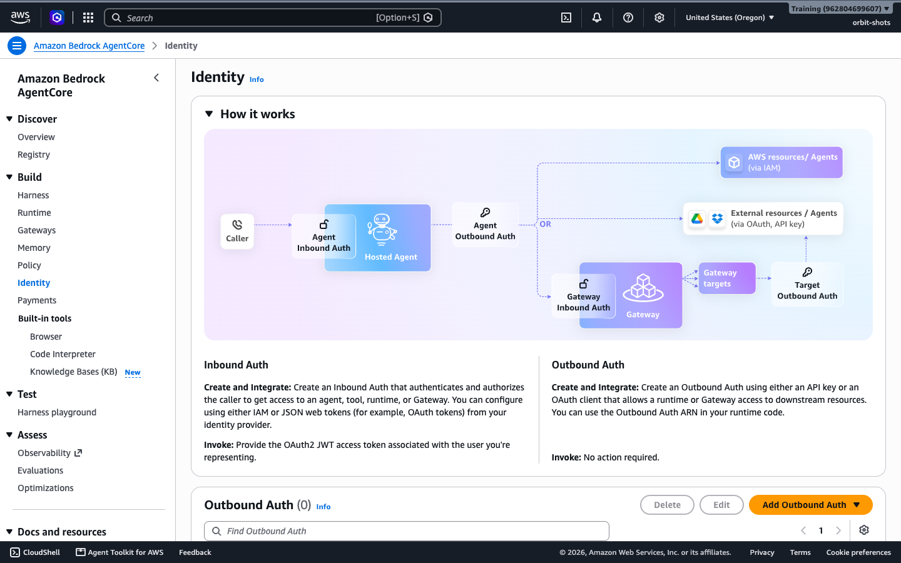

4. Open **Observability**. Agent sessions, traces and spans land here, on top of the same CloudWatch you used in Phase 3.

   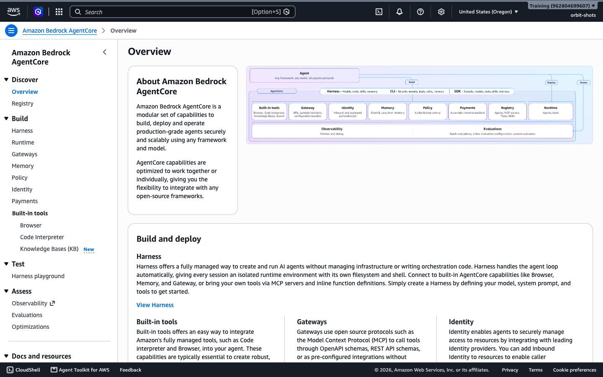

5. **The execution-role comparison.** Open IAM in a second tab and put the two trust policies side by side:

| | Your Lambda role (Mission 01, Phase 5) | The mystery role (Mission 01, Phase 4) = AgentCore pattern |
|---|---|---|
| Trusted service principal | `lambda.amazonaws.com` | `bedrock-agentcore.amazonaws.com` |
| Conditions | none | `aws:SourceAccount` = this account, `aws:SourceArn` like `arn:aws:bedrock-agentcore:us-west-2:ACCOUNT:*` |
| Typical permissions | `logs:*` (basic execution) + what the code needs (`bedrock:InvokeModel` on one model) | `bedrock:InvokeModel*` on allowed models and inference profiles, `bedrock-agentcore:InvokeGateway` on its gateways, `logs:*` on `/aws/bedrock-agentcore/runtimes/*`, read-only tool access, explicit denies on writes |

   The two roles are the same idea with different principals. In Mission 04 the console creates an AgentCore role for you; now you will be able to read it.

**🧩 Investigation checkpoint**

- [ ] I can name the AgentCore building block that would host the Lambda function as a **tool** (Gateway) and the one that would hold the **agent** (Harness).
- [ ] I can explain why an agent's role should not be the same role as its tools' roles.

---

## 🔐 Phase 7 — Inspect the Cognito user pool, then get a real token (10 minutes)

**Concept:** AgentCore and APIs do not know your users; they trust **tokens** issued by an identity provider. The instructor's pool `orbit-academy-pool` is such a provider. You will read its configuration, confirm that its public endpoints are really public, and sign in as a recruit to see where a token comes from.

1. Search for `Cognito` and open it. **User pools** lists every pool in the account; open **`orbit-academy-pool`**.

   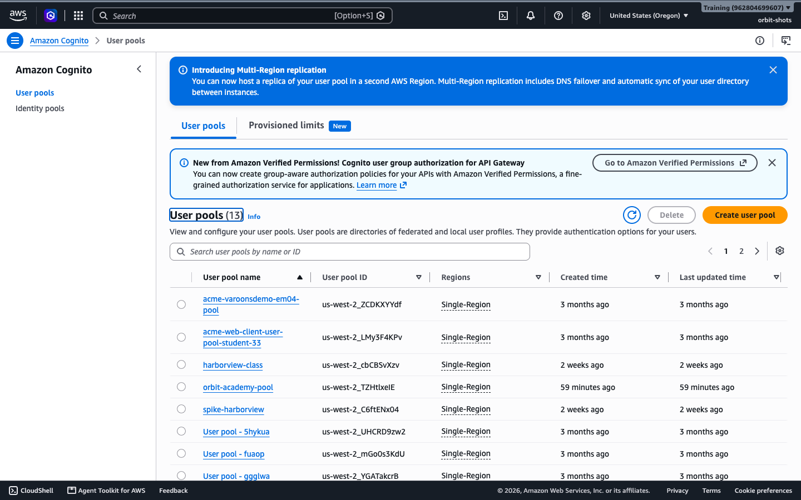

2. The pool **Overview** shows the **User pool ID** (`us-west-2_…`), the ARN, the **estimated number of users** (31), the feature plan (*Essentials*), and two URLs you will use in a moment: the **OpenID Connect configuration URL** and the **Token signing key URL**.

   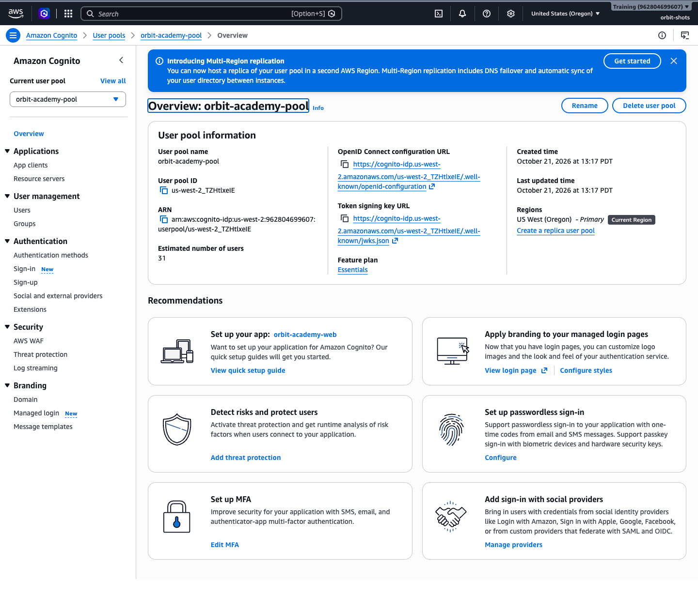

3. In the left navigation choose **User management → Users**: thirty recruits with **Confirmation status** *Force change password* until each one signs in for the first time. Find your own `recruitNN`.

   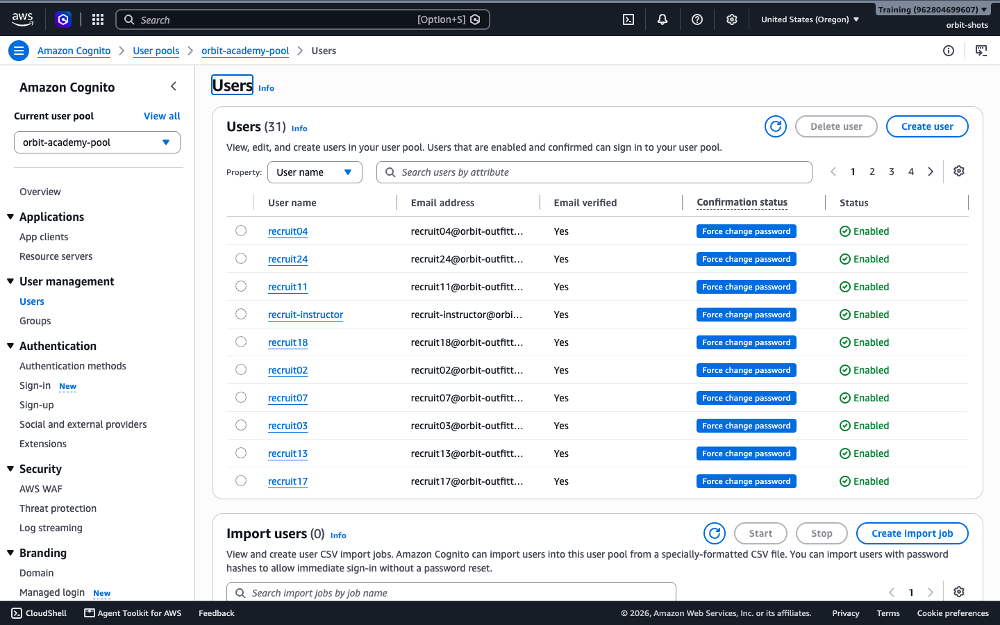

4. Choose **Applications → App clients** and open **`orbit-academy-web`**. **App client information** shows the **Client ID**, **Client secret: -** (a **public** client has none), the authentication flows (*Choice-based sign-in*, *Secure remote password (SRP)*), and the token lifetimes (access and ID tokens 60 minutes, refresh token 1 day). Open the **Login pages** tab: the **allowed callback URLs** (`https://localhost:8080/callback`), the OAuth grant **Authorization code**, the scopes (`openid`, `email`, `profile`, `orbit-academy-api/read`) and the pool's **domain** (`orbit-academy-….auth.us-west-2.amazoncognito.com`), where the hosted sign-in lives.

   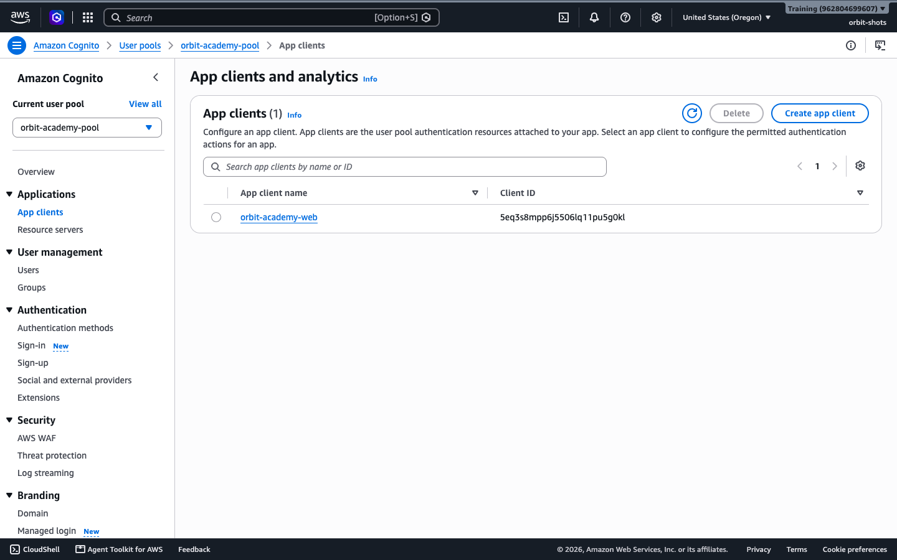

   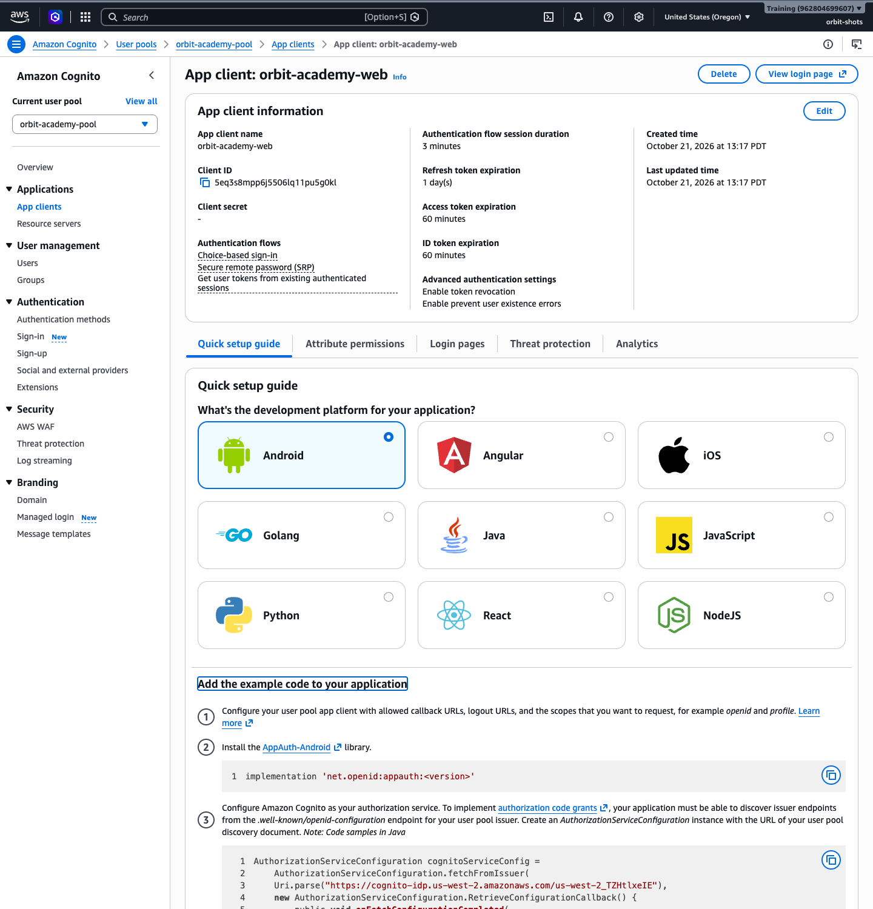

5. **Public by design.** In a new browser tab open the pool's discovery document (replace the pool ID with the one on the Overview page):

   ```
   https://cognito-idp.us-west-2.amazonaws.com/POOL_ID/.well-known/openid-configuration
   ```

   You get JSON with `issuer`, `authorization_endpoint`, `token_endpoint`, `jwks_uri` and the supported scopes, with no sign-in. Open the `jwks_uri` too: two RSA public keys. Any service can verify a token offline with those; the private keys never leave Cognito. This URL is what Mission 05 pastes into AgentCore as the *discovery URL*.

6. **Sign in as a recruit.** Open the hosted login URL from the whiteboard. The managed login page asks for your **Username** (`recruitNN`) → **Next**, then the temporary **Password** → **Sign in**, then, because the account is in *Force change password* state, a **new password** (10+ characters with upper, lower, number and symbol, typed twice). After you set it, the browser is sent to `https://localhost:8080/callback?code=…` and shows *This site can't be reached*. **That is expected**: nothing is listening on your laptop. Look at the address bar: the `code` is a one-time **authorization code** that a real app would exchange for tokens within five minutes. Copy it if you intend to do Challenge C right away.

   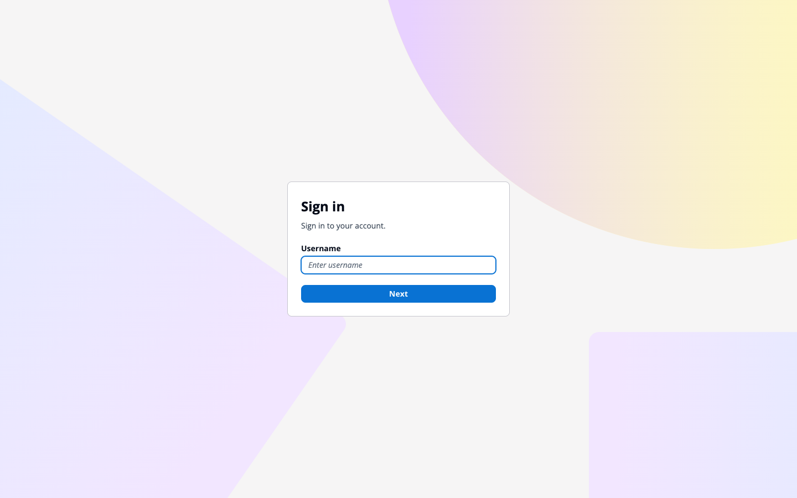

   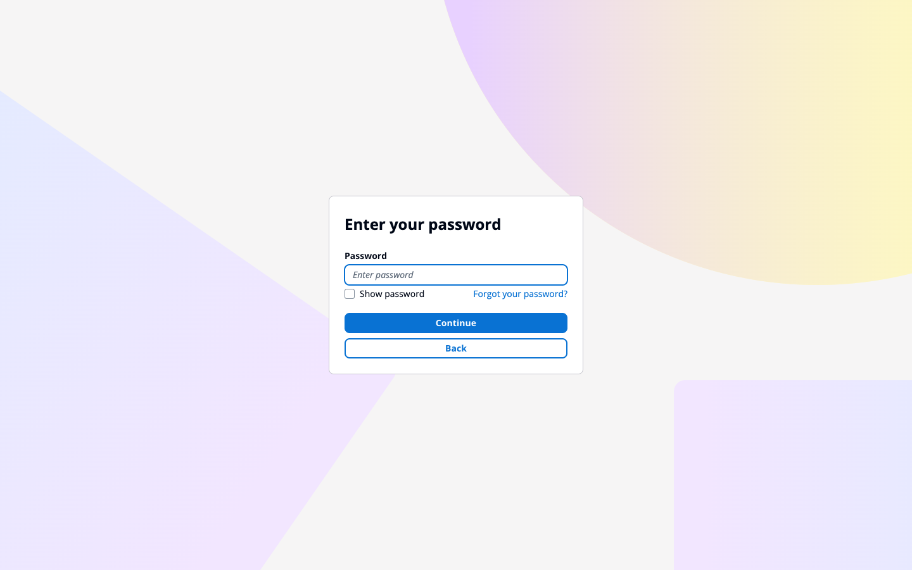

   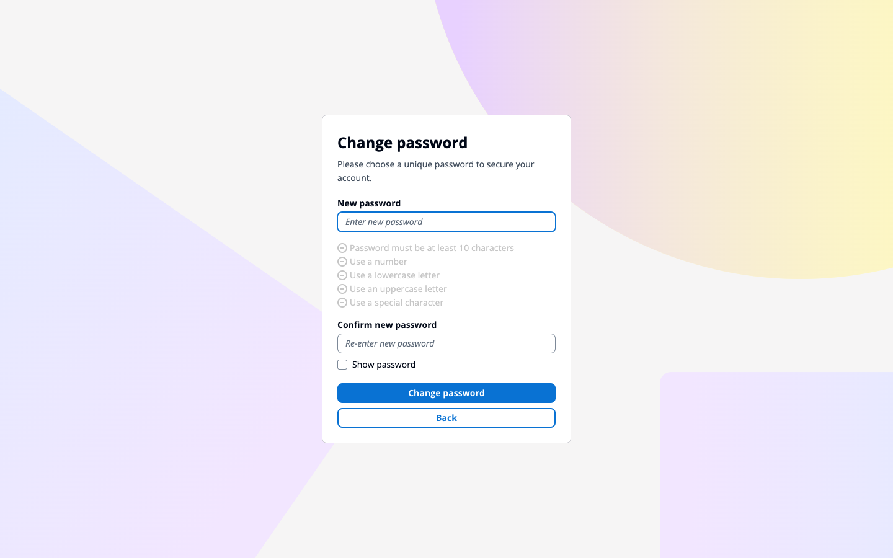

   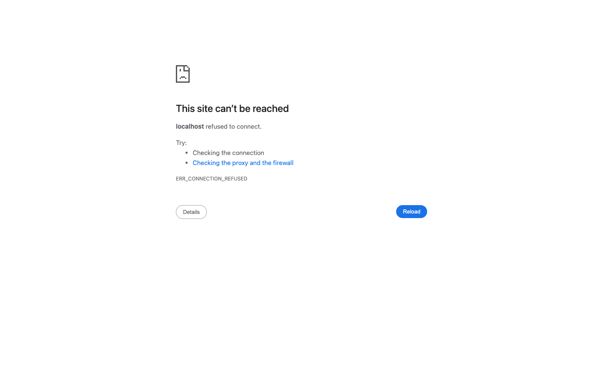

**🧩 Investigation checkpoint**

- [ ] I can say which Cognito objects are **public** (issuer, discovery document, JWKS, login page, client ID) and which are **secret** (passwords, private signing keys, a confidential client's secret).
- [ ] I can explain why an app client with no secret still cannot be abused to log in as someone else.

---

## 🔎 Phase 8 — Inspect the OpenSearch domain (5 minutes)

**Concept:** Managed knowledge bases (Mission 03) hide the vector store. An OpenSearch domain is that store with the lid off: you can see the nodes, the index and the vector field.

1. Search for `OpenSearch` and open **Amazon OpenSearch Service → Domains**. Open **`orbit-academy-search`**.

   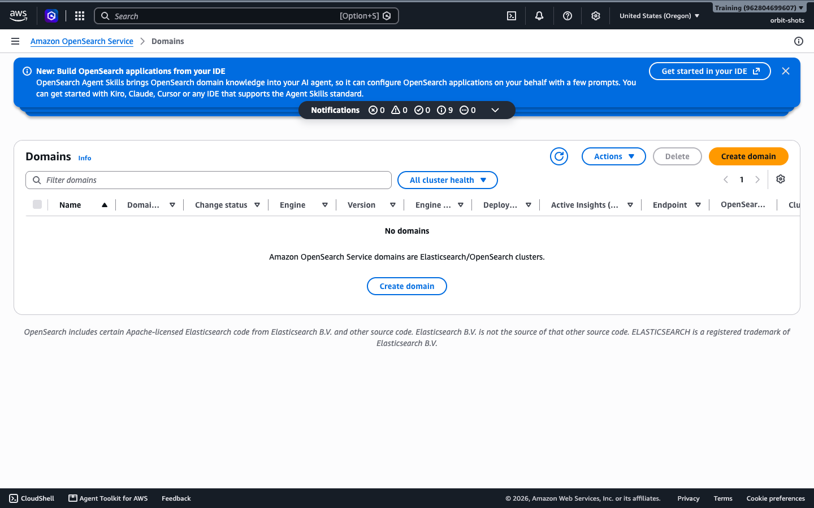

2. On the domain dashboard read **General information**: the **Domain endpoint** (`https://search-orbit-academy-search-….us-west-2.es.amazonaws.com`), the **engine version** (OpenSearch 2.19), **Deployment type** (dev/test, single AZ), the **data node** type (`t3.small.search`, 1 node) and storage (10 GiB gp3). Note the domain ARN.
3. Check **Cluster health**: with a single node the *cluster status* is **green** only when every index has zero replicas; a yellow status means replica shards have nowhere to go. The sample index is configured with zero replicas, so expect green.
4. Open **Security configuration**. The **access policy** is a resource-based policy: it allows the instructor identity everything (`es:*`) and the account's other identities only `es:ESHttpGet` and `es:ESHttpHead` on the domain. Fine-grained access control is off for this teaching domain. Compare the shape of this document with the trust policy of a role: a **Principal** element, because the policy sits on the resource and must say *who*.
5. The domain holds one index, `orbit-policies`, with four ORBIT policy documents and an 8-dimensional `knn_vector` field called `embedding` (real embeddings have 256–1,536 dimensions). Challenge D shows you the mapping from CloudShell.

**🧩 Investigation checkpoint**

- [ ] I can explain why a resource-based policy needs a `Principal` and an identity-based policy does not.
- [ ] I can describe, in one sentence each, *domain*, *index*, *document* and *vector field*.

---

## 🏆 Phase 9 — Challenge exercises (optional)

### Challenge A · Alarm bell (CloudWatch)

Create an alarm that fires when your function errors. **CloudWatch → Alarms → Create alarm → Select metric → Lambda → By Function Name → `orbit-MY_ID-hello` · Errors** → statistic *Sum*, period *1 minute*, threshold *Greater or equal to 1*, name `orbit-MY_ID-hello-errors`, no notification. Then break the function on purpose: change `MODEL_ID` to `"amazon.nova-pro-v1:0"`, deploy, and test (AccessDenied, because your policy names only Nova Lite). Within one to three minutes the alarm state moves *Insufficient data → In alarm*. Fix the model ID, deploy, and watch it return to *OK* after the next successful test. Delete the alarm when done.

### Challenge B · Telemetry analyst (Logs Insights)

Write one Logs Insights query over your log group that returns: number of invocations, average and maximum duration, maximum memory used in MB, and the number of cold starts (hint: `@initDuration` exists only on cold-start `REPORT` lines; use `count(@initDuration)`). Then answer: at 128 MB, how many invocations of your Bedrock function would one dollar buy at $0.0000167 per GB-second plus $0.20 per million requests?

### Challenge C · Token autopsy (Cognito + CloudShell)

Within five minutes of signing in (Phase 7 step 6), exchange the authorization code for tokens. In CloudShell, replace the values and run:

```bash
DOMAIN=orbit-academy-XXXXX.auth.us-west-2.amazoncognito.com   # from App client → Login pages
CLIENT_ID=XXXXXXXXXXXXXXXXXXXXXXXXXX                            # from App client
CODE=PASTE_THE_CODE_FROM_THE_ADDRESS_BAR
curl -s -X POST "https://$DOMAIN/oauth2/token" \
  -H 'Content-Type: application/x-www-form-urlencoded' \
  -d "grant_type=authorization_code&client_id=$CLIENT_ID&code=$CODE&redirect_uri=https%3A%2F%2Flocalhost%3A8080%2Fcallback" > /tmp/tokens.json
python3 - <<'PY'
import json, base64
t = json.load(open('/tmp/tokens.json'))
for name in ('id_token', 'access_token'):
    payload = t[name].split('.')[1]
    payload += '=' * (-len(payload) % 4)
    print(f"--- {name} ---")
    print(json.dumps(json.loads(base64.urlsafe_b64decode(payload)), indent=2))
PY
```

Questions: which claim says who issued the token (`iss`) and does it match the discovery document? Which token carries your `cognito:username`, and which carries `scope`? What is `exp` minus `iat`? Why would AgentCore reject this exact token if its *allowed clients* list named a different client ID? (If the code has expired you get `invalid_grant`; sign in again for a fresh one.)

### Challenge D · Vector safari (OpenSearch + CloudShell)

Every request to the domain must be **signed**, exactly like the STS call in Mission 01. In CloudShell:

```bash
ENDPOINT=https://search-orbit-academy-search-XXXX.us-west-2.es.amazonaws.com   # from General information
eval $(aws configure export-credentials --format env)
sig() { curl -s --aws-sigv4 aws:amz:us-west-2:es --user "$AWS_ACCESS_KEY_ID:$AWS_SECRET_ACCESS_KEY" -H "x-amz-security-token: $AWS_SESSION_TOKEN" "$@"; }
sig "$ENDPOINT/_cat/indices?v"
sig "$ENDPOINT/orbit-policies/_mapping" | python3 -m json.tool
sig "$ENDPOINT/orbit-policies/_search?q=tent&pretty"
```

Find the `knn_vector` field and its `dimension`. Then try an unsigned `curl` on the same URL and a signed `PUT` (`-X PUT "$ENDPOINT/orbit-policies/_doc/test" -d '{}'`): which error do you get for each, and which policy statement decides it?

### Challenge E · Change the model (Bedrock + IAM)

Switch `MODEL_ID` to the Nova Micro inference profile `us.amazon.nova-micro-v1:0`, deploy, test, and read the new AccessDenied. Extend your inline policy so the call works **without** using `*` as the resource. Hint: a cross-Region profile needs the profile ARN (`arn:aws:bedrock:us-west-2:ACCOUNT:inference-profile/us.amazon.nova-micro-v1:0`) *and* the foundation-model ARN in each Region it routes to (`arn:aws:bedrock:*::foundation-model/amazon.nova-micro-v1:0`). Set it back to Nova Lite when you are done.

### Challenge F · Configuration, not code

Move `MODEL_ID` into an **environment variable** (Configuration → Environment variables) and read it with `os.environ["MODEL_ID"]`. Why is this the right place for a model ID and the wrong place for a client secret?

---

## 🏁 Mission completion · Earn the Ignition Badge

One line each, in your own words:

1. **Execution role** — who assumes it and when.
2. **REPORT line** — three numbers it gives you.
3. **AccessDenied** — the four facts in the message.
4. **Model access vs. IAM** — the two gates.
5. **Token** — what a user pool publishes so others can verify one.

- [ ] My function ran, logged, and answered a question through Nova Lite with a one-model policy.
- [ ] I found its log group, read a `REPORT` line, and ran a Logs Insights query.
- [ ] I toured Bedrock and AgentCore and can describe an AgentCore execution role.
- [ ] I inspected the shared Cognito pool and OpenSearch domain and know what is public, what is secret, and what is read-only.

---

## 🧯 Shared-account guardrails, costs, and cleanup

**Cleanup at the end of the course** (your own resources only):

1. Lambda → Event Functions → `orbit-MY_ID-hello` → **Actions → Delete**.
2. CloudWatch → Alarms → `orbit-MY_ID-hello-errors` → Delete (if you did Challenge A).
3. CloudWatch → Log management → `/aws/lambda/orbit-MY_ID-hello` → Delete (optional; it costs a fraction of a cent per month).
4. IAM → Roles → `orbit-MY_ID-lambda-role` → Delete (last; Mission 04 creates its own roles).

Never touch `orbit-academy-pool`, `orbit-academy-search`, or `orbit-academy-mystery-role`.

**What this mission costs** (US West (Oregon) list prices, October 2026):

| Item | Price | Typical use | Cost per participant |
|---|---|---|---|
| Lambda requests and duration | $0.20 per 1M requests; $0.0000167 per GB-second | about 8 invocations, 128 MB, < 1 s each | < $0.001 |
| Nova Lite via the Converse API | $0.06 per 1M input tokens, $0.24 per 1M output tokens | about 3 calls × 50 tokens | < $0.001 |
| CloudWatch Logs ingestion | $0.50 per GB | a few KB | < $0.001 |
| CloudWatch alarm (Challenge A) | $0.10 per alarm-month after 10 free | 1, deleted | $0 |
| IAM, Bedrock catalog, AgentCore console, Cognito (31 users), OpenSearch *inspection* | free | | $0 |
| **Total** | | | **effectively $0** |

The instructor's OpenSearch domain (`t3.small.search`) costs about **$0.90 per day** while it exists and is deleted after the course.

**Quotas that matter with 20+ people at once:** Lambda allows 1,000 concurrent executions (you use one at a time); the Bedrock on-demand throughput for Nova Lite is shared, so a `ThrottlingException` means wait a few seconds and test again; CloudShell allows **10 concurrent sessions per account per Region**, so Challenges C and D run in waves.

### If something fails

| Symptom | Check |
|---|---|
| Create function fails with a role error | You chose a role without your `MY_ID`, or the role's trust policy is not Lambda; recreate it as in Mission 01 Phase 5 |
| `Runtime.UserCodeSyntaxError` on test | Indentation changed on paste; select all in the editor, delete, paste again from the guide, Deploy |
| Test shows *Task timed out after 3.00 seconds* | You skipped Phase 4 step 2; set the timeout to 30 s |
| AccessDenied persists after the policy | Policy is on the **role** (not the user), resource ARN is exactly the Nova Lite ARN, Region in the ARN is `us-west-2`; wait 10 s and retry |
| `ValidationException … model identifier is invalid` | Typo in `MODEL_ID`, or you used a profile ID without the `us.` prefix |
| Logs Insights returns nothing | Log group selected, time range *1h*, you invoked the function at least once |
| Hosted login says *An error was encountered with the requested page* | Copy the login URL exactly from the whiteboard (client ID and redirect URI must match the app client) |
| Cognito *Access denied* on Edit | Correct: students are read-only on the shared pool |
| OpenSearch `sig` returns `403 … explicit deny` on PUT | Correct: the access policy allows the account only GET and HEAD |

**AWS docs to consult:** [Lambda execution role](https://docs.aws.amazon.com/lambda/latest/dg/lambda-intro-execution-role.html) · [Lambda console code editor](https://docs.aws.amazon.com/lambda/latest/dg/code-editor.html) · [Lambda REPORT log line](https://docs.aws.amazon.com/lambda/latest/dg/monitoring-cloudwatchlogs.html) · [Logs Insights query syntax](https://docs.aws.amazon.com/AmazonCloudWatch/latest/logs/CWL_QuerySyntax.html) · [Bedrock Converse API](https://docs.aws.amazon.com/bedrock/latest/userguide/conversation-inference.html) · [Bedrock inference profiles and IAM](https://docs.aws.amazon.com/bedrock/latest/userguide/inference-profiles-prereq.html) · [AgentCore execution roles](https://docs.aws.amazon.com/bedrock-agentcore/latest/devguide/runtime-permissions.html) · [Cognito user pool OIDC endpoints](https://docs.aws.amazon.com/cognito/latest/developerguide/userinfo-endpoint.html) · [OpenSearch Service access policies](https://docs.aws.amazon.com/opensearch-service/latest/developerguide/ac.html).

*End of Mission 02 · Next: Mission 03, THE KNOWLEDGE HEIST — the Bedrock Playground, a real knowledge base, and the line between evidence and action.*
