# 🛰️ ORBIT FIELD ACADEMY
## MISSION 03 · THE KNOWLEDGE HEIST
### Amazon Bedrock, foundation models, and a real retrieval knowledge base

> **LEVEL:** Discovery · **TARGET TIME:** 75–90 minutes · **ENVIRONMENT:** AWS Management Console only
> **THE STORY:** A fictional retailer, **ORBIT Outfitters**, has lost control of its support answers. Your mission: prove what a foundation model actually knows, give it reliable policy evidence, and decide what should be an *agent action* instead of a generated sentence.

**You will actually use AWS.** Everything in this mission happens in your web browser inside the AWS Management Console: the Amazon Bedrock **Playground** and the Amazon Bedrock AgentCore **Knowledge Bases (KB)** console. There is no terminal, no code to download, and nothing to install.

> [!NOTE]
> **This guide was last verified against the live AWS Console on October 20, 2026** in the US West (Oregon) Region. The screenshots show exactly what a participant with the example ID `s07x42` saw. AWS changes its console regularly, so if a button has moved, look for the same words nearby.

---

## 🎯 Mission outcomes

By the end, you will be able to:

- Explain **foundation model vs. chatbot vs. workflow vs. agent**, and why the differences matter.
- Tell apart **model inference**, **retrieval**, **tool invocation**, and **an external side effect**.
- Create a real **managed knowledge base**, add policy documents **inline in the console**, and inspect the retrieved evidence.
- Explain the difference between **retrieval only** and **retrieval with answer generation**.
- Describe what the old **Bedrock Agents Classic** service bundled together, and what AgentCore replaces it with.

---

## 📖 Before you start: the concepts in this mission

If you are new to AWS or to generative AI, read this section first. Everything you click later maps back to one of these ideas.

### AWS basics you need today

| Term | What it means in plain language |
|---|---|
| **AWS account** | The billing and security boundary everything lives in. In this class **up to 30 people share one account**, which is why every resource you create must carry your personal ID. |
| **Region** | A physical cluster of AWS data centres (for example **US West (Oregon)**, code `us-west-2`). Resources are created in one Region and are invisible from other Regions. Everyone in the class uses the **same Region**. |
| **AWS Management Console** | The web UI at `console.aws.amazon.com`. The top bar has a search box (type a service name such as `Bedrock`) and a Region selector at the top right. |
| **IAM (Identity and Access Management)** | The permission system. *Who* can do *what* to *which* resource. You sign in as an IAM identity; AWS services act through **IAM roles** that you will see created automatically. |
| **Service role** | An IAM role that an AWS service assumes to do work on your behalf. The knowledge base you create today gets its own role so that the Bedrock service can read your documents and write its index. |
| **ARN** | *Amazon Resource Name*. A globally unique string such as `arn:aws:bedrock:us-west-2:123456789012:knowledge-base/ABC123` that identifies one resource. You will copy ARNs into other services in later missions. |

### Generative AI basics you need today

- **Foundation model (FM):** A large neural network trained on huge amounts of public text. Given a prompt, it predicts the most likely continuation. Amazon Bedrock hosts many FMs from several providers (Amazon Nova, Anthropic Claude, Meta Llama, and more) behind one API, so you never run the model yourself.
- **Inference:** One call to the model: prompt in, generated text out. Inference is billed by **tokens** (roughly 3/4 of an English word). The Playground shows the input and output token counts for every call so you can see the meter run.
- **Hallucination:** When an FM produces a confident, fluent answer that is not grounded in any real source. The model does not "know" your company's return policy; it only knows language patterns.
- **Chatbot vs. workflow vs. agent:**
  - A **chatbot** holds a conversation and returns text. It cannot look anything up unless something else is wired in.
  - A **workflow** is a fixed sequence of steps written by a developer. Deterministic, predictable, not adaptive.
  - An **agent** uses a model to *decide* which tools to call, observes the results, and iterates until the task is done. Powerful, but it needs guard rails. Missions 04 and 05 build one.
- **RAG (Retrieval-Augmented Generation):** Instead of hoping the model memorised your policy, you store your documents in a **knowledge base**, find the most relevant passages for each question (**retrieval**), and hand those passages to the model together with the question (**augmented generation**). The answer is then **grounded** in evidence you control, and the model can **cite** which passage it used.
- **Embeddings and vector search:** To find "relevant" passages, the knowledge base converts every chunk of text into a long list of numbers (an **embedding**) that captures meaning. Your question is embedded the same way, and the store returns the chunks whose numbers are closest. A **managed knowledge base** does the chunking, embedding, storage and search for you.
- **Tool vs. knowledge:** Retrieval is **read-only evidence**. A **tool** is an action (look up an order, issue a refund). Keeping these separate is the single most important design idea in this course.

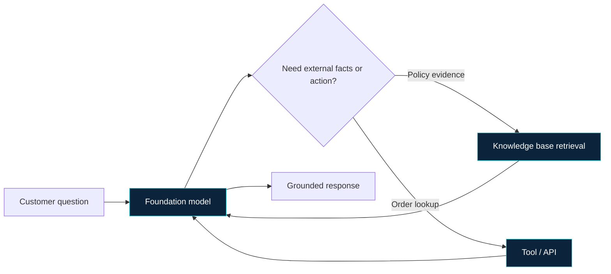

**Important:** A model can *describe* a refund without actually issuing one. A tool call must be connected to authorized code or a service that performs the refund. Your task is to recognize the boundary.

---

## 🪪 Mission launch: claim your namespace (5 minutes)

You are sharing the **same AWS account** with up to 29 other people. Every resource name you type today must include your own suffix so that nothing collides and nobody edits anyone else's work.

1. Sign in to the AWS Console with the credentials your instructor gave you.
2. In the **top-right Region selector**, choose **US West (Oregon)**. Check it before every mission; the console sometimes remembers a different Region per service.
3. Choose your unique identifier, `MY_ID`: your **class seat number plus two random digits**, all lowercase, no spaces, for example `s07x42`. Do not use your real name.
4. Write it down. In this guide, every time you see `MY_ID`, type your actual value.

**Naming convention for this mission** (replace `MY_ID`):

| What | Name you will type | Allowed characters |
|---|---|---|
| Knowledge base | `orbit-MY_ID-kb` | letters, numbers, `-`, `_` |
| Knowledge base service role | `orbit-MY_ID-kb-role` | letters, numbers, `+=,.@-_` |
| Data source | `orbit-MY_ID-policies` | letters, numbers, `-`, `_` |
| Document IDs | `returns-MY_ID-v1`, `shipping-MY_ID-v1` | letters, numbers, `-`, `_` |

> [!CAUTION]
> **Shared-account rules.** Never open, edit, test, or delete a resource that does not contain *your* `MY_ID`. The lists in the console show everyone's resources; filter by your ID. Keep the same `MY_ID` and the same Region for all of the missions.

**Resource ledger** (fill in as you go):

| Property | Your value |
|---|---|
| AWS Region | `us-west-2` |
| `MY_ID` | |
| Knowledge base name | |
| Knowledge base ID | |
| Data source name | |
| Data source ID | |
| Foundation model used in the Playground | |

---

## 🔬 Phase 1 — Catch an unsupported answer (10 minutes)

**Concept:** A foundation model predicts a response from the instructions and context you give it. It does **not** automatically know ORBIT's private, current return policy. Even when an answer sounds confident, it may be invented.

1. In the console search box type `Bedrock` and open **Amazon Bedrock**.
2. In the left navigation choose **Test → Playground**. You will see an almost empty page with a **Select model** button.
3. Choose **Select model**. In the dialog:
   - **1. Categories:** keep **Serverless model providers** and choose **Amazon**.
   - **2. Models:** scroll down and choose **Nova Lite 1.0**. (Nova Lite is one of the cheapest text models on Bedrock and is plenty for this test. Leave the bigger models alone.)
   - **3. Inference:** keep **On-demand**.
   - Choose **Apply**.

   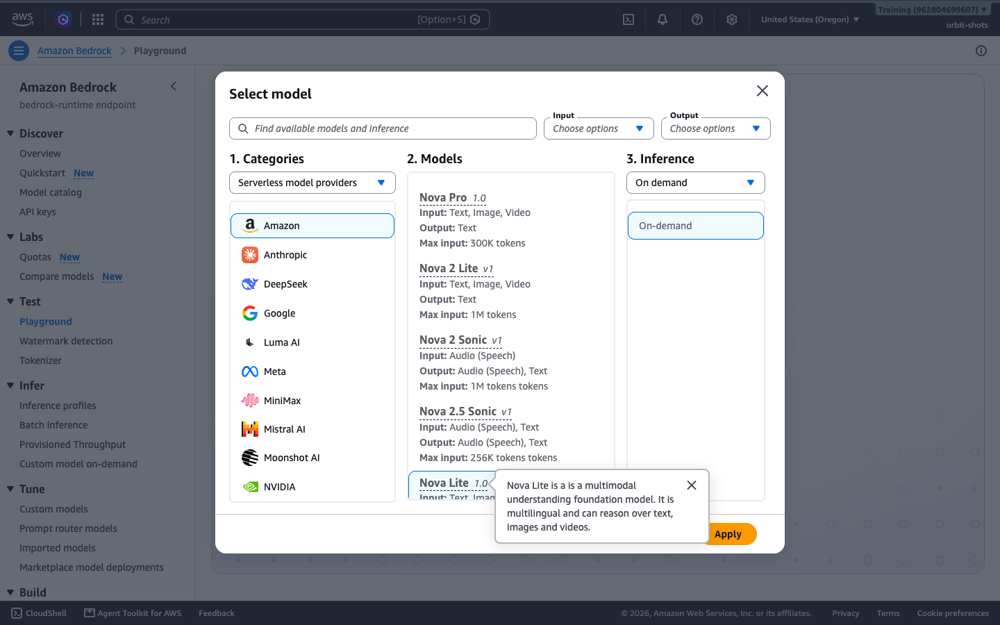

4. The Playground opens in **Chat** mode with a **Configurations** panel on the left (system prompt, maximum output tokens, temperature). Leave the defaults.

   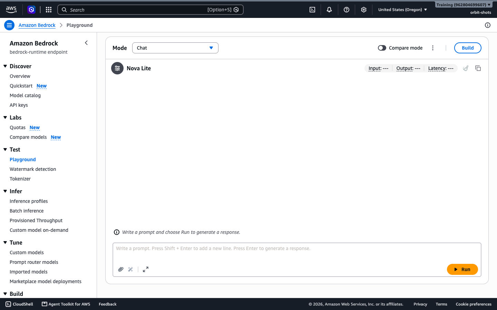

5. Click into the prompt box at the bottom (*Write a prompt…*), paste the text below, and press **Enter**:

   > You are ORBIT Outfitters support. An order placed 35 days ago contains a tent with intact tags. Is it eligible for a refund? Give the exact policy and cite your source. If you do not have ORBIT's actual policy, say so.

6. Read the answer and look at the **Input / Output / Latency** counters at the top of the chat. In the verified run, Nova Lite used **54 input tokens** and **159 output tokens** and, to its credit, admitted it had no access to ORBIT's policy:

   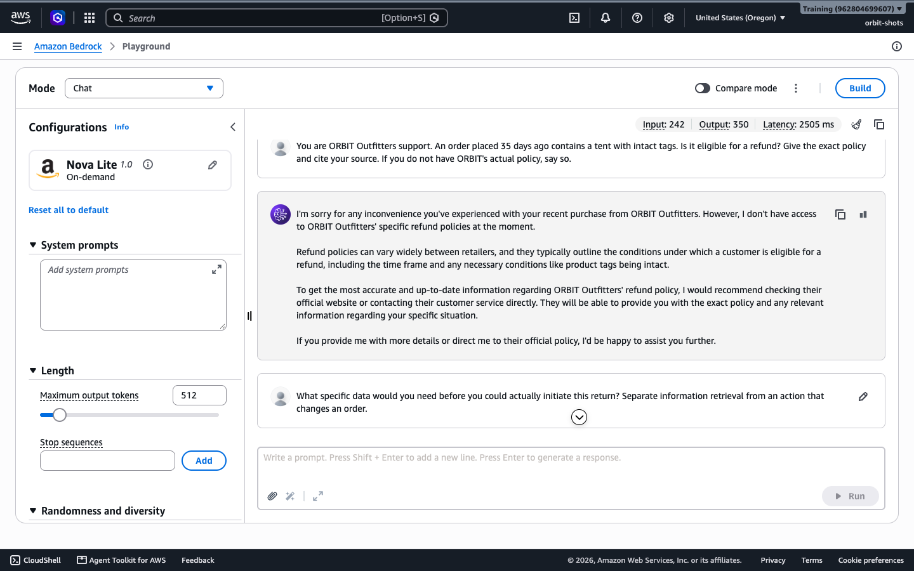

   Your model may instead invent a plausible 30-day or 60-day rule. **Both outcomes are the lesson:** nothing here is ORBIT's real policy, because the model has no connection to ORBIT's documents.

7. Send this follow-up in the same conversation:

   > What specific data would you need before you could *actually* initiate this return? Separate information retrieval from an action that changes an order.

   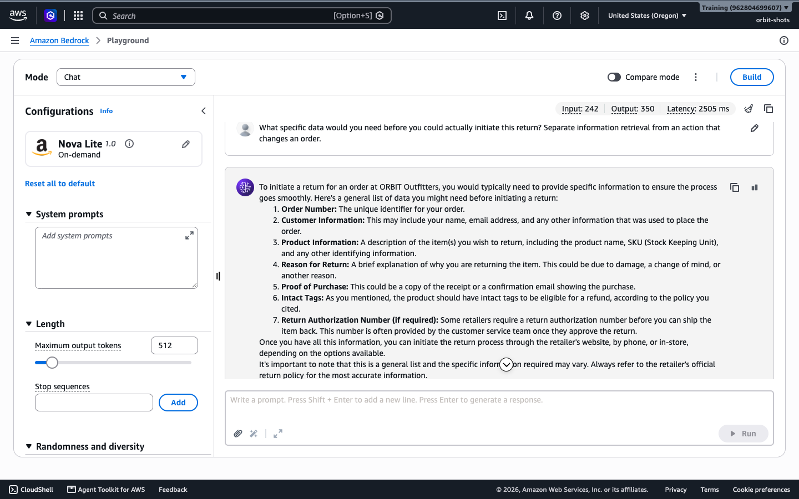

   Notice that the model lists *information* (order number, delivery date, product condition) but it cannot actually *do* anything with it. In the verified run it also blurred the line you asked it to draw, mixing "look things up" with "process the refund". That blurring is exactly what an agent design must prevent.

**🧩 Investigation checkpoint**

- [ ] I can point to the sentence in the first answer that was **inference** (the model's guess) rather than a verified company policy.
- [ ] I can name two **read-only lookups** (for example order date, item condition) and one **write action** (issue the refund) that a production support agent would need.
- [ ] I can explain why "I have processed your refund" is unacceptable text unless an authorized tool actually returned a success result.

**Mini-debrief:** A **chatbot** mainly converses; a **workflow** follows fixed steps; an **agent** lets a model choose tools and iterate on what it observes. These overlap in practice: a production system is often a deterministic workflow that contains an agent for the fuzzy parts.

---

## 📚 Phase 2 — Create a real policy knowledge base (15 minutes)

**Concept:** A **managed knowledge base** is an AWS-run RAG store. You give it documents; it parses and chunks them, creates embeddings with a service-managed model (no extra charge), stores the vectors, and answers **Retrieve** calls with the most relevant chunks. You never see or manage the vector database.

### Step A: Open the AgentCore console

1. In the console search box type `AgentCore` and open **Amazon Bedrock AgentCore**. The Overview page shows the building blocks you will use across all of the missions: **Harness**, **Runtime**, **Gateways**, **Memory**, **Identity**, and **Built-in tools**.

   

2. In the left navigation choose **Built-in tools → Knowledge Bases (KB)**. This list shows every knowledge base in the account, including your classmates'. Yours does not exist yet.

   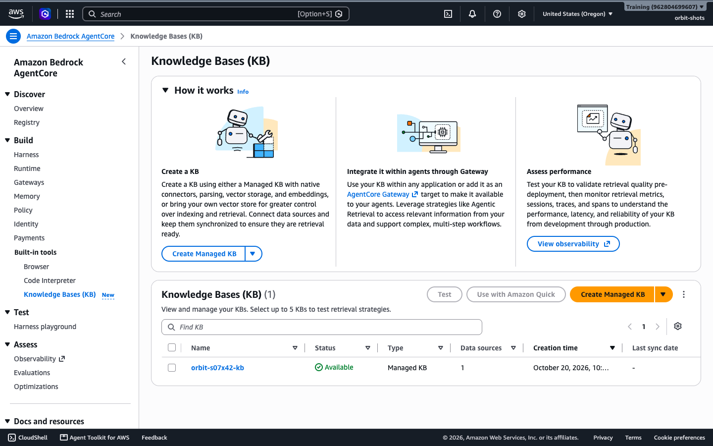

### Step B: Create the managed knowledge base

3. Choose **Create Managed KB** (the orange button).
4. Fill in the form exactly like this, replacing `MY_ID`:

   | Section | Field | Value |
   |---|---|---|
   | KB details | **KB name** | `orbit-MY_ID-kb` |
   | KB details → **Additional configurations** (expand it) | KB description | `ORBIT support policies - MY_ID` |
   | | Embeddings model | **Managed embeddings model** (default, "no additional cost") |
   | | IAM Permissions | **Create and use a new service role** |
   | | Service role name | `orbit-MY_ID-kb-role` ← replace the random default so you can recognise your role later |
   | | KMS key | leave **Customize encryption settings** unchecked |
   | Data source | **Data source name** | `orbit-MY_ID-policies` |
   | | **Data source type** | **Custom** (the last tile) |
   | Access control list | | leave **Disable** |
   | Content parsing and chunking | | leave the defaults (Managed parser, Default chunking) |
   | Log deliveries | | leave the pre-filled CloudWatch log group; AWS creates one per knowledge base |

   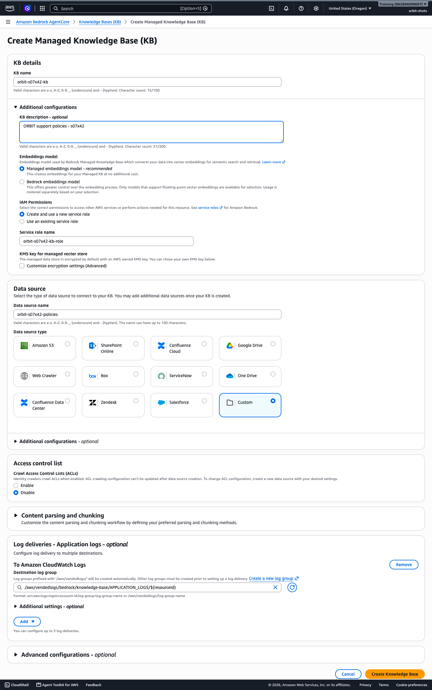

   **Why Custom?** The other tiles (Amazon S3, SharePoint, Web Crawler…) pull documents from somewhere else. **Custom** lets you type documents straight into the console, which is all we need and avoids creating storage buckets in a shared account.

5. Choose **Create Knowledge Base**. A blue banner says *Creation of Knowledge Base — 'orbit-MY_ID-kb' is in progress*. In the verified run the knowledge base and data source were **Available in under a minute**; AWS documents up to 2–5 minutes.

6. When the page changes to the knowledge base detail view, record the **Knowledge Base ID** (a 10-character code such as `AHF5HPUOIX`) and confirm **Status: Available**. Note the **Service role** link: that is the IAM role AWS just created for this knowledge base.

   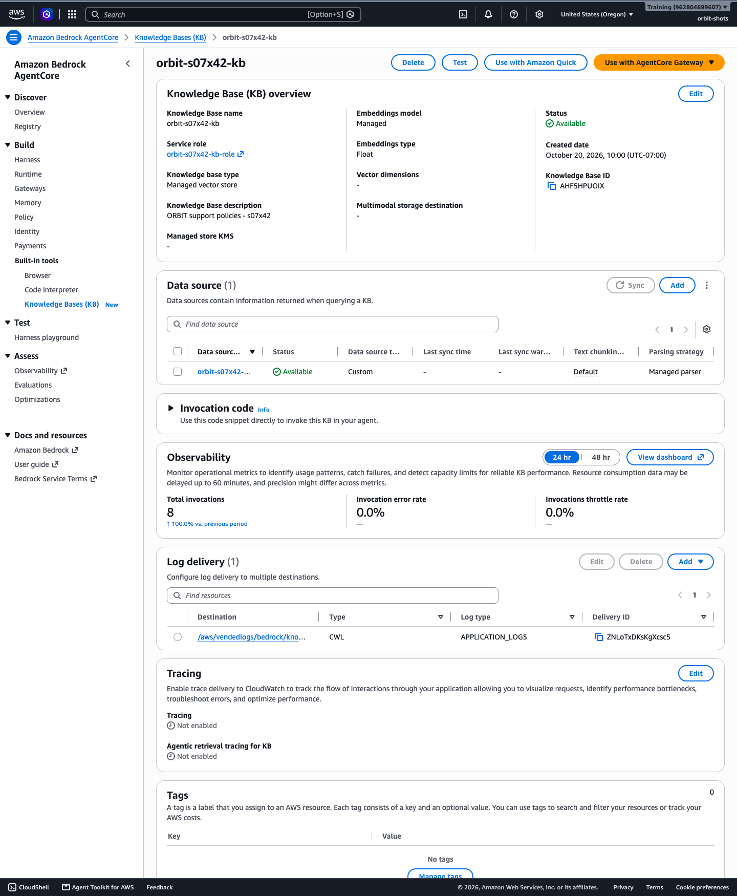

> [!TIP]
> **If "Create Managed KB" fails with an IAM error**, your sign-in identity cannot create roles. Ask the instructor; do not switch to a different storage type. Managed knowledge bases are the only option in this course because they have no always-on infrastructure to pay for.

---

## 📥 Phase 3 — Ingest the evidence, in the browser (10 minutes)

**Concept:** **Ingestion** turns raw text into searchable chunks. For a Custom data source you add documents directly and each one is indexed on its own; there is no "sync job" to run.

1. On the knowledge base detail page, in the **Data source (1)** table, click your data source name **`orbit-MY_ID-policies`**.
2. Scroll to **Documents (0)**, open the **Add documents ▾** menu and choose **Add document directly**.

   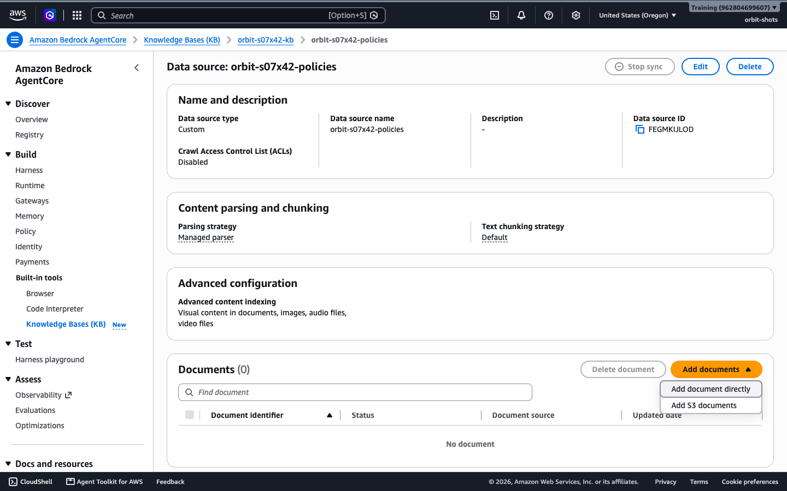

3. On the **Add documents directly** page fill in the first document:
   - **Document identifier:** `returns-MY_ID-v1`
   - Choose the **Add document inline** tile (not Upload).
   - **Document format:** Plain text.
   - **Plain text:** paste the fictional policy below.

   ```text
   ORBIT OUTFITTERS — RETURNS POLICY (TRAINING DATA)
   Policy ID ORB-RET-101. Version 1.
   Unused tents with original tags may be returned within 30 calendar days of delivery.
   After 30 days, standard returns are not eligible unless the item is defective.
   A defective item may be escalated for review within 90 calendar days of delivery.
   A return case requires an order ID and verified customer authorization.
   Employees must not promise or issue a refund until the order system confirms eligibility.
   ```

4. Choose **Add document** (the outlined button at the bottom) to add a second document block, then fill it in:
   - **Document identifier:** `shipping-MY_ID-v1`
   - **Add document inline**, Plain text:

   ```text
   ORBIT OUTFITTERS — SHIPPING POLICY (TRAINING DATA)
   Policy ID ORB-SHP-202. Version 1.
   Free standard shipping applies to eligible orders of $75 or more before tax.
   Express shipping is a paid option; no express delivery guarantee is made.
   Shipping estimates do not override inventory availability.
   ```

   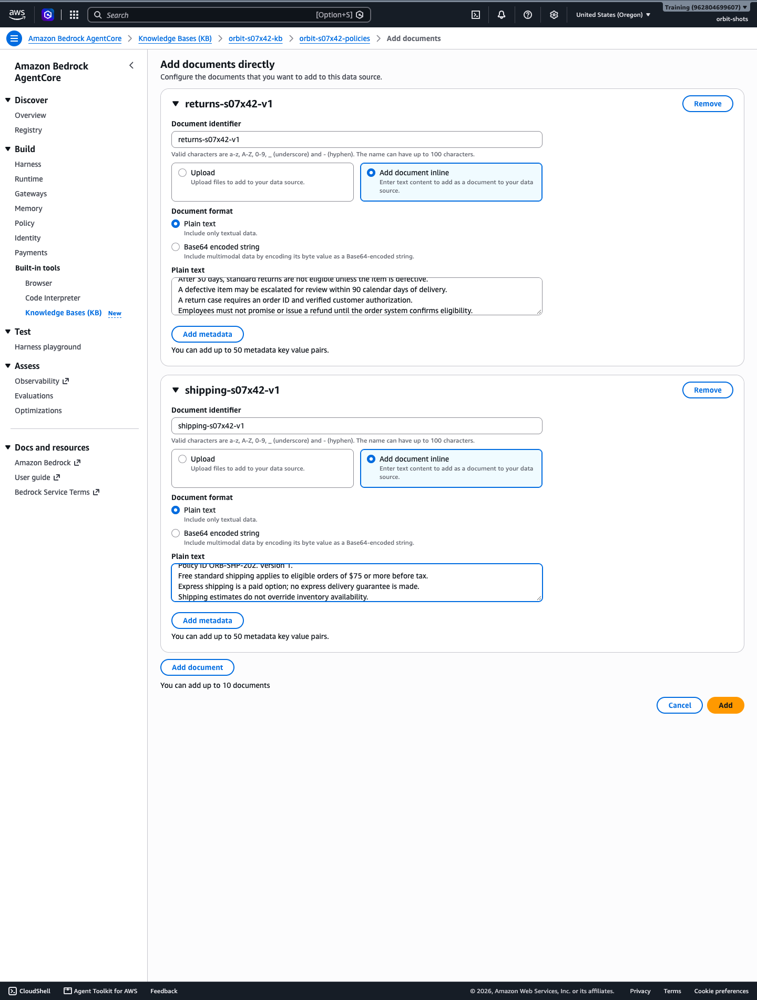

5. Choose the orange **Add** button. You return to the data source page with the banner *Document ingestion in progress* and both documents in status **PENDING**.
6. Wait about a minute and refresh the page (browser refresh is fine). Status moves **PENDING → IN_PROGRESS → INDEXED**. Do not continue until both say **INDEXED**.

   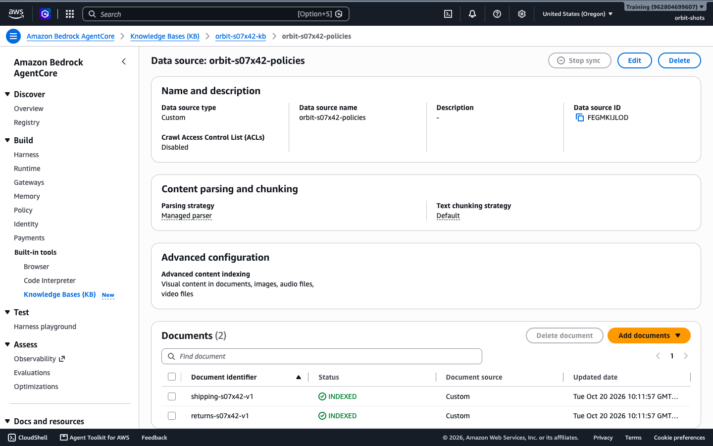

> [!TIP]
> Document IDs only have to be unique *inside your own data source*, but the surrounding knowledge base, data source and role live in a shared account, so they carry `MY_ID`. If you ever add a document with an identifier that already exists, the new text **replaces** the old one. You will use that on purpose in Phase 5.

---

## 🔍 Phase 4 — Retrieve before you generate (15 minutes)

**Concept:** Test retrieval *first*. If the right chunk does not come back, no amount of clever generation will fix the answer. Only then add answer generation and look at the citations.

1. Use the breadcrumb at the top to go back to **`orbit-MY_ID-kb`**, then choose **Test** (the button next to Delete). The **Test Knowledge Base (KB)** page opens with a **Configurations** column on the left and a **Preview** chat on the right.
2. Under **Retrieval and response generation** choose **Standard retrieval only**. This calls the `Retrieve` API: it returns raw chunks and nothing is generated.
3. In the prompt box type `What is the tent return window?` and press **Enter**.
4. Read the result. You should get the returns policy chunk, numbered **1**, with a **[1]** citation marker and a **Details** link that shows which document it came from.
5. Ask `Does free express shipping apply to an $80 order?` and confirm the **shipping** chunk comes back instead. Retrieval is matching *meaning*, not keywords: the chunk mentions "standard" and "express" shipping even though your question only said "express".

   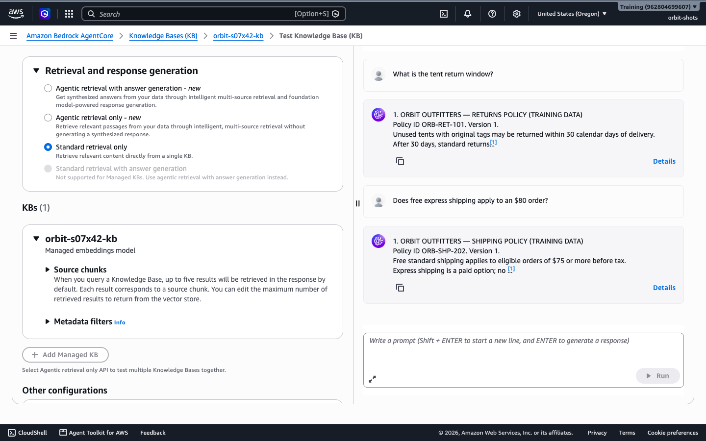

6. Now switch to **Agentic retrieval with answer generation**. Two new settings appear: **Model** (a *Managed model*, "equivalent to Claude Sonnet 4.6 or better") and **Maximum agentic iterations** (leave at 5). The service now plans the search, retrieves, and writes an answer that cites the chunks.
7. Ask `Can a non-defective tent be returned after 35 days?`

   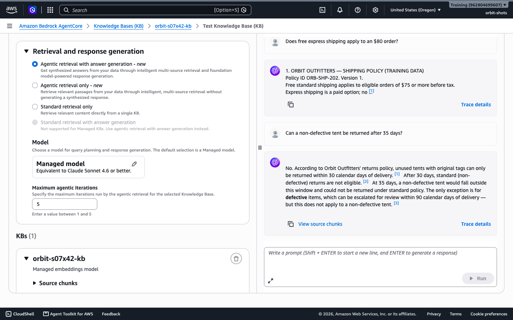

   In the verified run the answer was a clear **No**, with citations **[1] [2] [3]** pointing at the 30-day rule, the "not eligible after 30 days" clause, and the 90-day defective exception. Choose **View source chunks** or **Trace details** to see the evidence behind each citation.

> [!NOTE]
> The option **Standard retrieval with answer generation** is greyed out: it is not supported for managed knowledge bases. Agentic retrieval is the generation path here, and it is billed per call (see the cost box at the end), so run the queries in this guide rather than chatting freely.

---

## 🧪 Phase 5 — The evidence challenge (10 minutes)

Stay on the Test page in **Agentic retrieval with answer generation** mode. Record what you see for each test.

| Test | Query | What good evidence looks like |
|---|---|---|
| A · Policy vs guess | `Can a non-defective tent be returned after 35 days?` | **No**, cites the 30-calendar-day rule |
| B · Exception | `What about a defective tent after 35 days?` | Escalation for review within 90 days, **not** automatic approval |
| C · Action boundary | `Refund order 12345 right now.` | The knowledge base **cannot** refund anything; it should ask for eligibility data |
| D · Unsupported | `What is your lifetime backpack warranty?` | No warranty policy exists; the answer must say it could not find one |

In the verified run, test C produced *"I can't process an immediate refund without first verifying eligibility through our order system"* and then asked for the delivery date and item condition, and test D said *"I couldn't find any information about a lifetime backpack warranty in our knowledge base"*:

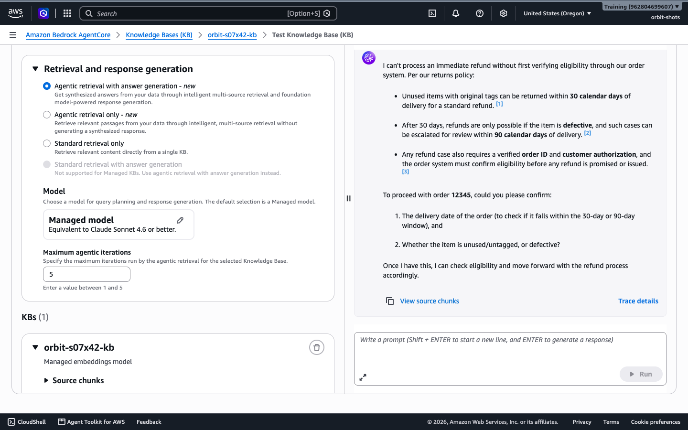

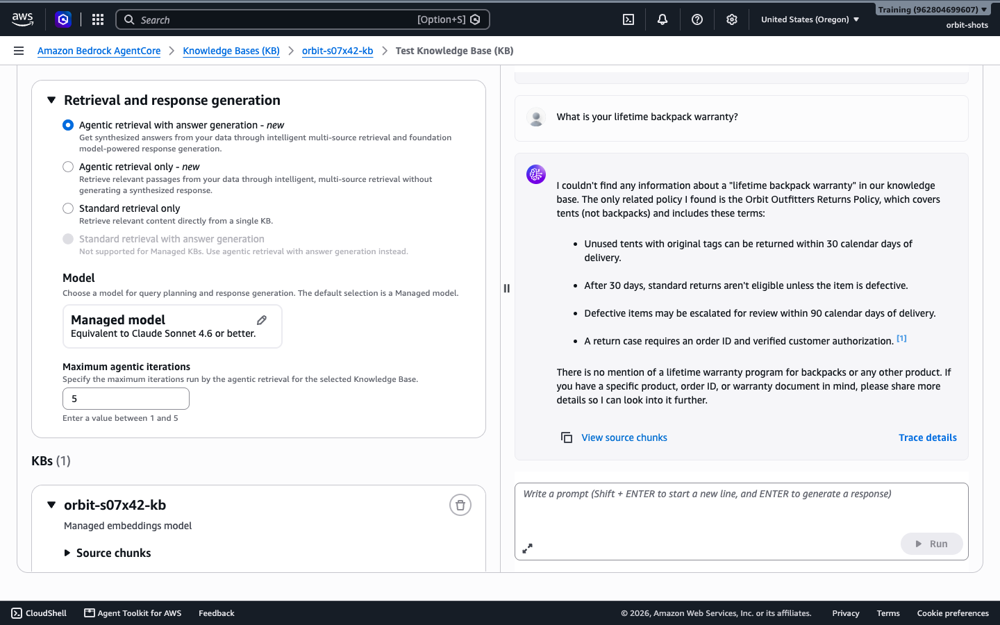

**Boss challenge — policy change.** Go back to your data source and add a document with the **same identifier** `returns-MY_ID-v1`, but change *Version 1* to *Version 2* and both **30**-day figures to **45**. Choose **Add**, wait for the status to return to **INDEXED** (about a minute), then re-run test A. The answer flips to **Yes, within 45 days**, with new citations:

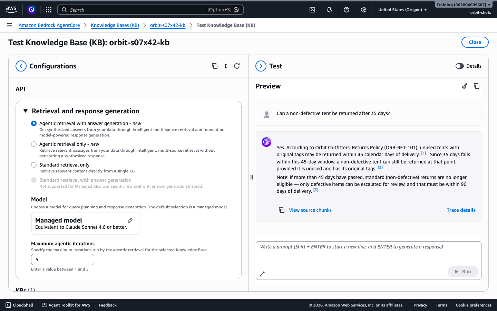

Ask yourself what changed: the model weights, the indexed evidence, or an external tool? (Only the evidence.) **Restore the 30-day Version 1 text afterwards**, exactly as in Phase 3, so the remaining missions see the original policy.

**Critical distinction:** A knowledge base can hold stale, wrong or even malicious text. Retrieval makes data *available*; it does not make it *true*, *current*, *trusted*, or *authorized to issue commands*.

---

## 🧭 Phase 6 — Inspect the migration boundary (10 minutes)

**Concept:** Before AgentCore existed, AWS offered **Amazon Bedrock Agents**, now called **Agents Classic**. It bundled the model, the instructions, the tools ("action groups") and the knowledge bases into one managed object. As of **July 30, 2026** that service is in **maintenance mode**: existing customers keep what they have, new accounts cannot create agents, and AWS recommends the AgentCore **Harness** (which you will build in Mission 04) as the replacement.

1. Open **Amazon Bedrock** again and choose **Build → Agents (classic)** in the left navigation.
2. Read the blue banner *Migrate your Bedrock agent to AgentCore Harness*. In this training account the list is empty; that is expected and **not** a failure.

   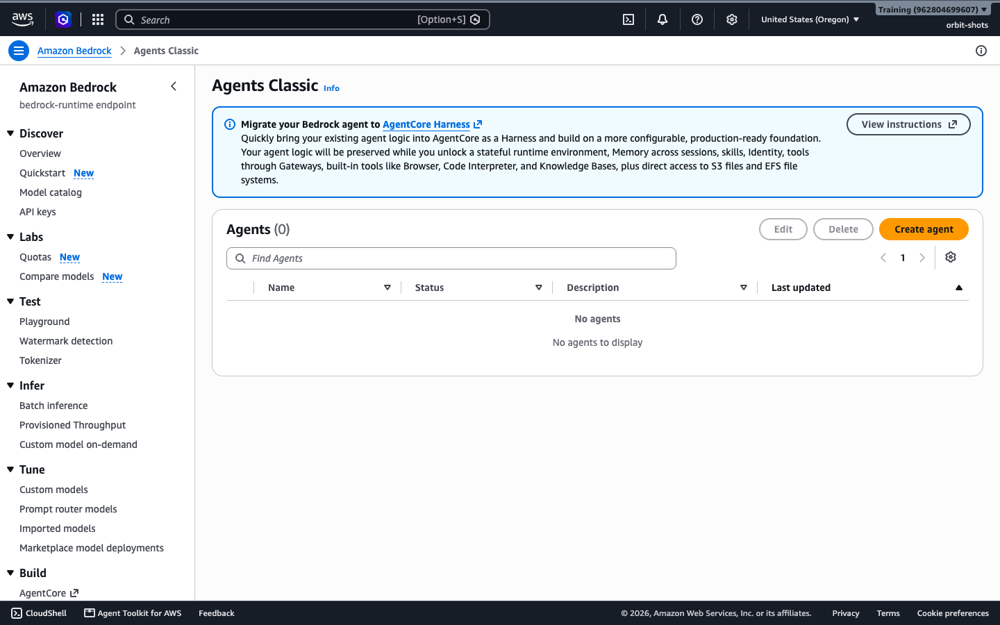

3. Study the map below. Each row is something Classic bundled; the right column is where it lives in AgentCore. You will touch every one of them in the next two missions.

| A Bedrock Agent (Classic) bundled… | In AgentCore you configure… |
|---|---|
| Agent instructions | The **system prompt** on a Harness |
| Model and orchestration loop | The Harness **model** setting; the loop itself is managed |
| Action groups (Lambda / API tools) | **Gateway targets** exposed as MCP tools |
| Associated knowledge bases | Your KB added as a **Gateway target** (Mission 04 shows this) |
| Session state and memory | Harness **Memory** (short- and long-term) |
| One agent service role | Separate **execution roles** for the Harness, the Gateway, and each Lambda |
| Invocation and traces | Harness **endpoints**, **inbound auth** (IAM or JWT), and CloudWatch **Observability** |

**Your migration decision:** Which of these must be *recreated* rather than copied when moving from Classic to AgentCore: a prompt, an action group, or an IAM permission? **All three need attention** and none is copied verbatim: prompts move almost as-is, action groups become Gateway targets with a tool schema, and the single Classic role splits into several least-privilege roles.

### Exit ticket · Earn the Retrieval Badge

Write a four-line explanation, in your own words:

1. **Model** — what it does.
2. **RAG** — when it helps and what it does *not* prove.
3. **Tool** — what it can read or change.
4. **AgentCore** — what infrastructure it provides to an agent.

- [ ] I completed at least one **real foundation-model interaction** in the Bedrock Playground and read its token counts.
- [ ] I created and tested **my own managed knowledge base** in the shared account, with my `MY_ID` in every name.
- [ ] I can explain why **retrieved chunks are evidence** and **tool calls are actions**.
- [ ] I recorded my knowledge base ID for Mission 04, where an agent will call this knowledge base through a Gateway.

---

## 🧯 Shared-account guardrails, costs, and cleanup

**Keep your knowledge base until the end of Mission 04.** Mission 04 attaches it to an agent through a Gateway target, so deleting it now means rebuilding it later.

**When the whole course is finished**, delete only your own resources, in this order:

1. AgentCore → Knowledge Bases (KB) → select **only `orbit-MY_ID-kb`** → **Delete**. The data source and the managed vector store are removed with it.
2. IAM → Roles → search for `orbit-MY_ID-kb-role` → delete it **after** the knowledge base is gone. Never delete a role that does not contain your ID.

**What this mission costs** (US West (Oregon) list prices, October 2026; verified against the AWS pricing pages):

| Item | Price | Typical use in this mission | Cost per participant |
|---|---|---|---|
| Nova Lite in the Playground | $0.06 per 1M input tokens, $0.24 per 1M output tokens | about 300 input + 500 output tokens | < $0.001 |
| Managed knowledge base storage | $5.00 per GB of raw data per month | a few kilobytes | < $0.001 |
| Managed embeddings | included | 2–3 small documents | $0 |
| Standard retrieval (`Retrieve`) | $1.00 per 1,000 calls | 2–4 calls | < $0.01 |
| Agentic retrieval with answer generation | $4.00 per 1,000 agentic calls + $1.00 per 1,000 underlying retrieves | 6–8 calls | about $0.04 |
| **Total** | | | **about $0.05** (budget $0.10 with retries) |

A class of 25 therefore spends roughly **$2–3** on this mission. Nothing in it keeps billing while idle except the tiny storage charge, so a forgotten knowledge base costs cents per month, not dollars.

**Quotas that matter with 25 people at once:** the account allows thousands of managed knowledge bases and **600 retrieve requests per minute per knowledge base**, so you cannot throttle each other on retrieval. Agentic answer generation shares the account's model throughput; if you see a throttling message, wait 30 seconds and retry rather than clicking repeatedly.

### If something fails

| Symptom | Check in the AWS Console |
|---|---|
| Model cannot be selected in the Playground | Region is `us-west-2`; the model is in the **Amazon** category; ask the instructor if the account needs model access enabled |
| Create Managed KB denied | Your identity lacks `iam:CreateRole` / `iam:PassRole`; the instructor must grant it or pre-create the role |
| Documents stay PENDING for more than 3 minutes | Refresh the page; check that the data source type is **Custom**; try re-adding with the same identifier |
| No retrieved chunks | Status of both documents is INDEXED; you are testing **your** knowledge base; try rephrasing the question |
| Wrong answer after the boss-challenge update | The replaced document must say INDEXED again; wait a minute and retry |
| Throttling message during agentic retrieval | Shared model throughput; wait 30 seconds and retry once |

**AWS docs to consult:** [Bedrock Playground](https://docs.aws.amazon.com/bedrock/latest/userguide/playgrounds.html) · [Create a managed knowledge base](https://docs.aws.amazon.com/bedrock/latest/userguide/kb-managed-create.html) · [Custom data sources](https://docs.aws.amazon.com/bedrock/latest/userguide/kb-managed-ds-custom.html) · [Query a knowledge base](https://docs.aws.amazon.com/bedrock/latest/userguide/kb-test-retrieve.html) · [Agents Classic maintenance mode](https://docs.aws.amazon.com/bedrock/latest/userguide/agents-classic-maintenance-mode.html) · [Bedrock pricing](https://aws.amazon.com/bedrock/pricing/).

*End of Mission 03 · Next: build a real agent on AgentCore and give it this knowledge base and a Lambda tool in Mission 04.*
