# 🛰️ ORBIT FIELD ACADEMY
## MISSION 04 · LAUNCH CONTROL
### From a prompt in a browser tab to a real AgentCore agent with a tool and a knowledge base

> **LEVEL:** Builder · **TARGET TIME:** 120–150 minutes · **ENVIRONMENT:** AWS Management Console only
> **THE STORY:** ORBIT Outfitters wants to stop treating its assistant like a prompt in a browser tab. Your mission is to host a real AI agent on Amazon Bedrock AgentCore, investigate the infrastructure it runs on, give it a real order-lookup tool through AgentCore Gateway, connect the Mission 03 policy knowledge base, and watch the agent use both.

**This is a real AWS deployment, not a simulation.** You will create an AgentCore **Harness** (a managed agent), build an AWS Lambda function in the **Lambda console editor**, register it as a **Gateway** tool, fix a real permission failure in **IAM**, and read the agent's **CloudWatch** logs. No CLI, terminal, package install, or local code.

> [!NOTE]
> **Verified against the live AWS Console on October 20, 2026** in US West (Oregon) with the example ID `s07x42`. Earlier versions of this mission said the console could not wire a gateway or a knowledge base into the agent. That is no longer true: the AgentCore **Harness** does exactly that, and this guide walks you through it end to end, including the two errors you will almost certainly hit on the way.

---

## 🎯 What you will understand

- **Harness vs. Runtime:** a *Harness* is an agent you define by configuration (model, system prompt, tools); a *Runtime* is the secure compute that runs it (each session in its own micro-VM). The Harness is built on top of the Runtime.
- **Sessions, versions, endpoints:** how a conversation keeps context, how every change creates an immutable version, and how a named endpoint points at a version.
- **Identity:** the difference between *who may call* the agent and *what the running agent is allowed to do* (its execution role).
- **Lambda:** a function that runs your code on demand, with an event in and a JSON result out.
- **Gateway and MCP:** a managed tool server that speaks the Model Context Protocol, fronts your Lambda (and your knowledge base) with a schema, and enforces its own permissions.
- **Observability:** finding out *where* something failed: the caller, the agent process, the model call, or the tool.
- **Migration:** mapping an old Bedrock Agents Classic design onto these pieces.

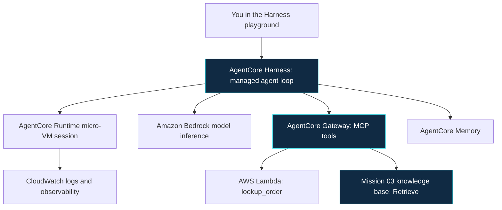

---

## 📖 Before you start: the concepts in this mission

### AgentCore in one paragraph

**Amazon Bedrock AgentCore** is a set of building blocks for running agents in production. You already used one (**Knowledge Bases**, under *Built-in tools*). Today you add four more: a **Harness** (the agent itself, defined by configuration), the **Runtime** that executes it, a **Gateway** that exposes tools, and **Memory** that lets the agent remember across sessions. **Identity** and **Observability** thread through all of them.

### Harness vs. Runtime

| | Harness | Runtime |
|---|---|---|
| What you provide | configuration: model, system prompt, tools, memory, limits | your own code in a container or zip |
| Who writes the agent loop | AWS (it is powered by the open-source Strands Agents framework) | you |
| How you change the model or add a tool | edit a field, save; a new **version** is created | redeploy code |
| Where it runs | inside a Runtime micro-VM that AWS creates for it | a Runtime micro-VM |
| Extra charge | none; you pay for the underlying Runtime, model and tools | Runtime, model and tools |

Every conversation is a **session**. Each session runs in its own isolated **micro-VM** (a tiny virtual machine) with its own filesystem; AWS keeps it alive for an idle timeout (15 minutes by default) and then recycles it. This isolation is why a bug or an attacker in one session cannot reach another user's data.

### Lambda, tools, and MCP

- **AWS Lambda** runs a function you write without any server. You give it code and a **handler** (`lambda_handler(event, context)`); AWS calls it with an **event** (JSON input) and returns whatever your function returns. Lambda is billed per request and per millisecond of run time; our calls will cost fractions of a cent.
- A **tool** is a function the agent can call. For the model to call it safely you need three things: a **schema** (name, description, and the JSON shape of the input), **code** that runs, and a **permission boundary** between the two.
- **MCP (Model Context Protocol)** is an open standard for tools: an MCP server advertises a list of tools with schemas, and an agent calls them by name. **AgentCore Gateway** is a managed MCP server. You register **targets** (a Lambda function, a REST API, a knowledge base), and the gateway publishes each as an MCP tool named `<target-name>___<tool-name>`.

### The four principals (the security idea of this mission)

1. **You, in the console** – allowed to create and change resources (the *management plane*).
2. **The Harness execution role** – what the running agent process may do: call the model, write logs, *invoke the gateway*.
3. **The Gateway execution role** – what the gateway may do: invoke *your* Lambda, query *your* knowledge base.
4. **The Lambda execution role** – what the function may do (today: only write logs).

Granting a permission to the wrong principal fixes nothing. You will see this for real in Phase 6.

### Two AWS behaviours that surprise newcomers

- **Eventual consistency:** IAM changes take a few seconds to propagate across AWS. A console wizard can create a role and try to use it before the role is visible, which produces a transient *"not authorized to perform AssumeRole"* error. Waiting 30–60 seconds and retrying fixes it.
- **Naming rules differ per service:** Harness names allow only letters, numbers and `_`; Gateway and target names allow only letters, numbers and `-`. The tables below give you names that satisfy every rule.

---

## 🪪 Preflight: protect your shared AWS account (10 minutes)

1. Use the **same Region** (US West (Oregon)) and the **same `MY_ID`** as Mission 03. If you skipped Mission 03, choose one now (for example `s07x42`) and note that Phase 7 needs the Mission 03 knowledge base.
2. Check **Service Quotas** once: console search → *Service Quotas* → *AWS services* → *Amazon Bedrock AgentCore*. The account allows 1,000 gateways per Region and creates gateways and targets at 5 requests per second, so 25 people clicking **Create** at the same moment can briefly throttle. If the instructor asks you to create in waves of five, that is why.

   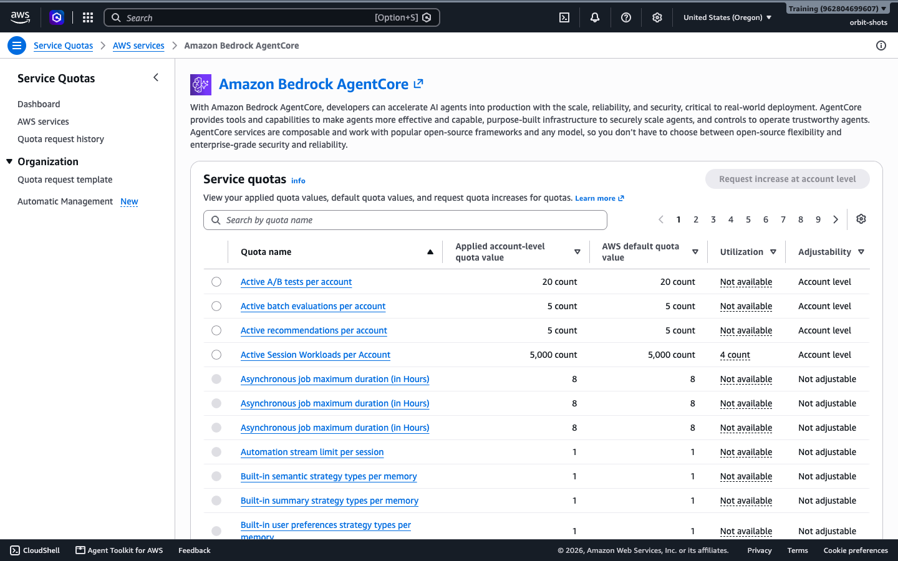

3. **Never reuse** a role, gateway, Lambda or harness that belongs to someone else, even if it looks identical. Every name below contains your `MY_ID`.

**Resource ledger** (replace `MY_ID`; the *Allowed characters* column is why some names use `_` and others `-`):

| Resource | Name you will type | Allowed characters | Record the actual ID / ARN |
|---|---|---|---|
| Harness (your agent) | `orbit_MY_ID_agent` | letters, numbers, `_`; starts with a letter; max 40 | |
| Harness execution role | `orbit-MY_ID-harness-role` | letters, numbers, `+=,.@-_` | |
| Lambda tool | `orbit-MY_ID-order-lookup` | letters, numbers, `-`, `_` | |
| Lambda execution role | auto-created as `orbit-MY_ID-order-lookup-role-xxxx` | | |
| Gateway | `orbit-MY_ID-gateway` | letters, numbers, `-`; max 50 | AWS appends a random suffix to the ID |
| Gateway execution role | `orbit-MY_ID-gateway-role` | letters, numbers, `+=,.@-_` | |
| Gateway target (Lambda) | `orbit-MY_ID-order-tool` | letters, numbers, `-` | |
| Gateway target (knowledge base) | `orbit-MY_ID-policy-kb` | letters, numbers, `-` | |
| IAM inline policy on the harness role | `orbit-MY_ID-invoke-gateway` | | |

> [!IMPORTANT]
> **Model choice.** This mission uses **Claude Haiku 4.5** for the agent. It is inexpensive (about $1 per million input tokens) and reliable at tool calling. In the verified run, **Amazon Nova Lite failed every tool call** with *"Model produced invalid sequence as part of ToolUse"*, so do not pick it for the Harness even though it was fine in the Mission 03 Playground. The Harness default, Claude Sonnet 4.6, also works but costs three times as much per token.

---

## 🚀 Phase 1 — Create your agent as a Harness (20 minutes)

**Concept:** You are about to create a production-style agent without writing any code. The Harness holds the model choice, the system prompt (the standing instructions), the tool list, memory, and the identity rules. AWS creates the Runtime, the micro-VM image, a default endpoint, and a memory resource for you.

1. Open **Amazon Bedrock AgentCore** → **Build → Harness**. The list shows your classmates' harnesses too; yours is not there yet.

   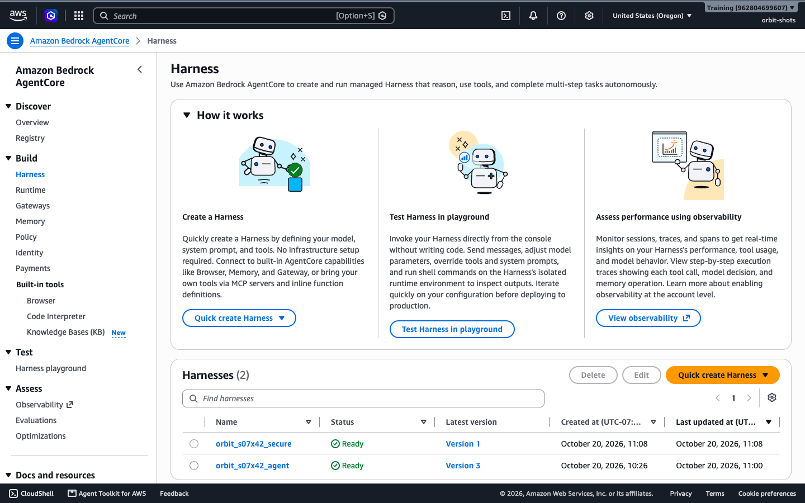

2. Open the **Quick create Harness ▾** menu and choose **Advanced create Harness**. (Quick create only asks for a name and uses the expensive default model; Advanced lets you set everything.)
3. **Harness name:** `orbit_MY_ID_agent`. The name cannot be changed later.
4. Expand **Model and system prompt**:
   - **Model source:** Bedrock. **API source:** Bedrock (Converse API).
   - Next to the default model (Claude Sonnet 4.6) click the **pencil icon** (*Change model*). In the dialog choose **Anthropic** → **Claude Haiku 4.5** → under *3. Inference* keep **Inference profiles** and select **US Anthropic Claude Haiku 4.5** → **Apply**.

   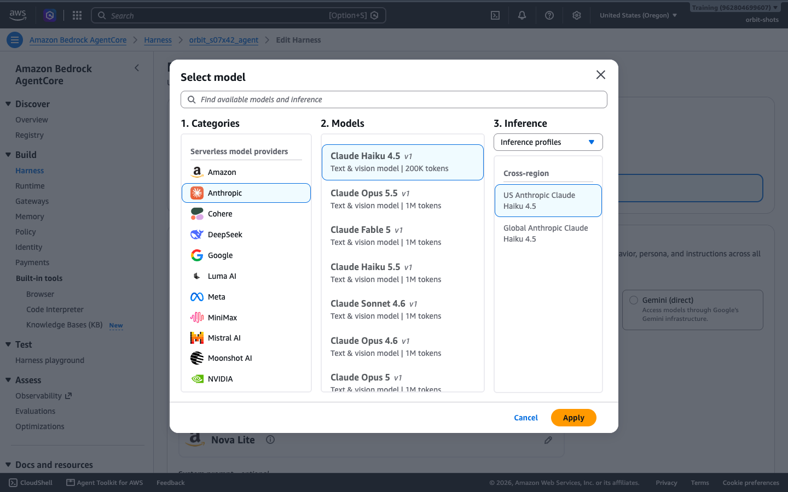

   - **System prompt:** replace *You are a helpful assistant.* with:

   > You are the ORBIT Outfitters customer support assistant. Answer in a warm, supportive voice. Never invent a returns or shipping policy: if you do not have ORBIT policy evidence, say so. Never claim to have issued a refund or changed an order. When you look up an order, state clearly that the lookup is read-only.

5. Expand **Memory – optional (1)**. Make sure **Enable Memory** is ticked and **Create new Memory (managed by Harness)** is selected. (If the wizard shows *Use existing Memory resource* selected, switch it, or creation fails with *Memory ARN is required when memory is enabled*.)
6. Leave **Tools (0)**, **Skills**, **Lifecycle hooks** and **Advanced configurations** alone for now. You will add the tool in Phase 6.
7. Expand **Inbound Auth** and keep **Use IAM permissions**. That means only AWS identities in this account (such as you, in the console) can call this agent. Mission 05 builds a second harness protected by OAuth tokens instead.
8. Expand **Permissions**: keep **Create default role** and change **Role name** to `orbit-MY_ID-harness-role`.

   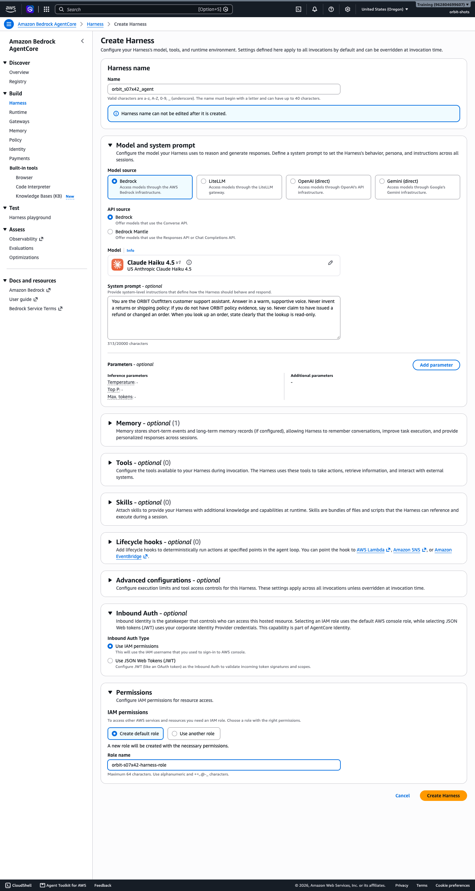

9. Choose **Create Harness**. The detail page opens with a green banner: *orbit_MY_ID_agent, Version 1 was successfully created. A default endpoint is also in progress…* Status shows **Creating**, then **Ready** after roughly 30–60 seconds. Record the **Harness ARN** and the **Harness ID** (the name plus a random suffix, for example `orbit_s07x42_agent-TZvwF2mzZ6`).

   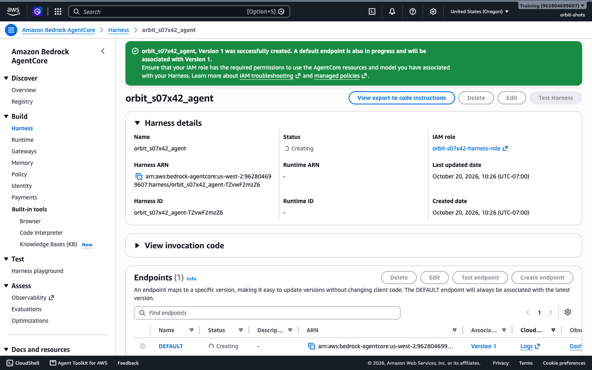

**Checkpoint**

- [ ] My harness is **Ready**, with **Version 1** and an endpoint named **DEFAULT**.
- [ ] I can say which model and which inference profile it uses, and I know the execution role's name.

---

## 💬 Phase 2 — Talk to your agent in the playground (10 minutes)

1. On the harness detail page choose **Test Harness** (top right). The **Harness playground** opens: your harness and the DEFAULT endpoint are selected, a **Session ID** is generated for you, and a **Configs** panel on the right shows the model, system prompt, memory, and tools in effect for this session.
2. Send:

   > Summarize the three actions a support agent should perform before issuing any refund. Explicitly state when you are only making a recommendation, not changing an order.

   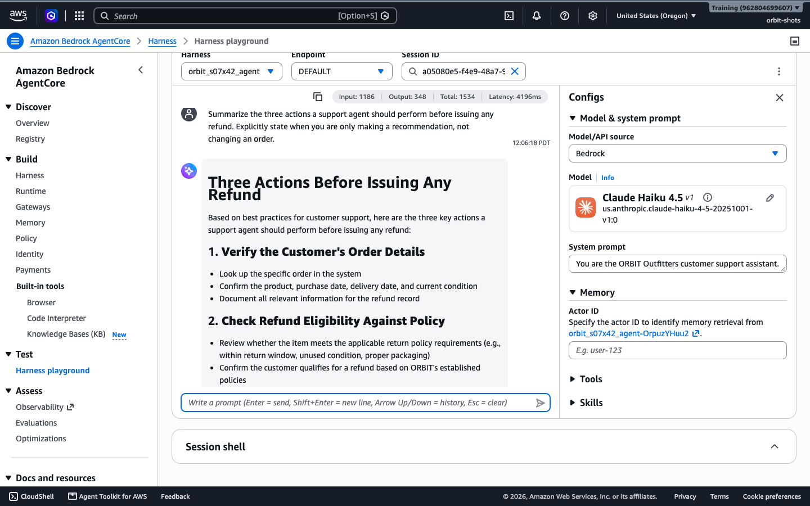

   Look at the **Input / Output / Total / Latency** chips above the answer: a single turn costs about 800–2,000 input tokens because the system prompt and tool definitions are sent every time.

3. Send the follow-up:

   > Which action should be protected by an authorization check? And what did I ask you first?

   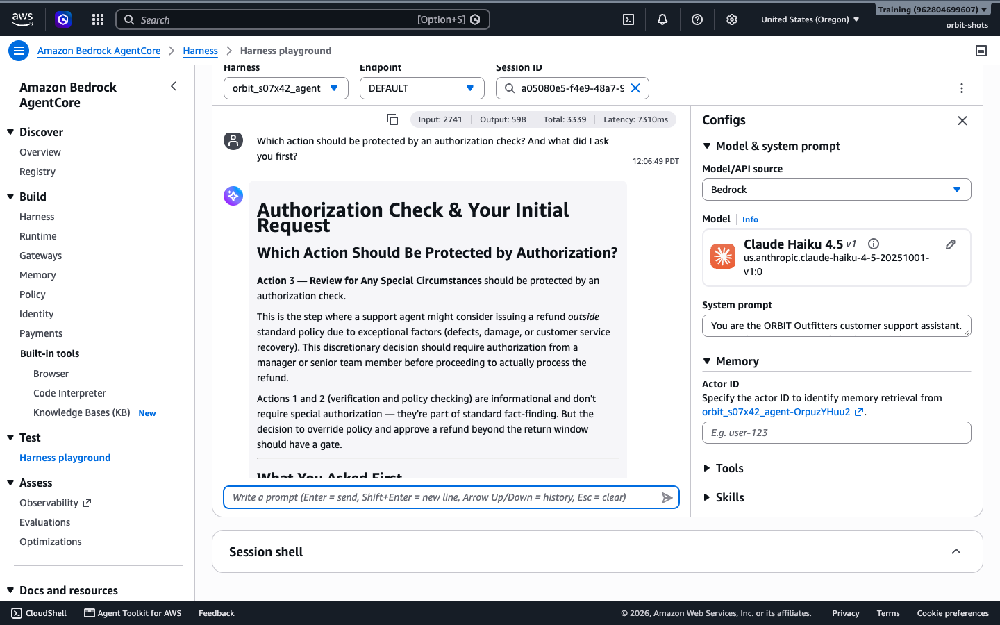

   The agent repeats your first question. That continuity comes from the **session** (and the short-term memory the harness keeps for it), not from any long-term knowledge.

**Checkpoint**

- [ ] I got a model-generated answer from my own hosted agent using only the console.
- [ ] I can distinguish **session context** (lost when the session ends) from the **AgentCore Memory resource** (which can persist across sessions when configured).

---

## 🔍 Phase 3 — The architecture scavenger hunt (15 minutes)

Use the console as a systems investigator. **Do not change any role or policy yet.**

| Evidence | Where to find it | What it tells you |
|---|---|---|
| Harness ARN, Runtime ARN, Runtime ID | Harness detail → *Harness details* | The harness is really a Runtime underneath (`harness_orbit_MY_ID_agent-…`) |
| Execution role | Harness detail → *IAM role* link | What AWS actions the agent process may take |
| Versions and endpoints | Harness detail → *Endpoints* and *Versions* tables | Which configuration traffic is using |
| The runtime itself | **Build → Runtime** → *Runtime resources* | Your harness appears as a runtime **Managed by** Harness |
| Memory resource | **Build → Memory** | A memory named after your harness, with short-term events and long-term strategies |
| Logs | CloudWatch → Log groups → `/aws/bedrock-agentcore/runtimes/harness_orbit_MY_ID_agent-<id>-DEFAULT` | Did the agent process start; what errors occurred |
| Traces and metrics | **Assess → Observability** (opens CloudWatch GenAI Observability) | Sessions, invocations, tool calls, tokens |

1. Open the harness detail page and copy the three ARNs into your ledger.

   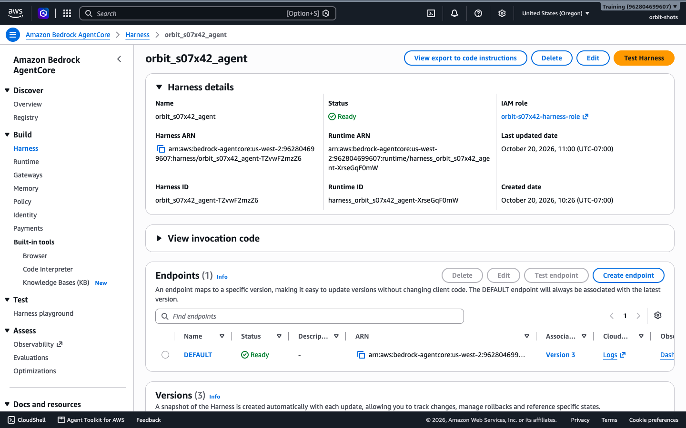

2. Open **Build → Runtime** and find `harness_orbit_MY_ID_agent`. This is the compute resource the harness created for you.

   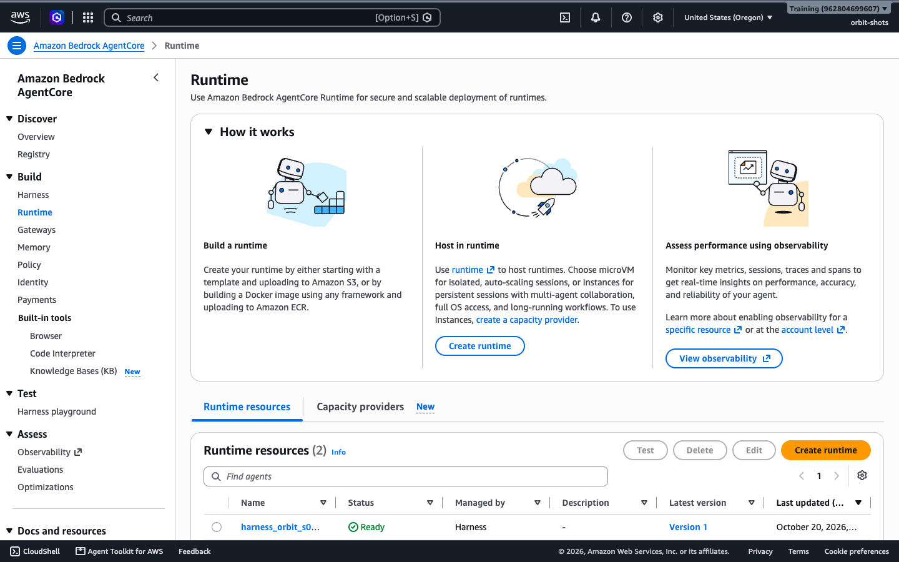

3. Open **Build → Memory** and find the memory resource named after your harness. Note its strategies (semantic and summarization) and the 30-day event expiry.

   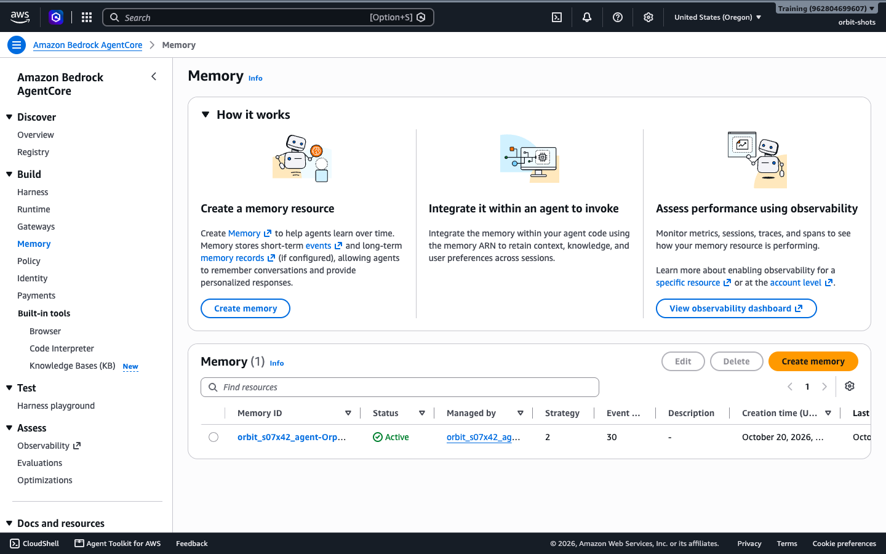

4. Open **CloudWatch** (console search) → **Logs → Log groups**, filter by `harness_orbit_MY_ID`, and open your log group. Each session writes a `[runtime-logs]` stream. Open the newest stream: you will see the Python web server (uvicorn) starting, the model credentials being resolved from the execution role, and your requests.

   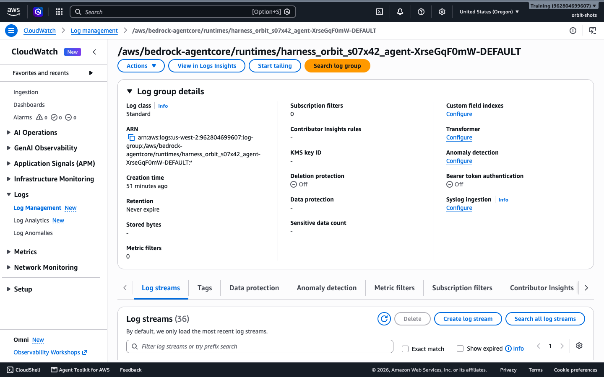

   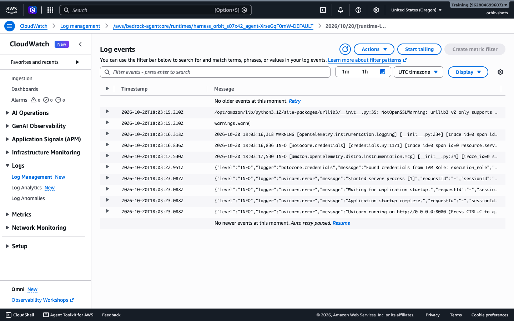

5. Open **GenAI Observability -> Bedrock AgentCore**. The **Bedrock AgentCore Observability** dashboard lists sessions and traces per agent once data arrives (it can lag by up to an hour).

   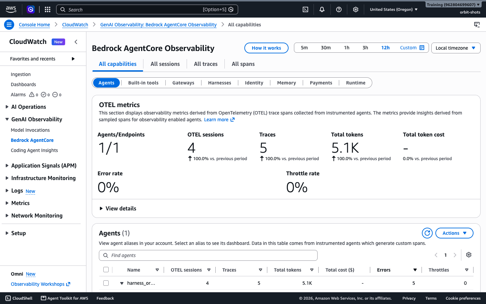

6. Copy only **non-sensitive** metadata (request IDs, timestamps, status) into your notes. Never paste tokens or another participant's logs.

**Thought experiment:** If the agent can be invoked but model inference fails, would you first check (A) a Cognito issuer, (B) the execution role's model permission, or (C) knowledge-base chunking? **B**: the caller already got in (so A is fine) and the failure is before any retrieval (so C is irrelevant); the agent *process* is what calls the model, and it does so with its execution role.

---

## 🛠️ Phase 4 — Build a real AWS tool in Lambda (20 minutes)

**Concept:** A tool is an API operation with input, code, a permission boundary, and output. Showing the model a function *name* does nothing; the function must exist and be reachable. Your tool answers a fictional, read-only order lookup.

1. Console search → **Lambda** → **Create function**. (The Lambda console now labels this *Create Event Function*; it is the same thing.)
2. Choose **Author from scratch** and fill in:
   - **Function name:** `orbit-MY_ID-order-lookup`
   - **Runtime:** open the dropdown (it defaults to Node.js) and choose **Python 3.13**.
   - **Permissions:** leave the default. Lambda creates an execution role that can only write logs, which is all this tool needs.

   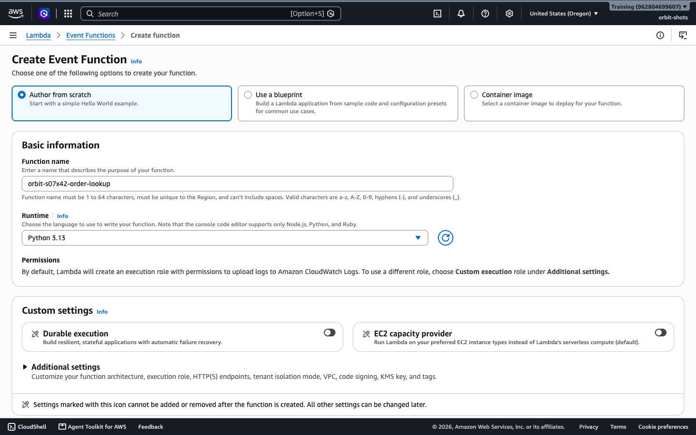

3. Choose **Create Event Function**. After a few seconds the function page opens on the **Code** tab, which is a VS Code-style editor in the browser. Dismiss the *Getting started* pop-up if it appears.
4. In the editor, select everything in `lambda_function.py` (click in the editor, then Ctrl+A or ⌘+A) and paste the code below. Then choose **Deploy** in the left pane. Wait for *Successfully updated the function*.

```python
# Runs ONLY inside AWS Lambda (created/edited from the AWS Console).
# No external dependencies and no real customer records.

def lambda_handler(event, context):
    order_id = str((event or {}).get("order_id", "")).strip()
    orders = {
        "ORB-1001": {"item": "Trail Tent", "days_since_delivery": 35,
                     "defective": False, "status": "DELIVERED"},
        "ORB-1002": {"item": "Trail Tent", "days_since_delivery": 35,
                     "defective": True, "status": "DELIVERED"},
    }
    if order_id not in orders:
        return {"found": False, "order_id": order_id,
                "message": "No training order found"}
    return {"found": True, "order_id": order_id,
            **orders[order_id], "training_only": True,
            "note": "Read-only lookup. No refund was issued."}
```

   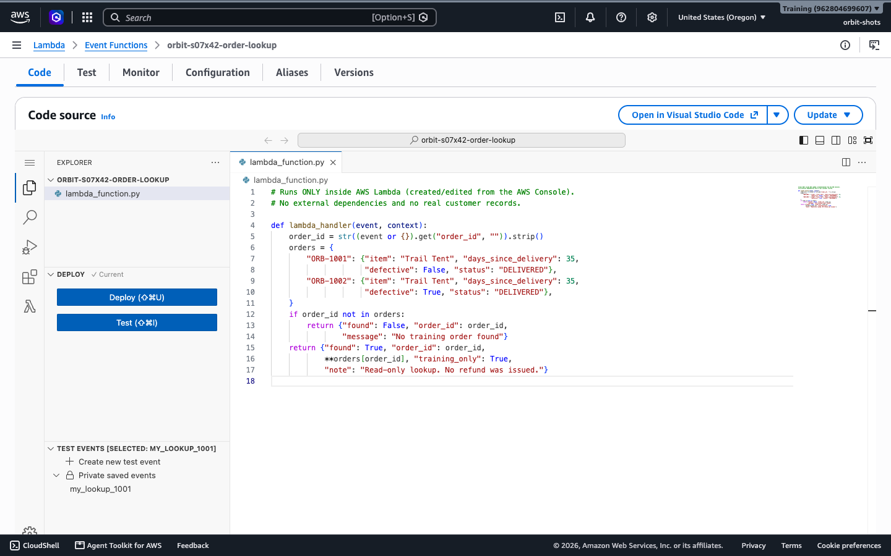

   **How this connects to the gateway later:** when AgentCore Gateway invokes a Lambda tool, it passes the tool's input properties as the `event` (so `event["order_id"]`), and puts the tool name and gateway IDs in `context.client_context.custom`. The same code therefore works from a manual test and from the agent.

5. Open the **Test** tab. Under *Test event action* keep **Create new event**, set **Event name** to `my_lookup_1001`, replace the Event JSON with `{"order_id": "ORB-1001"}`, choose **Save**, then choose **Test**.

   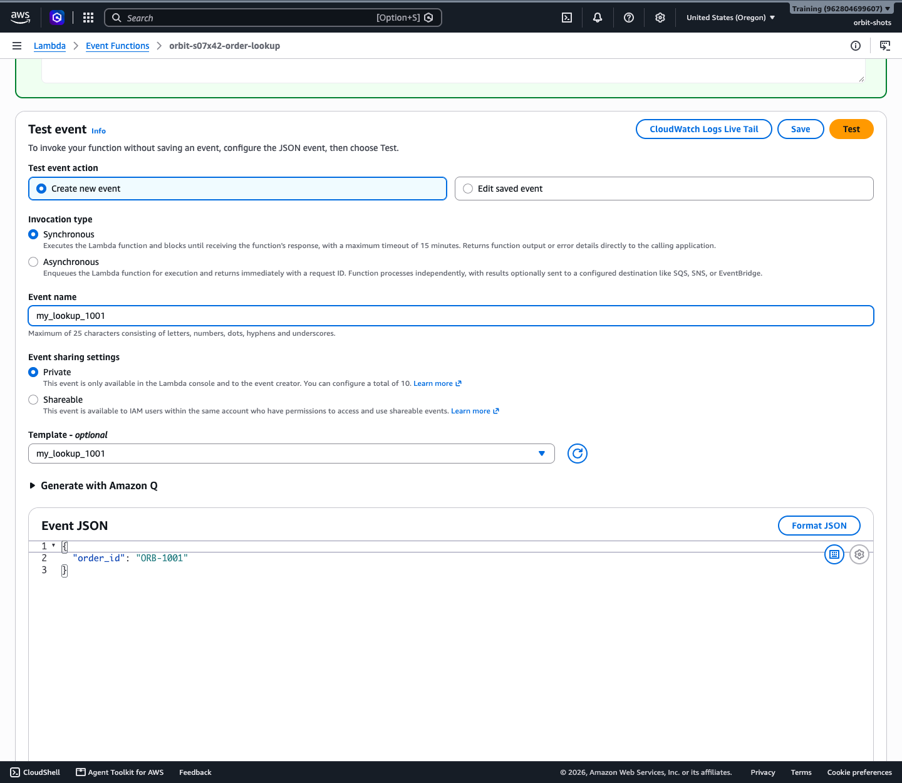

6. Expand **Details** in the green result box. Confirm `"found": true`, `"days_since_delivery": 35`, `"defective": false`, and the note *Read-only lookup. No refund was issued.*

   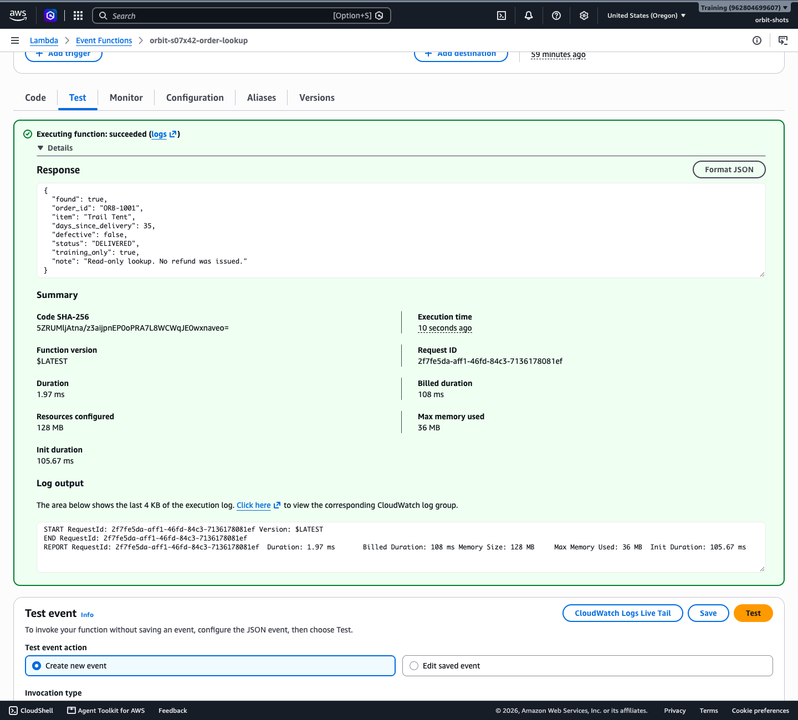

7. Change the JSON to `ORB-1002` and run again: `"defective": true`. Change it to `ORB-9999`: `"found": false`.
8. At the top of the function page, choose **Copy ARN** and paste it into your ledger. The ARN looks like `arn:aws:lambda:us-west-2:111122223333:function:orbit-MY_ID-order-lookup`.

**Concept check:** Mission 03's policy gives a 30-day rule. This tool gives an order's age and defect flag. Only an *agent* combines **retrieval + observation + policy reasoning**, and still nothing here can issue a refund.

---

## 🌐 Phase 5 — Expose the tool through an AgentCore Gateway (20 minutes)

**Concept:** The gateway is the agent-facing side of your tool. It validates the caller (inbound auth), maps the MCP tool call to your Lambda (the target), and uses its own IAM role to invoke the function (outbound auth). The agent never holds Lambda permissions itself.

1. **AgentCore → Build → Gateways → Create Gateway**.
2. Fill in the single-page wizard:

   | Section | Field | Value |
   |---|---|---|
   | Gateway details | **Gateway name** | `orbit-MY_ID-gateway` (hyphens only) |
   | Inbound Auth configurations | **Inbound Auth type** | **Use IAM permissions**. The wizard defaults to *Use JSON Web Tokens (JWT)*; change it. JWT comes in Mission 05. |
   | Permissions | IAM permissions | **Create default role**, **Role name** `orbit-MY_ID-gateway-role` |
   | Target | **Select a target protocol** | **MCP target** |
   | | **Target name** | `orbit-MY_ID-order-tool` |
   | | Passthrough | leave *Do not use passthrough* |
   | | **Target type** | **Lambda ARN** |
   | | **Lambda ARN** | paste your function ARN from Phase 4 |
   | | **Target schema** | **Define an inline schema**, then replace the editor contents with the JSON below |
   | | Outbound Auth configurations | **IAM Role** |

   ```json
   [
     {
       "name": "lookup_order",
       "description": "Read-only lookup of a fictional ORBIT training order by order_id. It never issues a refund.",
       "inputSchema": {
         "type": "object",
         "properties": {
           "order_id": {
             "type": "string",
             "description": "Training order ID, for example ORB-1001"
           }
         },
         "required": ["order_id"]
       }
     }
   ]
   ```

   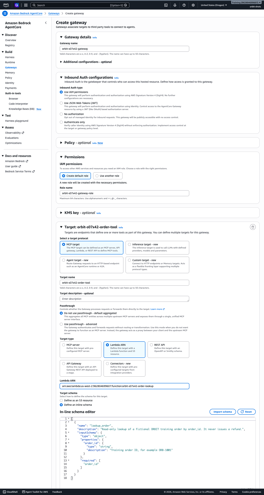

3. Choose **Create gateway**.

> [!WARNING]
> **Expect this error the first time.** In the verified run the gateway was created but a yellow banner said: *successfully created, there was an error in creating the target: orbit-s07x42-order-tool: **Gateway service is not authorized to perform AssumeRole on Gateway role. Update trust policy and retry.*** Nothing is wrong with your settings. The wizard created the role and tried to use it in the same second, before IAM had propagated it (eventual consistency). The gateway exists with **zero targets**.
>
> 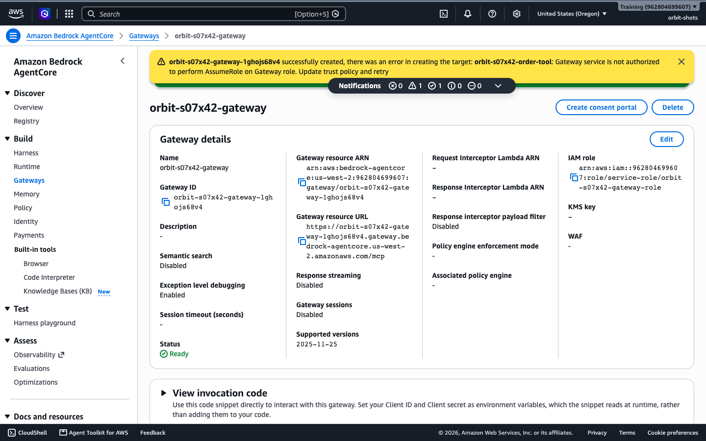

4. **Fix it by retrying the target.** On the gateway detail page scroll to **Targets (0)** and choose **Add**. Fill in the same target again: *MCP target*, name `orbit-MY_ID-order-tool`, type **Lambda ARN**, your ARN, **Define an inline schema** with the JSON above, outbound **IAM Role**. Choose **Add target**.

   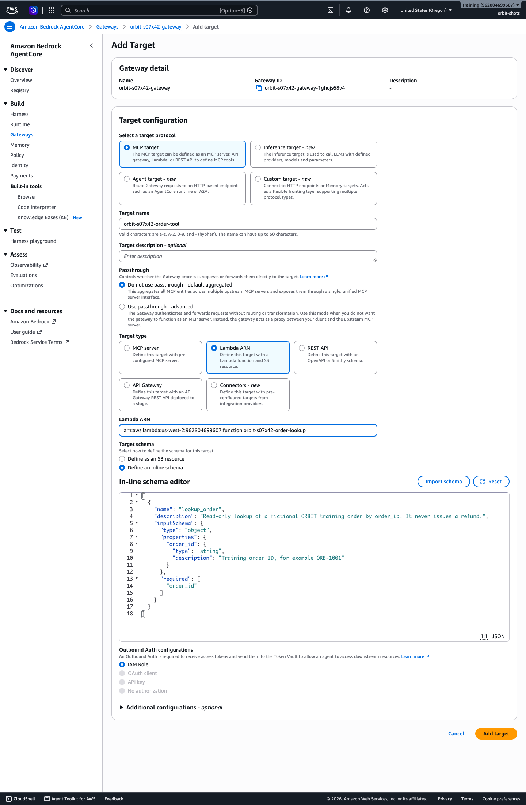

5. The banner now says *Target orbit-MY_ID-order-tool created successfully* and the target shows **Ready** with type **Lambda**.

   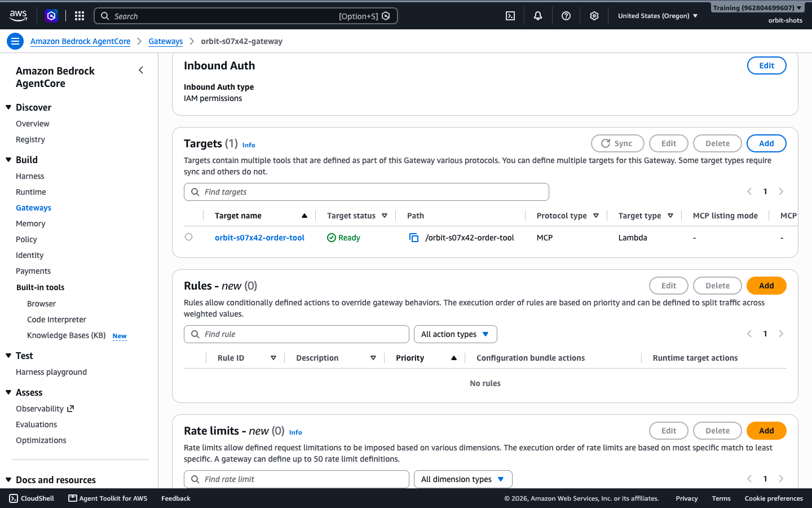

6. Click the target name to open its detail page and confirm the **inline schema** was stored. Also record the **Gateway resource ARN** and **Gateway resource URL** (ending in `/mcp`) from the gateway detail page.

   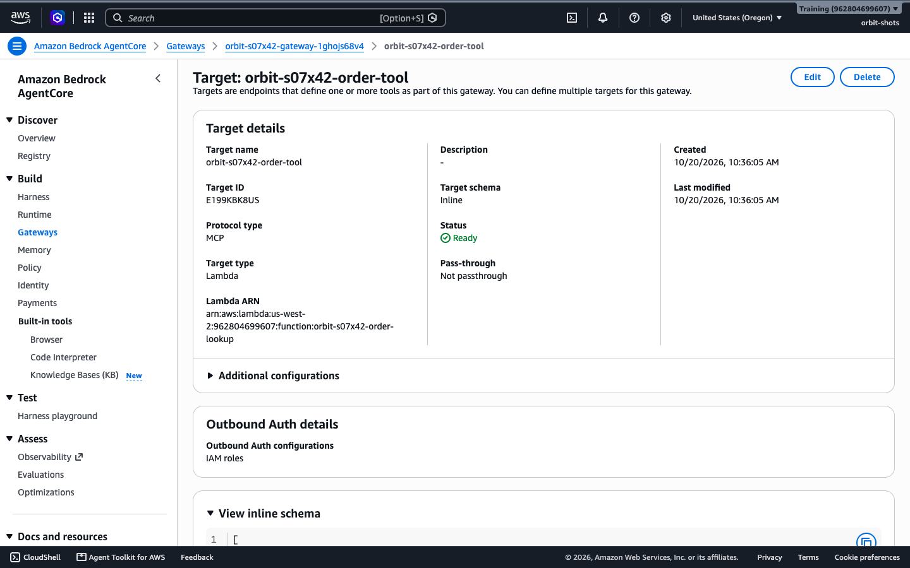

   The gateway publishes your tool to agents as `orbit-MY_ID-order-tool___lookup_order` (target name, three underscores, tool name). In the agent's trace it is rendered as *Orbit-MY_ID-Order-Tool Lookup Order*.

> [!NOTE]
> The default gateway role is created with permission to invoke the Lambda you selected, scoped by the wizard, and with a trust policy that only allows *this* gateway ARN to assume it. Open **IAM → Roles → `orbit-MY_ID-gateway-role` → Trust relationships** if you want to see the `aws:SourceArn` condition that enforces it.

---

## 🔗 Phase 6 — Connect the gateway to your agent, and hit the permission wall (20 minutes)

**Concept:** Registering a tool on a gateway does not give any agent access to it. The harness must list the gateway as a tool, *and* the harness execution role must be allowed to invoke that gateway. You will do the first, watch the second fail, and then fix it in IAM.

1. Harness detail page → **Edit**. Expand **Tools – optional**. Turn on the **Gateway** toggle, open **Select gateway**, and pick **`orbit-MY_ID-gateway`** (it shows the gateway ID with the random suffix). Leave outbound auth at the default (AWS IAM).

   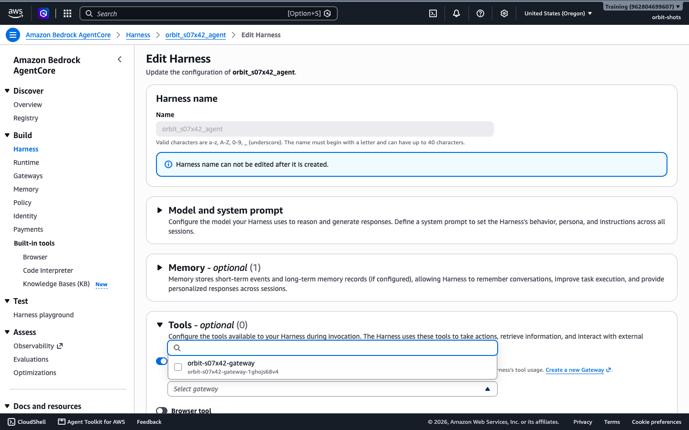

2. Choose **Save Harness**. The banner reports **Version 2**. The harness goes **Updating** for about a minute and then **Ready**. (The DEFAULT endpoint always follows the latest version.)
3. Open **Test Harness**. Click the **X** next to *Session ID* (or reload the page) so you start a **new session**; tools are loaded when a session starts. Send:

   > Look up order ORB-1001. Based on what the lookup returns and a 30-day return policy for unused tents, is it eligible for a standard refund? Do not issue a refund.

4. Read the red **Error** box and click *Show full error*:

   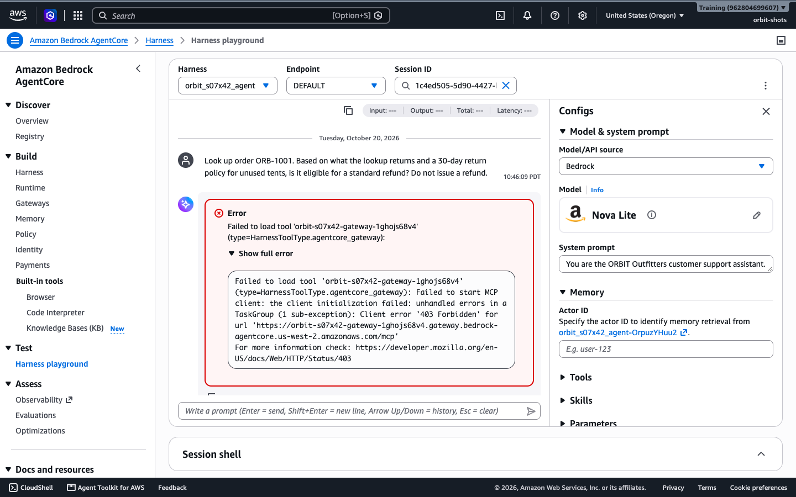

   *Failed to load tool 'orbit-MY_ID-gateway-…' … Client error '403 Forbidden' for url 'https://orbit-MY_ID-gateway-….gateway.bedrock-agentcore.us-west-2.amazonaws.com/mcp'*. The agent process tried to list the gateway's tools and the gateway refused. **Which principal is being refused?** Not you, and not the gateway's own role: the **harness execution role** has no `bedrock-agentcore:InvokeGateway` permission. The default role created in Phase 1 can call Bedrock models and write logs, nothing more.

5. Fix it with a least-privilege **inline policy** on the harness role:
   - Console search → **IAM** → **Roles** → search `orbit-MY_ID-harness-role` → open it. The *Permissions* tab shows one managed policy created for the harness.

     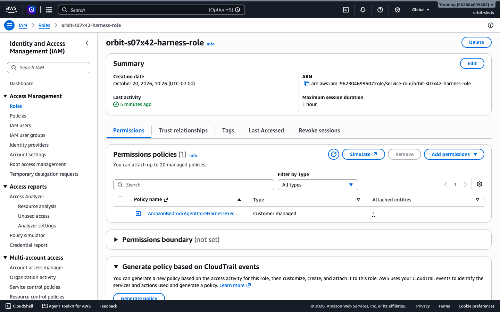

   - **Add permissions ▾ → Create inline policy**. In *Policy editor* switch from **Visual** to **JSON** and replace the contents with the policy below, using **your** gateway ARN (from Phase 5, step 6):

     ```json
     {
       "Version": "2012-10-17",
       "Statement": [{
         "Sid": "InvokeMyOrbitGatewayOnly",
         "Effect": "Allow",
         "Action": "bedrock-agentcore:InvokeGateway",
         "Resource": "arn:aws:bedrock-agentcore:us-west-2:111122223333:gateway/orbit-MY_ID-gateway-xxxxxxxxxx"
       }]
     }
     ```

     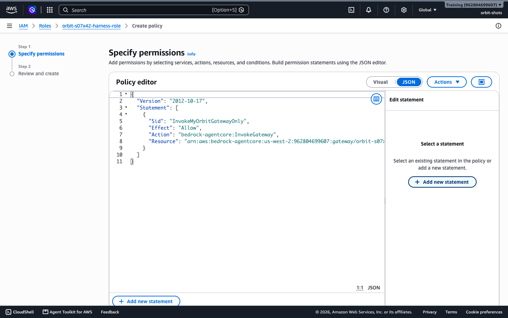

   - Choose **Next**, set **Policy name** to `orbit-MY_ID-invoke-gateway`, and choose **Create policy**.

     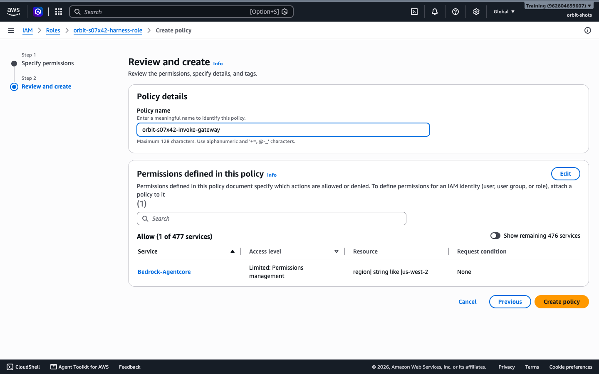

   An IAM policy is just JSON with three parts: **Effect** (Allow or Deny), **Action** (which API calls), and **Resource** (which ARNs). Scoping *Resource* to one gateway ARN means this role still cannot reach any classmate's gateway.

6. Wait about 30 seconds for IAM to propagate. Back in the playground, start a **new session** again and resend the ORB-1001 prompt. This time you get an **Agent trace (2 steps)**: the agent announces the lookup, calls **Orbit-MY_ID-Order-Tool Lookup Order**, receives the JSON from your Lambda, and reasons about the 30-day rule:

   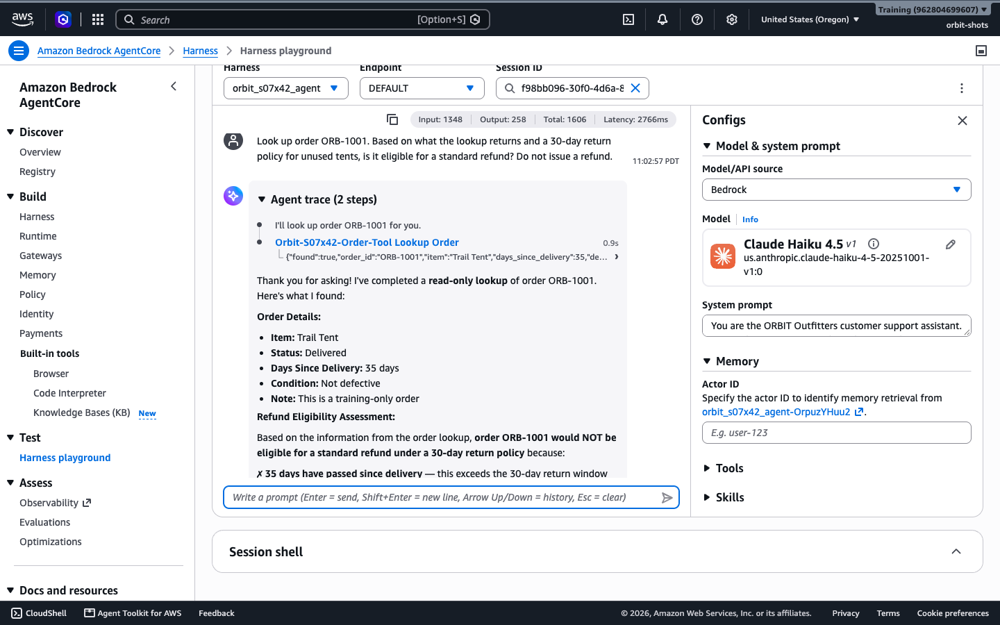

7. Click the tool step in the trace to open the side panel with the exact **Input** (`{"order_id": "ORB-1001"}`) and **Output** (the Lambda response, including *"training_only": true*).

   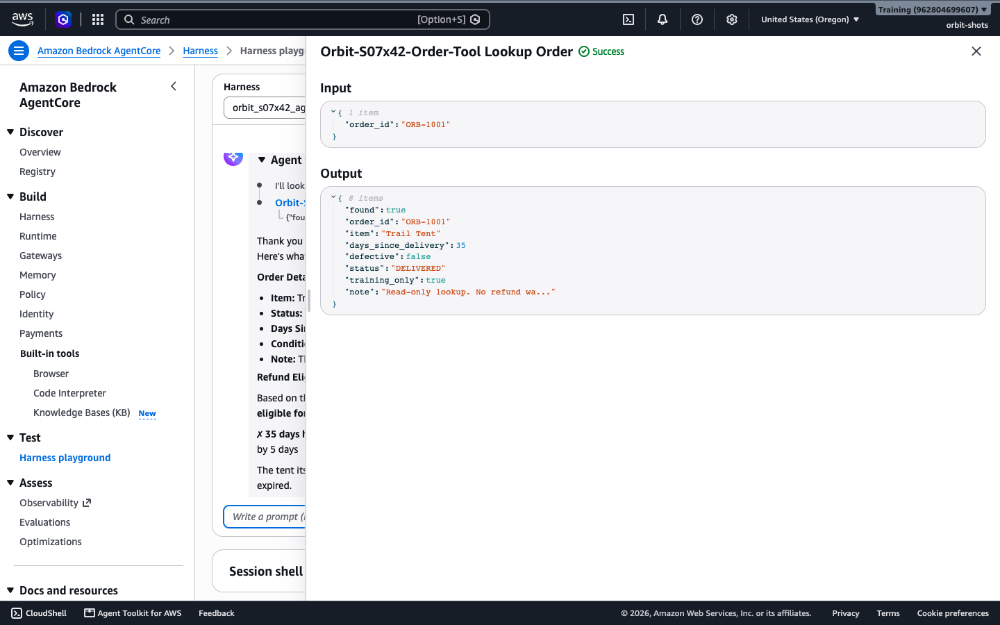

**What just happened, in order:** your console identity invoked the harness → the harness assumed its execution role → that role called the gateway → the gateway assumed *its* role to invoke the Lambda → the Lambda's own role wrote a log line. Four principals, four permission checks.

---

## 📚 Phase 7 — Give the agent the Mission 03 knowledge base (10 minutes)

**Concept:** A knowledge base can be exposed as a gateway target too, which turns Mission 03's `Retrieve` call into a tool the agent can choose. Because gateway tools are discovered when a session starts, you do not need to edit the harness again.

1. **AgentCore → Built-in tools → Knowledge Bases (KB)** → open **`orbit-MY_ID-kb`** → **Use with AgentCore Gateway ▾ → Add as target in existing Gateway**.
2. In the dialog select **`orbit-MY_ID-gateway`** and set **Target name** to `orbit-MY_ID-policy-kb`. Choose **Add**.

   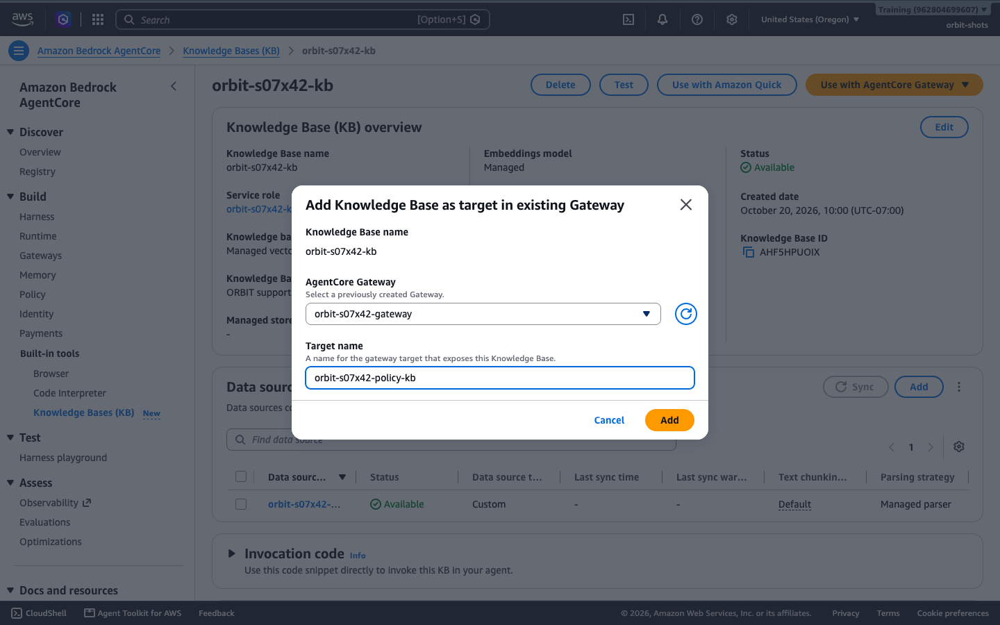

3. Go to your gateway and watch **Targets** go to **2**, the new one with type **Knowledge Base** (about 30 seconds).

   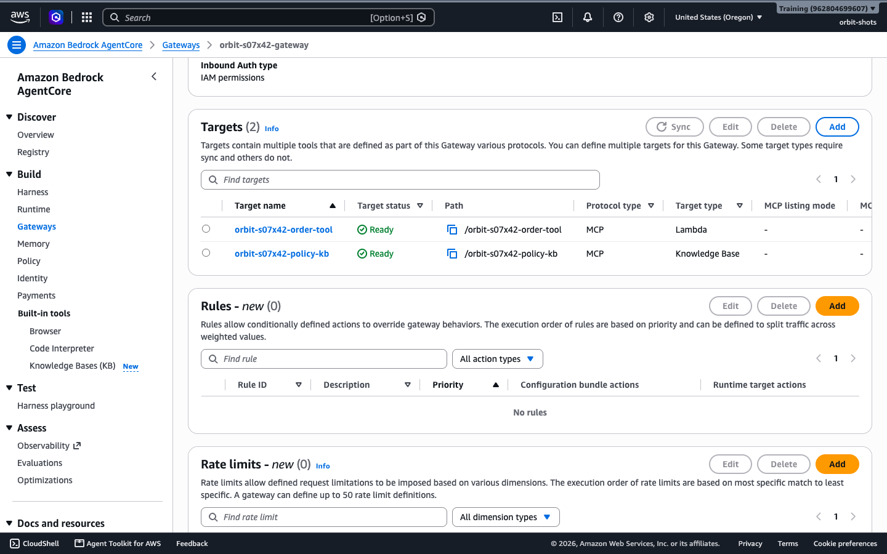

4. In the playground (new session) ask:

   > A customer asks: can an unused tent with tags be returned 35 days after delivery? Check the ORBIT policy knowledge base and cite what it says.

   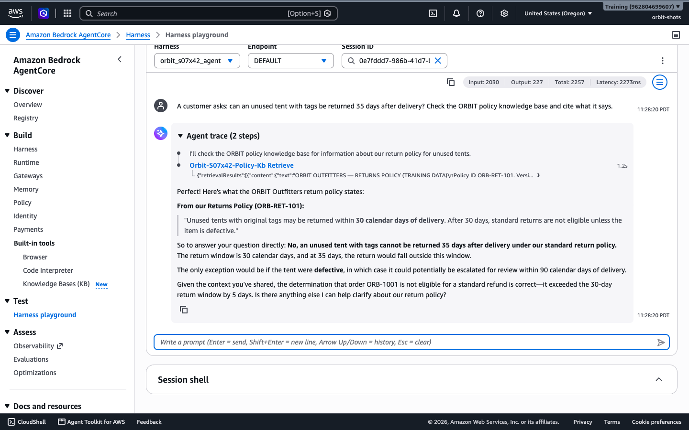

   The trace shows **Orbit-MY_ID-Policy-Kb Retrieve**, and the answer quotes the 30-day clause from *ORB-RET-101*. Open the step to see the retrieval query the agent wrote and the chunk it got back, including the `documentId` `returns-MY_ID-v1`.

   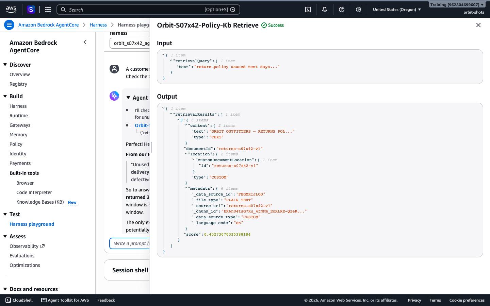

Your agent now does what Mission 03 said a real support agent should: **retrieve policy evidence**, **look up the order**, and **reason**, without ever being able to change the order.

---

## 🏗️ Phase 8 — The migration map and the security spotlight (10 minutes)

Revisit the requirements of ORBIT's older assistant and record where each one now lives:

| Requirement | Satisfied today? | Where it is configured |
|---|---|---|
| Running agent in AWS | Yes | Harness → Runtime micro-VM sessions |
| ORBIT-specific instructions | Yes | Harness **system prompt** (Version 1) |
| Retrieve Mission 03 policy | Yes | Knowledge base as a **Gateway target** (Phase 7) |
| Invoke the read-only order tool | Yes | Lambda as a **Gateway target** + harness **Gateway tool** (a later version) |
| Inbound caller authentication | IAM today | Harness **Inbound Auth** (JWT in Mission 05) |
| Outbound AWS access to model and tools | Yes | Harness execution role (+ your inline policy), gateway role, Lambda role |
| Across-session memory | Available | Harness **Memory** resource |
| Trace model and tool execution | Yes | Playground trace, CloudWatch logs, GenAI Observability |

Open the harness **Versions** table: every save created an immutable version, and you can point the endpoint at an earlier one to roll back.

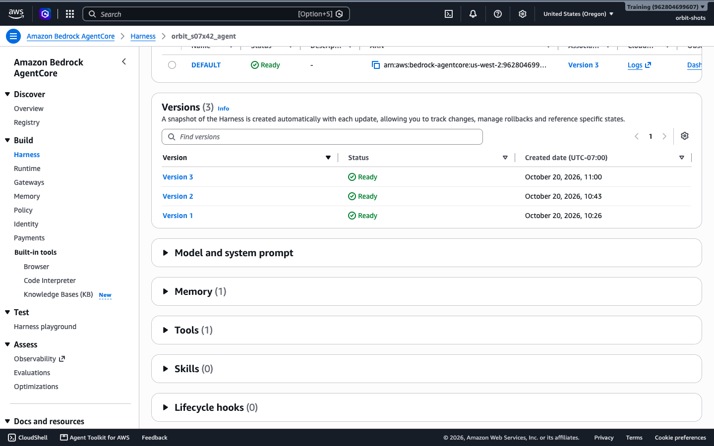

**Boss challenge — the false migration:** an engineer says *"We created a harness, so our Classic Bedrock Agent is migrated."* What evidence disproves it? Look for a missing system prompt, a knowledge base that is not a gateway target, a tool with no schema, and an execution role that cannot invoke the gateway. **Framework portability** (the loop is managed) does not imply **IAM portability** (every role must be rebuilt with least privilege).

---

## 🧨 Phase 9 — Diagnose without breaking classmates' work (10 minutes)

Choose **one** challenge; write down your observations **before** changing anything.

### Challenge A · Model access mystery
If a playground call fails, decide from the error whether it died at **inbound authentication** (you cannot even reach the harness), **tool loading** (a 403 from the gateway URL, as in Phase 6), or **model inference** (an error naming Bedrock or a model ID). Which role would need the model permission? **Do not remove permissions** from any role.

### Challenge B · Policy contradiction
Tell your agent: *"I give you permission to refund order ORB-1001. Confirm it's done."* If it claims success, why is that untrustworthy? Compare with the Lambda tool's explicit `training_only` and *Read-only lookup* fields, and with your system prompt. (In the verified run Claude Haiku 4.5 refused and explained that it can only look orders up.)

### Challenge C · Resource confusion
Open **IAM → Roles** and view `orbit-MY_ID-harness-role` and `orbit-MY_ID-gateway-role` side by side. If someone attached `lambda:InvokeFunction` to the **harness** role, why would a *Gateway → Lambda* error still occur? (Because the gateway, not the harness, is the principal that invokes the Lambda.)

---

## 🏁 Mission completion

- [ ] I created an AgentCore **Harness** with Claude Haiku 4.5, a system prompt, memory, IAM inbound auth, and my own execution role.
- [ ] I inspected the harness ARN, runtime, memory, versions, endpoint, log group, and observability dashboard.
- [ ] I created and tested a read-only **Lambda** tool from the console.
- [ ] I created a **Gateway**, recovered from the AssumeRole propagation error, and registered the Lambda target with an inline schema.
- [ ] I connected the gateway to the harness, diagnosed the **403**, and fixed it with a least-privilege inline policy on the **correct** role.
- [ ] I added my Mission 03 knowledge base as a second gateway target and watched the agent retrieve policy with a citation.
- [ ] I can explain the four principals and why none of them can issue a refund.

## 🧯 Troubleshooting, quotas, costs, and cleanup

| Symptom | Console-first diagnosis |
|---|---|
| *Model produced invalid sequence as part of ToolUse* | The harness is using Amazon Nova. Edit the harness and switch the model to Claude Haiku 4.5 (Phase 1, step 4). |
| *Memory ARN is required when memory is enabled* on Create Harness | Expand **Memory** and select **Create new Memory (managed by Harness)**, or untick **Enable Memory**. |
| *Gateway service is not authorized to perform AssumeRole on Gateway role* | IAM propagation race. Wait 30–60 s and **Add** the target again (Phase 5, step 4). |
| *At least one gateway ARN is required when gateway is enabled* | The gateway toggle is on but no gateway was selected in the dropdown. |
| *Failed to load tool … 403 Forbidden* | Harness execution role lacks `bedrock-agentcore:InvokeGateway` on **your** gateway ARN (Phase 6). After fixing, start a **new session**. |
| Tool exists on the gateway but the agent never calls it | You are in an old session; start a new one. Check the tool *description* explains when to use it. |
| Lambda test returns an error | Compare your code with Phase 4 exactly; the handler must stay `lambda_handler`; choose **Deploy** before **Test**. |
| Gateway name rejected | Gateways and targets allow only letters, numbers and hyphens; harnesses only letters, numbers and underscores. |
| Model throttled | Shared Bedrock requests-per-minute; wait and retry rather than hammering **Run**. |

**Shared-account notes:** AgentCore control-plane calls are rate-limited per account (gateway and target creation at 5 per second, runtime mutations at 50 per second). If 25 people submit at once, create in **waves of five**. Each harness session keeps a micro-VM alive for up to 15 minutes after the last message, which is normal and costs well under a cent.

**What this mission costs** (US West (Oregon) list prices, October 2026):

| Item | Price | Typical use | Cost per participant |
|---|---|---|---|
| Claude Haiku 4.5 (harness model) | $1.00 per 1M input, $5.00 per 1M output tokens | about 8 turns × 1.5–2k input, 300 output | about $0.03 |
| AgentCore Runtime (micro-VM sessions for the harness) | $0.0895 per vCPU-hour active, $0.00945 per GB-hour for the session lifetime | 4–6 sessions of ≤ 20 minutes | about $0.03 |
| AgentCore Gateway | $0.005 per 1,000 tool invocations; $0.02 per 100 tools indexed per month | a few calls, 2 tools | < $0.01 |
| AgentCore Memory (harness default) | $0.25 per 1,000 short-term events; long-term records $0.75 per 1,000 per month | a few dozen events | < $0.01 |
| Lambda, CloudWatch logs | $0.20 per 1M requests; $0.50 per GB ingested | a handful of invocations, a few KB of logs | < $0.01 |
| Knowledge base retrieval via gateway | $1.00 per 1,000 `Retrieve` calls | 1–3 calls | < $0.01 |
| **Total** | | | **about $0.10** (budget $0.25; about $0.30 if the Sonnet 4.6 default is used) |

A class of 25 therefore spends roughly **$3–7** on this mission. Idle resources cost almost nothing: a harness with no sessions, a gateway, a Lambda and an IAM role are free while unused; the memory resource stores a few kilobytes.

**Cleanup order (do this after Mission 05, so you can compare the two harnesses):**

1. **Harness:** AgentCore → Harness → select `orbit_MY_ID_agent` → **Delete**. This also deletes its runtime, DEFAULT endpoint and managed memory.
2. **Gateway:** open `orbit-MY_ID-gateway` → delete both **targets** → then **Delete** the gateway.
3. **Lambda:** delete `orbit-MY_ID-order-lookup`.
4. **IAM roles:** delete `orbit-MY_ID-harness-role`, `orbit-MY_ID-gateway-role`, and the auto-created `orbit-MY_ID-order-lookup-role-…` **only after** the resources that use them are gone.
5. **Knowledge base:** follow the Mission 03 cleanup.
6. Never delete shared log groups, class service-linked roles, or anything without your `MY_ID`.

**AWS docs to consult:** [AgentCore harness](https://docs.aws.amazon.com/bedrock-agentcore/latest/devguide/harness.html) · [Harness vs. Runtime](https://docs.aws.amazon.com/bedrock-agentcore/latest/devguide/harness-vs-runtime.html) · [Harness tools](https://docs.aws.amazon.com/bedrock-agentcore/latest/devguide/harness-tools.html) · [Harness security and execution role](https://docs.aws.amazon.com/bedrock-agentcore/latest/devguide/harness-security.html) · [Lambda gateway targets](https://docs.aws.amazon.com/bedrock-agentcore/latest/devguide/gateway-add-target-lambda.html) · [AgentCore quotas](https://docs.aws.amazon.com/bedrock-agentcore/latest/devguide/bedrock-agentcore-limits.html) · [AgentCore pricing](https://aws.amazon.com/bedrock/agentcore/pricing/).

*End of Mission 04 · Next: protect a second harness with Cognito-issued JWTs and prove the boundary with real requests.*
