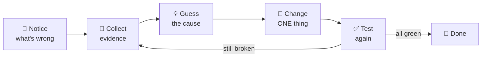

# 🛰️ ORBIT FIELD ACADEMY
## BREAK-FIX TRACK · ORBITOPS: COSMIC CARGO RESCUE
### Six AI systems, each broken on purpose. Find the evidence, fix the fault, prove it works.

## 🧭 How a break-fix mission works

In the guided missions, the guide tells you every click. **Break-fix missions are different.** Someone built a working AI agent, then broke one part of it on purpose. You get the symptoms, a few clues, and hints if you need them. You work out what's wrong, fix it, and prove it's fixed.

Real engineers spend a lot of their time doing exactly this. The **AWS Agentic AI Demonstrated** assessment works the same way, so every mission here is good practice for it.



**The golden rule: look before you touch.** Write down what you see *before* you change anything. If you change three things at once and it starts working, you won't know which change fixed it. If it gets worse, you won't know what to undo.

## 🌌 The story

**OrbitOps** runs a space-cargo supply chain. Its operators chat with an AI **flight controller**: an AI agent that answers questions and uses tools to look up stock, suppliers, shipments and inspections. Around the agent sit the services every real agent needs: a login system, a tool gateway, a library of manuals, a memory, a private network and a safety filter.

During a "migration", someone broke a different piece of each one. Cargo is grounded. **You're on call.**

| Mission | What's broken | You'll work with | Minutes |
|:-:|---|---|:-:|
| **A** | The chat app can't log in to the flight controller | Amazon Cognito, OAuth tokens, JWT authorizers | 40 |
| **B** | Ask where a shipment is and you get stock counts | AgentCore Gateway, MCP tools, Lambda | 40 |
| **C** | The manuals exist, but the agent can't read them | Bedrock Knowledge Bases, a second agent | 60 |
| **D** | Open a new chat and it forgets who you are | AgentCore Memory | 35 |
| **E** | The agents talk to AWS over the public internet | VPC, PrivateLink endpoints | 45 |
| **F** | It happily repeats secrets and personal data | Bedrock Guardrails | 40 |

The missions don't depend on each other. Your instructor chooses which ones you run and in what order.

## 🪪 Your first five minutes

### 1. Get your mission card

Your instructor gives you a **mission card** with your personal values. Keep it open in a browser tab all session.

| On your card | Looks like | What it's for |
|---|---|---|
| Console sign-in link | `https://…signin.aws.amazon.com/console` | Where you sign in to AWS |
| Username and temporary password | for example `student-07` / `••••••••` | Your AWS login |
| **Lab id** | `student07` | Built into the name of every resource you own |
| **Chat console URL** | `https://abc123….lambda-url.us-west-2.on.aws/` | The OrbitOps chat app you're repairing |
| Mission values | IDs, ARNs, URLs | Each mission lists the ones it needs |

> [!IMPORTANT]
> Your **login** and your **lab id** look alike but aren't the same: a login such as `student-07` has a hyphen, the lab id `student07` does not. Resource names use the lab id: `orbit-student07-am01-chat-handler`. In these guides, replace `student07` with **your** lab id.

### 2. Sign in and pick the Region

Sign in with the link on your card. If AWS asks you to choose a new password, do it now. Then check the **Region** selector in the top-right corner: it must say **US West (Oregon) `us-west-2`**.

> If a console page looks empty or says *no resources*, the Region is wrong nine times out of ten.

### 3. Find *your* copy

Everyone shares one AWS account, and everyone has their own copy of OrbitOps. To find yours, type your lab id into the search box of any console list.

| Resource | Where to find it | Your copy is named like |
|---|---|---|
| Chat app (the web page) | Lambda → Functions | `orbit-student07-am01-chat-handler` |
| Tool functions | Lambda → Functions | `orbit-student07-am01-inventory`, `…-logistics`, … |
| Flight controller agent | Bedrock AgentCore → Runtime | `orbit_student07_am01_orchestrator` (underscores) |
| Tool gateway | Bedrock AgentCore → Gateways | `orbit-student07-am01-gateway` |

> [!CAUTION]
> Anything **without** your lab id belongs to a classmate or to the whole class. **Look, don't touch.**

### 4. Meet the chat console

Open your **chat console URL**. Type a message and the flight controller answers. Three things on this page are your best evidence in every mission:

1. **Red ⚠ lines** are errors. The first line is short; the line under it (the *detail*) usually says exactly which part failed.
2. **The trace.** Under every reply there's a small **trace** link. Click it to see what the agent actually did, as JSON. Read `warnings` first: if something went wrong along the way, it's listed there.
3. **The status pills** in the sidebar, under *Last reply trace*. **Green means the feature is switched on** (for *tools called* and *specialist*: it was used in this reply). **Amber means it's off, or wasn't used.** Green isn't proof that it worked: also read the number on the pill and the `warnings`.

```chat The status pills, explained
pill+ gateway: 9 tools
pill+ tools called: logistics-target___track_shipment
pill- memory: 0 hits
pill- specialist: not configured
pill- guardrail: n/a
note: gateway = how many tools the agent found · tools called = which tools it used for this reply · memory = facts it remembered about you · specialist = whether it asked the manuals expert · guardrail = what the safety filter did
```

Each mission only cares about one or two pills. The others can stay amber; they belong to other missions.

> [!TIP]
> **Check the trace after every message.** "The reply looks fine" isn't evidence. A green pill, an empty `warnings` list and the right tool name are.

### 5. The health page

Add `health` to the end of your chat URL (for example `https://abc123….lambda-url.us-west-2.on.aws/health`) and open it in a new tab. It shows the chat app's settings, which ones are `MISSING`, and whether it could get a login token. Mission A depends on it most.

### Optional: a terminal with nothing to install

Everything can be done in the console. If you like the command line, open **AWS CloudShell** (the `>_` icon in the console's top bar). It's already signed in as you, in your Region.

## 🪜 How to use the hints

Every mission has **three hints per goal**. Open them in order, and **stop reading the moment you get an idea**. Then go and test your idea.

| Hint | What it gives you |
|---|---|
| **Hint 1 · Where to look** | The console page where the evidence lives |
| **Hint 2 · What to compare** | Two things that should match but don't |
| **Hint 3 · The nudge** | Leaves you one small step from the fix, without giving it away |
| **Big clue · the fault map** | A diagram that marks *where* every fault is. Use it last. |

Opening all three hints at once turns a puzzle into a recipe, and you'll remember a lot less. The struggle is where the learning happens.

## 🙋 How to ask for help (and get it fast)

First, run the mission's **Before you ask for help** checklist. Then tell your instructor three things:

1. **The symptom**, copied exactly from the error or the trace.
2. **Your guess:** "I think it's X, because Y."
3. **What you already tried**, and what changed when you did.

"It doesn't work" takes ten minutes to diagnose. "The trace says `Gateway rejected our token (403)` and I've updated the runtime's allowed clients but not the gateway's yet" takes ten seconds.

## 📏 Ground rules for a shared account

- 🌎 **Region is always `us-west-2`.** Can't find something? Check the Region first.
- 🏷️ **Only touch resources with your lab id.**
- 🔑 **Keep secrets out of chat, screenshots and slides.** That includes client secrets, access keys and your chat URL: it has no login of its own, so anyone with the link can use it.
- 💸 **Don't create anything the mission doesn't ask for.** Some AWS services charge by the hour.

## 🏠 Practise after class

You can rebuild any mission's broken environment in your own AWS account with Terraform and play it again. The instructions are in the [OrbitOps labs repository](https://github.com/varoonsahgal/orbitops-agentic-ai-labs/blob/main/PRACTICE-ON-YOUR-OWN.md). Don't read the Terraform files before you play: they *are* the crime scene.
