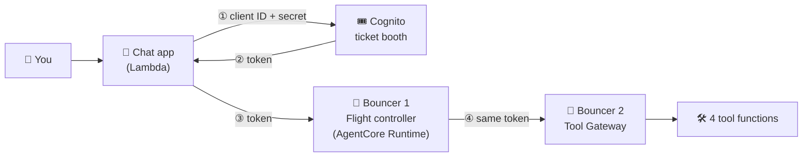

# 🛰️ ORBIT FIELD ACADEMY
## BREAK-FIX A · THE LOCKED LAUNCHPAD
### The chat app can't get past security to reach its AI flight controller. Rebuild the login chain, one link at a time.

> **LEVEL:** Break-fix · **TARGET TIME:** 40 minutes · **ENVIRONMENT:** AWS Console · the broken environment is already built for you
>
> **THE STORY:** Cargo ships are ready to launch, but every message in the OrbitOps chat console ends with *Authentication service unavailable*. During a migration, someone replaced the chat app's login key with one that can't work, and wiped the app's settings. Until the chat app can prove who it is, the AI flight controller won't talk to it.
>
> **SKILLS:** Cognito app clients · OAuth client credentials · JWT authorizers · Lambda environment variables

## 🚨 The emergency

Open your chat console and send any message. Instead of an answer, you get a red error:

```chat Right now (broken)
you: Flight control, are you receiving my cargo dispatch requests?
error: ⚠ Authentication service unavailable
note: No trace link and no pills: the request never reached the flight controller. That's a clue in itself.
```

**What *should* happen:** the chat app gets a **token** (a digital pass) from Amazon Cognito, shows it to the flight controller, and the flight controller shows the same pass to the tool gateway. Every link in that chain is broken or misconfigured somewhere.

## 🏁 The finish line

**You're done when all four of these are true:**

- The question *"Flight control, are you receiving my cargo dispatch requests?"* gets a normal reply, with no red ⚠ line.
- In that reply's **trace**, `token_source` is `"inbound"` and `warnings` is an empty list: `[]`.
- The **gateway** pill is green and says **9 tools**.
- The question *"Check our cargo stock levels"* turns the **tools called** pill green, with a tool whose name starts with `inventory-target___`.

```chat When you're done
you: Check our cargo stock levels
bot: (a stock report: SKUs, quantities and low-stock items)
pill+ gateway: 9 tools
pill+ tools called: inventory-target___get_stock_summary
note: The memory, specialist and guardrail pills stay amber in this mission. They belong to other missions.
```

## 🧠 Ideas you need first

Think of the system as a concert with **wristbands**.

- **Token = wristband.** A token is a signed digital pass. Amazon **Cognito** is the ticket booth that hands them out.
- **App client = an account at the ticket booth.** Each app that wants tokens needs its own *app client* in Cognito. It has a **client ID** (like a username) and, for apps that run on a server, a **client secret** (like a password).
- **Client credentials = software logging in as itself.** There's no human typing a password here: the chat app is a Lambda function. It logs in with its client ID and secret. This is called the **client credentials** flow (or *machine-to-machine*). Cognito only allows it for an app client that **has a secret**.
- **Scopes = which areas the wristband opens.** OrbitOps defines two: `supplychain/read` and `supplychain/write`. An app client can only ask for scopes it has been allowed.
- **JWT authorizer = the bouncer at a door.** It checks two things: is the wristband real (it asks Cognito for its public keys, via the **discovery URL**), and is this wristband's **client ID** on its guest list (**allowed clients**)?
- **There are two bouncers.** One guards the flight controller (an **AgentCore Runtime**). The flight controller passes your *same* wristband to the tool **Gateway**, which has its own bouncer and its own guest list.
- **Environment variables = the app's settings card.** The chat app reads its settings when it starts: where the ticket booth is, its client ID and secret, and where the flight controller lives.



## 🧰 What you start with

Your mission card has these values. You'll copy several of them, so keep the card open.

| Value | What it is |
|---|---|
| `chat_urls` | Your chat console. Add `health` to the end for the health page. |
| `cognito_user_pool_id` | The class's Cognito **user pool** (shared). Looks like `us-west-2_` followed by letters. |
| `cognito_domain` | The pool's web address. Its token endpoint is `https://<domain>/oauth2/token`. |
| `cognito_discovery_url` | The address both bouncers use to check that a token is real. |
| `legacy_client_ids` | The broken app client both bouncers trust right now. |
| `gateway_ids`, `gateway_urls` | Your tool Gateway. |
| `orchestrator_runtime_ids`, `orchestrator_runtime_arns` | Your flight controller. |
| `chat_function_names` | Your chat app's Lambda function. |

> [!WARNING]
> The **user pool is shared by the whole class.** Create and edit only *your own* app client, and put your lab id in its name.

## Phase 1 — Look before you touch (10 minutes)

Collect the evidence first. Write each answer down: you'll compare against it later.

- [ ] Send the test message. Copy the ⚠ error **and** the detail line under it.
- [ ] Open your health page (`<chat URL>health`). Which settings say `MISSING`? What does `token` say?
- [ ] **Cognito → User pools →** the class pool **→ App clients.** Open *your* legacy client. Does it have a **client secret**? Which **OAuth grant types** does it allow? Which **custom scopes**?
- [ ] Write down the **allowed clients** on your Gateway (**Bedrock AgentCore → Gateways →** yours **→ Inbound Auth**) and on your Runtime (**Bedrock AgentCore → Runtime →** yours).

**Predict first:** if you filled in every missing setting on the chat app and changed nothing else, would the chat start working? Write down why or why not, then keep going.

## Phase 2 — Find and fix (25 minutes)

**Your work order.** This is how the assessment phrases the job. It tells you *what* must be true at the end; the hints help with *how*.

1. Create a new **Cognito app client** that can use the **client credentials** grant. It must have a **client secret** and a name that contains your lab id.
2. Allow the existing scopes **`supplychain/read`** and **`supplychain/write`** on that client.
3. Add the new client ID to the **allowed clients** on **both** your Gateway and your Runtime.
4. Fill in the chat app's five settings: `ORCHESTRATOR_RUNTIME_ARN`, `COGNITO_DOMAIN`, `COGNITO_CLIENT_ID`, `COGNITO_CLIENT_SECRET`, `COGNITO_USER_POOL_ID`.

Don't create a new pool, gateway or runtime, and don't rename the scopes.

> [!TIP]
> **One goal at a time.** Each goal below says how you'll know it worked. Open Hint 1, try it, and only open Hint 2 if you're still stuck.

### Goal 1 · Give the chat app a key that can work

Right now the only app client is a *public web client*: the kind a browser uses. It can't prove who it is without a human, so the chat app can't use it.

**Expected:** your new app client's page shows a **client secret**, the **client credentials** grant, and both custom scopes.

<details><summary>Hint 1 · Where to look</summary>

**Cognito → User pools →** the class pool **→ App clients.** Open the legacy client and notice two things it *doesn't* have. Then choose **Create app client** and read the very first question it asks you.
</details>

<details><summary>Hint 2 · What to compare</summary>

Look at the five settings the chat app needs: one of them is a *secret*. Now look at what the legacy client has. An app with nothing secret can't prove who it is. Which **type** of application logs in without a person signing in?
</details>

<details><summary>Hint 3 · The nudge</summary>

The first choice in the create form is the **application type**. One option is named for software talking to software; picking it creates a secret automatically. The form does **not** ask which scopes to allow: it picks a default scope of its own. So after you create the client, open its **Login pages** tab and check the **custom scopes** against the two the chat app asks for. Copy the client ID and the client secret for Goal 2.
</details>

- [ ] My new app client has a secret, allows client credentials, and allows both `supplychain` scopes.

### Goal 2 · Fill in the chat app's settings card

The chat app can't ask for a token until it knows where the ticket booth is and what its own ID and secret are.

**Expected:** your health page shows all five settings as `set`, and `token` says `ok`.

<details><summary>Hint 1 · Where to look</summary>

**Lambda →** your chat app function **→ Configuration → Environment variables.** The health page tells you which ones are empty; your mission card and Goal 1 give you most of the values.
</details>

<details><summary>Hint 2 · What to compare</summary>

Two values look alike and often get swapped: the **user pool ID** (it starts with `us-west-2_`) and the **domain** (a web address ending in `amazoncognito.com`). Match each setting's *name* to the *shape* of the value you're pasting. The chat app adds `https://` to the domain itself.
</details>

<details><summary>Hint 3 · The nudge</summary>

The health page does more than list settings. Once all five are filled, it *tries to get a token* and shows the result. If `token` isn't `ok`, the message quotes Cognito's own complaint (such as `invalid_client`), which sends you back to Goal 1. When you save, keep the two settings that are already there (`STUDENT_ID` and `MODULE`).
</details>

- [ ] My health page shows every setting as `set` and `token: ok`.

### Goal 3 · Put the new client on both guest lists

Now the chat app has a real wristband. But both bouncers still have only the *old* client on their guest lists.

**Expected:** the test message gets a normal reply. The trace shows `token_source: "inbound"` and `warnings: []`, and the gateway pill is green with **9 tools**.

<details><summary>Hint 1 · Where to look</summary>

Two places, not one. **Bedrock AgentCore → Gateways →** yours **→ Inbound Auth.** And **Bedrock AgentCore → Runtime →** your flight controller **→** its inbound identity (authorizer) settings. Each one has its own **allowed clients** list.
</details>

<details><summary>Hint 2 · What to compare</summary>

Compare your new client ID with each allowed-clients list. Then read the error to see *which* bouncer is saying no. If the chat app reports that the **runtime rejected the token**, it's bouncer 1. If you get a reply but `warnings` says **Gateway rejected our token**, it's bouncer 2.
</details>

<details><summary>Hint 3 · The nudge</summary>

Leave the discovery URL alone: only the guest list is wrong. After you edit the runtime, its status leaves `READY` for about a minute while a new version starts, and the old version keeps answering until then. If you've fixed one bouncer but not the other, the error *changes*. Read it again before deciding your edit "did nothing".
</details>

- [ ] Both bouncers (Gateway and Runtime) list my new client ID.

## Phase 3 — Flight test (5 minutes)

Run both tests in your chat console and expand the trace each time.

- [ ] Ask the flight controller:

  ```text
  Flight control, are you receiving my cargo dispatch requests?
  ```

  **Expected:** a normal reply. Trace: `token_source: "inbound"`, `warnings: []`. The gateway pill is green and says **9 tools**.

- [ ] Ask:

  ```text
  Check our cargo stock levels
  ```

  **Expected:** a stock report. The **tools called** pill is green and shows a tool starting with `inventory-target___`.

**What you just proved:** a token from *your* new client got past both bouncers: the flight controller's, and the gateway's when the flight controller passed it along.

## 🧭 Stuck?

### Read the signals

| What you see | What it usually means | Go to |
|---|---|---|
| Health page shows any setting as `MISSING` | The settings card is incomplete. Nothing else can be tested yet. | Goal 2 |
| `token` mentions `invalid_client` or `unauthorized_client` | The app client can't do client credentials | Goal 1 |
| `token` mentions `invalid_grant` or a scope | The client isn't allowed the scopes it asks for | Goal 1 |
| `token` says *could not reach … /oauth2/token* | `COGNITO_DOMAIN` has the wrong shape | Goal 2 |
| Chat error: *the orchestrator runtime rejected the token (HTTP 401/403)* | Bouncer 1 doesn't know your client | Goal 3 |
| A reply arrives, but `warnings` says *Gateway rejected our token*, and the gateway pill is green but says **0 tools** | Bouncer 2 doesn't know your client | Goal 3 |
| HTTP 424 or *Flight controller fault* | The agent's code crashed. That isn't one of this mission's faults. | Ask your instructor |

### Don't waste time on

- **The discovery URL.** It's correct on both bouncers. Changing it creates new problems.
- **The scope names.** `supplychain/read` and `supplychain/write` already exist. Don't create a new resource server.
- **A new gateway or runtime.** They're healthy. Only their guest lists are wrong.
- **"Upgrading" the legacy client.** It's the wrong kind of client. Leave it alone and create the right kind.

### Before you ask for help

- Does my new client show a **client secret** and the **client credentials** grant?
- Are **both** custom scopes allowed on it?
- Is my new client ID on **both** guest lists, Gateway **and** Runtime?
- Is the runtime back to `READY` since my last edit?
- Does `COGNITO_DOMAIN` have no `https://` and no path, and does `COGNITO_USER_POOL_ID` start with `us-west-2_`?

<details><summary>Big clue · the fault map</summary>

This diagram marks **where** each planted fault is. It doesn't tell you how to fix them. Use it only after the hints.


</details>

## ⭐ Key takeaways

- **Software that logs in as itself needs a secret.** No secret means no client credentials. Cognito's machine-to-machine app type sets this up for you.
- **Scopes are allowed one client at a time.** A client can only ask for the scopes it was given.
- **Each bouncer keeps its own guest list.** A new client ID has to be added to *every* authorizer that checks the token, not just the first one.
- **Settings are part of the security chain.** Perfect identity setup still fails if the app doesn't know its domain, ID, secret or target.

## 💬 Think about it

1. Why does the chat app get the token on the server instead of letting your browser ask Cognito directly?
2. If you had fixed only the Gateway's guest list, where would the chain break, and what would the trace show?
3. The chat URL has no login of its own. Why is that risky, and how would you protect it in a real product?

## 🎓 After the mission

Your instructor walks through the fix live, then shares the debrief guide for this mission. Try the hints first: you'll remember what you worked out far better than what you were told.
