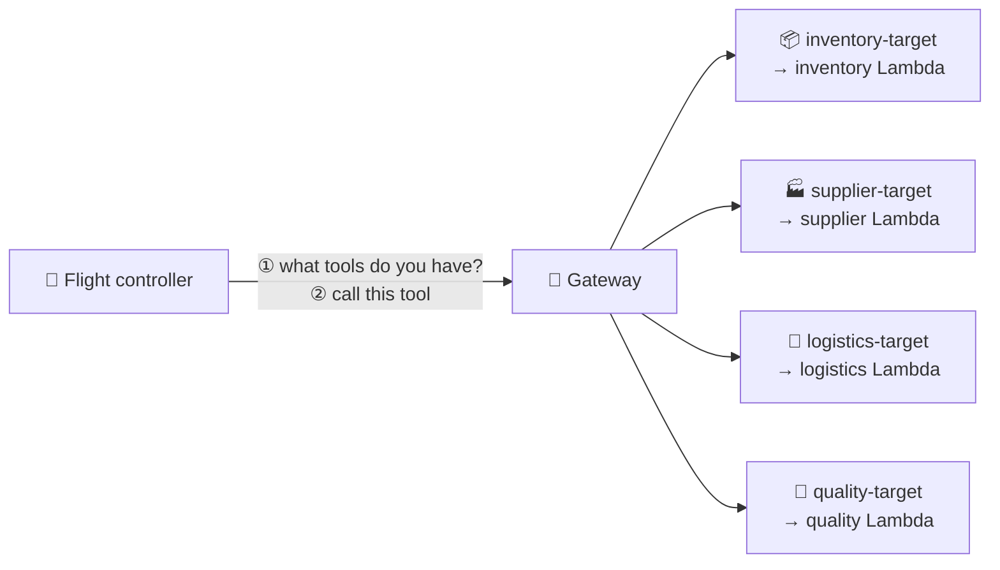

# 🛰️ ORBIT FIELD ACADEMY
## BREAK-FIX B · THE MISROUTED CARGO DROIDS
### The flight controller can chat, but its tools are miswired. Reconnect all four tool families.

> **LEVEL:** Break-fix · **TARGET TIME:** 40 minutes · **ENVIRONMENT:** AWS Console · the broken environment is already built for you
>
> **THE STORY:** The OrbitOps flight controller will happily chat about the weather on Mars. But ask it about stock and it says it has no tools. Ask where a shipment is and you get *stock counts*. Ask about quality inspections and it says that tool doesn't exist. The cargo droids have mixed up their assignments.
>
> **SKILLS:** AgentCore Gateway · MCP tool discovery · Lambda gateway targets · Tool schemas in S3

## 🚨 The emergency

Login works in this mission. The problem is the **tools**: the small programs the agent calls to look things up.

```chat Right now (broken)
you: Check our cargo stock levels
bot: I'm sorry, I don't have any tools connected right now…
pill- gateway: 0 tools
pill- tools called: none
```

**What *should* happen:** the agent asks its tool **Gateway** "what tools do you have?", gets back **9 tools** in four families (**inventory, supplier, logistics, quality**), and calls the right one for each question.

## 🏁 The finish line

**You're done when all of these are true:**

- The **gateway** pill is green and says **9 tools**.
- Each of these four questions turns the **tools called** pill green with a tool from the matching family:

| Question | Tool name starts with | A good answer mentions |
|---|---|---|
| *Check our cargo stock levels.* | `inventory-target___` | SKUs, quantities, low-stock items |
| *Who supplies NAV-GYRO-X and what is their lead time?* | `supplier-target___` | Titan Dynamics, 45 days |
| *Where is shipment SHP-1001?* | `logistics-target___` | A position, a status and an ETA |
| *Show the status of cargo quality inspections.* | `quality-target___` | Inspection IDs (`INS-…`) and results |

- For the shipment question, the trace's `result_preview` says `"service": "logistics"`.

```chat When you're done
you: Where is shipment SHP-1001?
bot: SHP-1001 is in transit in the trans-lunar injection corridor, ETA 23 Oct…
pill+ gateway: 9 tools
pill+ tools called: logistics-target___track_shipment
```

## 🧠 Ideas you need first

- **Tool = a small program the agent can call.** Here each tool family is a **Lambda function**: inventory, supplier, logistics, quality.
- **Gateway = the agent's phone book of tools.** The agent doesn't know your Lambda functions directly. It asks the **AgentCore Gateway**, which answers using **MCP** (Model Context Protocol), a standard way for agents to *list* tools and *call* them.
- **The agent needs the Gateway's address.** If nobody tells the agent where the Gateway is, it never asks for tools at all. That address lives in one of the agent's **environment variables** (its settings).
- **Target = one entry in the phone book.** A **gateway target** connects a set of tools to the function that runs them. Each target has four parts: a **name**, the **Lambda function** it calls, a **tool schema** (a description of each tool and its inputs), and **credentials** (how the Gateway is allowed to call the function).
- **Tool names come from target names.** The agent sees `target name` + `___` (three underscores) + `tool name`, for example `logistics-target___track_shipment`.
- **A wrong number doesn't always crash.** If a phone book entry has the right name but the wrong phone number, someone still answers. They just aren't the person you wanted. Watch for answers that look normal but come from the wrong place.



## 🧰 What you start with

| Value | What it is |
|---|---|
| `chat_urls` | Your chat console. Its trace shows `gateway_configured`, `tools_discovered`, `tools_called` and `warnings`. |
| `gateway_ids`, `gateway_urls` | Your Gateway. It's `READY` and its login check works. |
| `tool_function_arns` | Your four tool Lambda functions: `…-inventory`, `…-supplier`, `…-logistics`, `…-quality`. |
| `quality_schema_s3_uri` | Where the quality tools' schema file lives in Amazon S3. The other three schemas sit next to it. |
| `orchestrator_runtime_ids` | Your flight controller (an AgentCore Runtime). Its settings are under *environment variables*. |

> [!IMPORTANT]
> Target names are part of the contract: every tool name starts with them. **Don't rename** `logistics-target`, and give the new target exactly the name the work order asks for.

## Phase 1 — Look before you touch (10 minutes)

- [ ] Send *Check our cargo stock levels*. In the trace, note `gateway_configured`, `tools_discovered`, `tools_called` and `warnings`.
- [ ] Open your Gateway (**Bedrock AgentCore → Gateways →** yours) and its **Targets**. For every target, write down its name and the Lambda function it calls, side by side.
- [ ] List your four tool Lambda functions (**Lambda → Functions**, filter by your lab id).
- [ ] Open the S3 folder from `quality_schema_s3_uri`. How many schema files are there? Open `quality_tools.json` and note its two tool names.

**Predict first:** count the targets, the schema files and the tool functions. Which number is the odd one out, and what would that mean for the agent?

## Phase 2 — Find and fix (25 minutes)

**Your work order.** This is how the assessment phrases the job. It tells you *what* must be true at the end; the hints help with *how*.

1. Set the flight controller's **`GATEWAY_URL`** environment variable to your existing Gateway's endpoint URL.
2. Inspect the **logistics target** and replace its incorrect Lambda ARN with the ARN of the **logistics** function. Keep its name, `logistics-target`.
3. Create the missing quality target, named **`quality-target`**, using the **quality** Lambda function, the **`quality_tools.json`** schema from S3, and the **Gateway's own IAM role** for credentials.
4. Confirm the agent can find and use tools in **all four** families.

> [!TIP]
> Do the goals **in order**. Until the agent can find its tools at all, you can't see the other two faults.

### Goal 1 · Tell the agent where its tools are

The trace says `gateway_configured: false`. That flag comes from the *agent*, not the Gateway: the agent has no address to call.

**Expected:** `gateway_configured: true` and the gateway pill turns green. It shows **7 tools**, not 9, until Goal 3 is done.

<details><summary>Hint 1 · Where to look</summary>

**Bedrock AgentCore → Runtime →** your flight controller. Find its **environment variables**. One of them is empty.
</details>

<details><summary>Hint 2 · What to compare</summary>

That setting needs an address the agent can send requests to. Your Gateway's page offers three identifiers: an **ARN**, an **ID** and an **endpoint URL**. Only one of those is a web address.
</details>

<details><summary>Hint 3 · The nudge</summary>

The right value starts with `https://`, contains your gateway ID and the words `gateway.bedrock-agentcore`, and ends in `/mcp`. Saving a runtime's settings starts a new **version**: wait until the status is `READY` again before you test, or the old version will keep saying it has no gateway.
</details>

- [ ] The trace shows `gateway_configured: true` and the gateway pill is green.

### Goal 2 · Fix the droid that answers the wrong calls

Ask *Where is shipment SHP-1001?* You'll get stock numbers instead of a position and an ETA. The agent called the right tool name. So who actually answered?

**Expected:** the shipment question returns a position, a status and an ETA, and `result_preview` in the trace says `"service": "logistics"`.

<details><summary>Hint 1 · Where to look</summary>

Expand the trace of the shipment question. The tool name in `tools_called` looks right. Now read its `result_preview`: which **service** says it answered? Then open your Gateway → **Targets** → `logistics-target` and read, character by character, which Lambda function it calls.
</details>

<details><summary>Hint 2 · What to compare</summary>

Compare the *last word* of that function's ARN with the *first word* of the target's name. Check the other targets too: does each name match its function? The name is just a label; the ARN decides where the call goes.
</details>

<details><summary>Hint 3 · The nudge</summary>

Read the start of `result_preview` slowly: the function that *actually* ran left a `warning` saying it received a tool request it didn't recognise. That's your proof. Fix it by **editing** the existing target, not creating a new one: change only the function, keep the name and the schema.
</details>

- [ ] *Where is shipment SHP-1001?* returns shipment data, and `result_preview` says `"service": "logistics"`.

### Goal 3 · Add the missing quality tools

Ask *Show the status of cargo quality inspections.* The agent says it has no such tool. An agent can only call tools the Gateway lists.

**Expected:** the gateway pill shows **9 tools**, and the quality question calls a tool starting with `quality-target___`.

<details><summary>Hint 1 · Where to look</summary>

Count three things: the targets on your Gateway, the schema files in S3, and your tool Lambda functions. Two of the counts agree.
</details>

<details><summary>Hint 2 · What to compare</summary>

Open an existing target and note its four parts: name, function, schema (where does it come from?), and credentials. The new target needs the same four parts. The function ARN is on your mission card, the schema is in S3, the credentials are a choice in the form, and the name comes from the work order.
</details>

<details><summary>Hint 3 · The nudge</summary>

In **Add target**, choose the Lambda type and pick the quality function. Point the schema at the **S3 URI** from your mission card instead of typing JSON by hand, and choose the Gateway's own IAM role for credentials. A new target takes about a minute to become `READY`, and the agent refreshes its tool list within another minute.
</details>

- [ ] The gateway pill shows **9 tools**, and the quality question calls a `quality-target___` tool.

## Phase 3 — Flight test (5 minutes)

Ask all four questions and check the **tools called** pill each time.

- [ ] Inventory:

  ```text
  Check our cargo stock levels.
  ```

  **Expected:** SKUs and quantities; tool starts with `inventory-target___`.

- [ ] Supplier:

  ```text
  Who supplies NAV-GYRO-X and what is their lead time?
  ```

  **Expected:** Titan Dynamics, 45 days; tool starts with `supplier-target___`.

- [ ] Logistics:

  ```text
  Where is shipment SHP-1001?
  ```

  **Expected:** a position, status and ETA, **not** a stock report; tool starts with `logistics-target___`.

- [ ] Quality:

  ```text
  Show the status of cargo quality inspections.
  ```

  **Expected:** inspection IDs and results; tool starts with `quality-target___`.

**What you just proved:** the agent can find all nine tools, and every call reaches the function that actually does that job.

> [!NOTE]
> Want to try other questions? Use IDs that exist: shipments `SHP-1001` to `SHP-1004`, inspections `INS-501` to `INS-504`, and SKUs such as `ION-COIL-7`. Made-up IDs just return "not found".

## 🧭 Stuck?

### Read the signals

| What you see | What it usually means | Go to |
|---|---|---|
| `gateway_configured: false` | The agent doesn't know the Gateway's address | Goal 1 |
| Gateway pill green, but `warnings` mentions an HTTP error or a bad URL | The address has the wrong shape | Goal 1 |
| `warnings` mentions 401 or 403 | A login problem. That's Mission A, not planted here. | Ask your instructor |
| Gateway pill says **7 tools** | One tool family isn't registered | Goal 3 |
| Shipment question returns stock data; `result_preview` says `"service": "inventory"` | A target calls the wrong function | Goal 2 |
| Gateway pill says **9 tools** and the shipment answer has an ETA | Everything's wired | Flight test |

### Don't waste time on

- **The Gateway's login settings.** Authentication works in this mission.
- **The Lambda code.** All four functions are correct. If one "answers wrongly", ask *which* function was called, not what it computed.
- **Typing a schema by hand.** The S3 files are already right, and retyping JSON invites typos.
- **Renaming targets.** The names are the contract: renaming one changes every tool name.
- **A new Gateway.** The existing one is healthy; its targets are the problem.

### Before you ask for help

- Does `GATEWAY_URL` start with `https://` and end with `/mcp`?
- Is the runtime back to `READY` since you edited it?
- Does `logistics-target` now call a function whose name ends in `-logistics`, with its name and schema unchanged?
- Is the new target named exactly `quality-target`, `READY`, with its schema from S3 and the Gateway's IAM role for credentials?
- Does the gateway pill say **9 tools**?

<details><summary>Big clue · the fault map</summary>

This diagram marks **where** each planted fault is. It doesn't tell you how to fix them. Use it only after the hints.


</details>

## ⭐ Key takeaways

- **An agent only knows the tools it can discover.** No Gateway address, no tool list, no tools.
- **A target's name is a label; its function ARN is the wiring.** Check the wiring, not the label.
- **Wrong wiring can fail silently.** A tool can return confident, normal-looking answers from the wrong function. Always check *who* answered.
- **Lambda targets use the Gateway's own IAM role** to call your functions.

## 💬 Think about it

1. Why did the misrouted shipment call return *stock data* instead of an error? How would you change a tool so a wrong call fails loudly?
2. How could the Gateway's tool list alone have told you a family was missing, before you chatted at all?
3. If someone edits a schema file in S3, does the Gateway notice by itself? What would have to happen?

## 🎓 After the mission

Your instructor walks through the fix live, then shares the debrief guide for this mission. Try the hints first: you'll remember what you worked out far better than what you were told.
