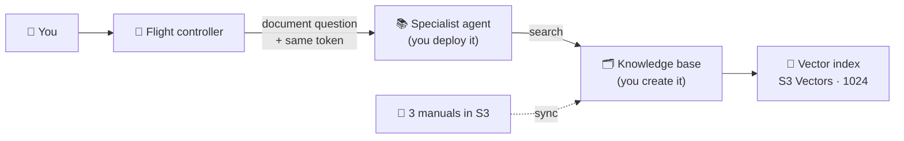

# 🛰️ ORBIT FIELD ACADEMY
## BREAK-FIX C · THE VANISHING STARPORT MANUALS
### The manuals exist, but nobody connected the library or hired the librarian. Build the path from question to page.

> **LEVEL:** Break-fix · **TARGET TIME:** 60 minutes · **ENVIRONMENT:** AWS Console · the broken environment is already built for you
>
> **THE STORY:** OrbitOps has three manuals: inventory procedures, a supplier manual and a quality-control manual. Ask the flight controller what they say and it guesses. Its research assistant, a second AI agent that reads the manuals, was never switched on, and the searchable library it would read from was never built.
>
> **SKILLS:** Bedrock Knowledge Bases · Vector stores and syncing · Deploying an agent to Runtime · Agent-to-agent hand-offs

## 🚨 The emergency

```chat Right now (broken)
you: What do our cargo handling procedures say about inventory checks?
bot: Typically, inventory checks involve regular counts… (a generic guess, not OrbitOps policy)
pill- specialist: not configured
pill- tools called: none
```

**What *should* happen:** the flight controller hands document questions to a **specialist** agent. The specialist searches a **knowledge base** built from the three manuals and answers from what it finds. Right now, two of those pieces don't exist and the third doesn't know where to send questions.

## 🏁 The finish line

**You're done when all of these are true:**

- *What do our cargo handling procedures say about inventory checks?* gets an answer that mentions **72-hour** cycle counts (and daily counts for hazardous cargo).
- The **specialist** pill is green, and the **tools called** pill shows `consult_manuals`.
- In the trace, `specialist_configured` and `specialist_consulted` are both `true`, and `warnings` is `[]`.

```chat When you're done
you: What do our cargo handling procedures say about inventory checks?
bot: Per Inventory Procedures IP-7, every storage bay is cycle-counted every 72 hours…
pill+ specialist: configured
pill+ tools called: consult_manuals
note: There's no tool gateway in this mission, so the gateway pill stays amber. That's expected.
```

## 🧠 Ideas you need first

- **Knowledge base = a searchable library.** Amazon Bedrock **Knowledge Bases** turns documents into something an AI can search by *meaning*, not just by exact words.
- **Embeddings = turning text into numbers.** An **embedding model** turns each chunk of text into a long list of numbers (a *vector*). Text with similar meaning gets similar numbers. This mission uses **Titan Text Embeddings V2**, which can make lists of 256, 512 or 1,024 numbers.
- **Vector store = the shelves.** The vectors are stored in a **vector index**. Yours already exists in **Amazon S3 Vectors**, and it was built for lists of exactly 1,024 numbers. If the model makes a different length, it won't fit on the shelves.
- **Data source + sync = stocking the shelves.** Pointing the knowledge base at the manuals in Amazon S3 isn't enough: you must **sync** it. Syncing reads the files, splits them into chunks, embeds them and stores them. Until then, the library is empty.
- **The specialist = a librarian agent.** It's a second AI agent, packaged as code in a zip file. You deploy it to **AgentCore Runtime**, give it settings (which model, which knowledge base) and a bouncer (an authorizer) that checks tokens.
- **Hand-off = agent-to-agent.** The flight controller calls the specialist and passes along the same token it received. So the specialist's bouncer must trust the same client as the flight controller's.



## 🧰 What you start with

These are in your mission card under `solution_resources_kb`:

| Value | What it is |
|---|---|
| `KnowledgeBaseBucketName` + `KnowledgeBaseDocsPrefix` | The S3 bucket and `docs/` folder holding the three manuals |
| `VectorBucketName`, `VectorBucketArn` | Your S3 Vectors bucket |
| `VectorIndexName`, `VectorIndexArn` | The vector index, `bedrock-knowledge-base-index`: **1024 dimensions, float32, cosine** |
| `EmbeddingModelId`, `EmbeddingDimensions` | `amazon.titan-embed-text-v2:0` and `1024` |
| `KnowledgeBaseRoleArn` | The IAM role the knowledge base uses |
| `KBSpecialistRoleArn` | The IAM role the specialist agent runs as |
| `KBSpecialistAgentCodeS3Uri` | The specialist's code: a zip file in S3 (its main file is `main.py`) |
| `KBSpecialistModelId` | The model the specialist should use |

You also need `cognito_discovery_url`, `m2m_client_ids` and `orchestrator_runtime_ids` from the main part of your card.

> [!CAUTION]
> **Reuse what's provided.** The vector index, roles and code already exist. If a wizard offers to *create* a new vector store, that's the expensive wrong turn: some store types cost hundreds of dollars a month.

## Phase 1 — Look before you touch (10 minutes)

- [ ] Ask the document question above. In the trace, note `specialist_configured`, `specialist_consulted` and `tools_called`.
- [ ] Copy every value from `solution_resources_kb` into your notes. Circle `EmbeddingDimensions`.
- [ ] Open your flight controller (**Bedrock AgentCore → Runtime →** yours). Note how it's set up: code source, Python version, entry point, protocol, authorizer, environment variables. You'll copy most of this shape for the specialist.
- [ ] Open the bucket named in `KnowledgeBaseBucketName`: what's under `agents/` and under `docs/`?

**Predict first:** a knowledge base can show *Available* and still answer nothing. What step might be missing?

## Phase 2 — Find and fix (45 minutes)

**Your work order.** This is how the assessment phrases the job. It tells you *what* must be true at the end; the hints help with *how*.

1. Create a **Bedrock knowledge base** on the **existing** S3 Vectors bucket and index, with **`amazon.titan-embed-text-v2:0`** at **1024** dimensions (float32), using **`KnowledgeBaseRoleArn`**. Don't create a new index.
2. Add the S3 bucket (folder `docs/`) as the knowledge base's **data source**, then **sync** it.
3. Deploy the **specialist** to AgentCore Runtime with these settings:

   | Setting | Value |
   |---|---|
   | Code source | `KBSpecialistAgentCodeS3Uri` |
   | Entry point | `main.py` |
   | Python version | `PYTHON_3_12` |
   | Protocol | `HTTP` |
   | Network | `PUBLIC` |
   | Execution role | `KBSpecialistRoleArn` |
   | Inbound authorizer | JWT: discovery URL = `cognito_discovery_url`, allowed client = `m2m_client_ids` |

4. Name it with **`kb`**, **`specialist`** or **`knowledge`** in it, using letters, digits and underscores only (for example `student07_kb_specialist`).
5. Give the specialist two environment variables: **`MODEL_ID`** = `KBSpecialistModelId`, and **`KNOWLEDGE_BASE_ID`** = your new knowledge base's ID.
6. Confirm its **`DEFAULT`** endpoint is `READY`.
7. Set **`KB_SPECIALIST_RUNTIME_ARN`** on the **flight controller** to the specialist's ARN.

> [!TIP]
> **Test from the inside out.** Prove the library works on its own, then the librarian, then the hand-off. If you test only at the end, you won't know which link broke.

### Goal 1 · Build the library and stock the shelves

**Expected:** the data source's last sync is **Complete** with **3** documents indexed, and the knowledge base's **Test** panel returns a passage when you ask about cycle counts.

<details><summary>Hint 1 · Where to look</summary>

**Amazon Bedrock → Knowledge Bases → Create.** Read every step of the wizard *before* filling anything in. There's a step about the IAM role, one about the data source, and one about embeddings and the vector store. Each one asks a question your mission card already answers.
</details>

<details><summary>Hint 2 · What to compare</summary>

The vector-store step has two paths: one **creates** a store for you, the other **uses an existing** one. You were given an existing bucket and index. Then compare the embedding model's dimension options with `EmbeddingDimensions`: only one choice fits your shelves.
</details>

<details><summary>Hint 3 · The nudge</summary>

After you create it, the knowledge base has one status and the data source has another, and *neither* means anything was read yet. There's a button on the data source that starts the reading; its job report shows how many documents it indexed (you want 3). Then try the **Test** panel. Copy the knowledge base **ID** (10 characters) before you leave the page.
</details>

- [ ] My knowledge base synced 3 documents, and its Test panel finds a passage about cycle counts.

### Goal 2 · Hire the librarian

**Expected:** a new runtime whose name contains your lab id and `kb`, `specialist` or `knowledge`, with status `READY` and a `DEFAULT` endpoint.

<details><summary>Hint 1 · Where to look</summary>

**Bedrock AgentCore → Runtime → Create runtime.** Open your flight controller in a second tab: it was deployed the same way, so its page shows you the shape of every field.
</details>

<details><summary>Hint 2 · What to compare</summary>

The flight controller passes the *caller's* token to the specialist. Whose token is that, and which client made it? Compare the flight controller's authorizer (discovery URL and allowed clients) with what the specialist must accept. Then compare the two environment variables the specialist needs with what you copied in Goal 1.
</details>

<details><summary>Hint 3 · The nudge</summary>

The code is a zip in S3, so choose the S3 source, Python 3.12 and `main.py`. `KNOWLEDGE_BASE_ID` wants the short 10-character ID, not the name or the ARN. When the specialist is `READY`, the value Goal 3 needs is on its page: an **ARN**, not an ID.
</details>

- [ ] My specialist runtime is `READY` with a `DEFAULT` endpoint, the right authorizer and both environment variables.

### Goal 3 · Tell the flight controller to use the librarian

**Expected:** `specialist_configured` flips to `true`, and the pill now reads *specialist: configured*. It stays amber until a question is actually handed over. When you ask a document question, `specialist_consulted` is `true`, the pill turns green, and `consult_manuals` appears in **tools called**.

<details><summary>Hint 1 · Where to look</summary>

The flight controller's **environment variables**. One of them is named for the specialist, and it's empty. The trace's `specialist_configured` simply reports whether it's set.
</details>

<details><summary>Hint 2 · What to compare</summary>

The variable's name tells you what kind of value it wants. The specialist's page shows a name, an ID and an ARN. Expect `specialist_configured` to flip first; `specialist_consulted` only turns true when the agent actually hands a document question over.
</details>

<details><summary>Hint 3 · The nudge</summary>

Saving starts a new version of the flight controller, so test after it's `READY`. If `consult_manuals` shows up with an error, the error names the broken link: `401` or `403` points at the specialist's authorizer, *0 passages retrieved* points at the sync, and `424` means the specialist's code crashed (its CloudWatch log says why).
</details>

- [ ] A document question shows `specialist_consulted: true` and `consult_manuals` in tools called.

## Phase 3 — Flight test (5 minutes)

- [ ] Ask:

  ```text
  What do our cargo handling procedures say about inventory checks?
  ```

  **Expected:** the answer mentions **72-hour** cycle counts. The specialist pill is green, **tools called** shows `consult_manuals`, and `warnings` is `[]`.

- [ ] Ask a second question the manuals answer:

  ```text
  How often are hazardous cargo bays counted?
  ```

  **Expected:** **daily**, countersigned by the safety officer.

**What you just proved:** a question travelled from the flight controller to a second agent you deployed, into a knowledge base you built, and back with real evidence from the manuals.

## 🧭 Stuck?

### Read the signals

| What you see | What it usually means | Go to |
|---|---|---|
| `specialist_configured: false` | The flight controller has no specialist ARN yet | Goal 3 (after Goals 1 and 2) |
| No `consult_manuals` in tools called | The question didn't sound like a manuals question | Ask *"What do our procedures say about…"* |
| `consult_manuals` error: *Specialist runtime returned 401* or *403* | The specialist's bouncer doesn't trust the token | Goal 2 |
| `consult_manuals` error: *Specialist runtime returned 424* | The specialist's code crashed | Its CloudWatch log |
| *KNOWLEDGE_BASE_ID is not configured* | The specialist is missing a setting | Goal 2 |
| *0 passages retrieved* | The library is empty: no sync, or wrong dimensions | Goal 1 |
| An answer mentioning **IP-7** and **72 hours** | Everything works | Flight test |

### Don't waste time on

- **Creating a new vector index or bucket.** The index exists with the right size. A wizard-created store is the expensive wrong turn.
- **Editing the agent code.** Both agents are correct; the zip is ready to deploy as it is.
- **The flight controller's authorizer.** It works. The *specialist* is the one that needs one.
- **Chunking settings.** The defaults are fine. Fancy chunking won't fix a library that was never synced.

### Before you ask for help

- Knowledge base: existing S3 Vectors store, index `bedrock-knowledge-base-index`, Titan V2 at **1024**, role `KnowledgeBaseRoleArn`?
- Data source: last sync **Complete**, **3** documents indexed? Does the Test panel return a passage?
- Specialist: S3 zip, Python 3.12, `main.py`, HTTP, Public, role `KBSpecialistRoleArn`, `READY`, `DEFAULT` endpoint?
- Specialist authorizer: same discovery URL and **same client ID** as the flight controller?
- `KNOWLEDGE_BASE_ID` is the 10-character ID? `KB_SPECIALIST_RUNTIME_ARN` is the specialist's **ARN**, and the flight controller is `READY` again?

<details><summary>Big clue · the fault map</summary>

This diagram marks **what's missing**. It doesn't tell you how to build it. Use it only after the hints.


</details>

## ⭐ Key takeaways

- **The model and the index must agree on size.** A 1,024-number index needs a 1,024-number embedding model.
- **"Created" isn't "ingested".** A data source does nothing until you sync it. Always check how many documents were indexed.
- **Deploying an agent is mostly configuration:** code location, Python version, entry point, role, protocol, authorizer and settings.
- **Hand-offs need two things:** the caller must know the specialist's address (its ARN), and the specialist must trust the caller's token.

## 💬 Think about it

1. Why does the knowledge base need its own IAM role, separate from the specialist's? What does each one touch?
2. What would happen if you picked 512 dimensions? At which step would you find out?
3. The flight controller passes your token to the specialist. What would change if the specialist belonged to another team with its own login system?

## 🎓 After the mission

Your instructor walks through the fix live, then shares the debrief guide for this mission. Try the hints first: you'll remember what you worked out far better than what you were told.
