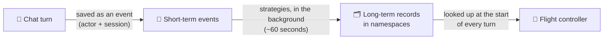

# 🛰️ ORBIT FIELD ACADEMY
## BREAK-FIX D · THE FORGETFUL FLIGHT COMPUTER
### Tell the flight controller what you like, open a new chat, and it has no idea who you are. Give it a long-term memory.

> **LEVEL:** Break-fix · **TARGET TIME:** 35 minutes · **ENVIRONMENT:** AWS Console · the broken environment is already built for you
>
> **THE STORY:** Captain Nova tells the flight controller she prefers detailed shipment reports. The next morning she opens a fresh chat, and it greets her like a stranger. The flight computer has all its memory wiring, but nobody ever installed the memory bank.
>
> **SKILLS:** AgentCore Memory · Events vs long-term records · Memory strategies · Namespaces and actor IDs

## 🚨 The emergency

```chat Right now (broken)
you: I'm Captain Nova, and I prefer detailed shipment reports.
bot: Noted, Captain Nova!
note: … click New session …
you: How should you format my shipment reports?
bot: I don't have any information about your preferences…
pill- memory: 0 hits
```

**What *should* happen:** the agent saves each conversation to **AgentCore Memory**. In the background, Memory pulls out lasting facts ("Captain Nova prefers detailed reports"). In a new chat, the agent looks those facts up before it answers.

## 🏁 The finish line

**You're done when all of these are true:**

- After you share your preference, the trace says `memory_write: "stored"`.
- After waiting at least a minute, in a **new session** with the **same operator**, *How should you format my shipment reports?* gets an answer that says **detailed**, without you reminding it.
- The **memory** pill is green and shows **1 hits** or more.

```chat When you're done
note: … a new session, same operator (captain-nova) …
you: How should you format my shipment reports?
bot: You prefer detailed shipment reports, so I'll include positions, ETAs and checkpoints…
pill+ memory: 1 hits
note: There's no tool gateway in this mission, so the gateway pill stays amber. That's expected.
```

## 🧠 Ideas you need first

- **Short-term memory = the diary.** Every turn of a conversation is saved as an **event**, filed under *who* was talking (the **actor ID**) and *which conversation* it was (the **session ID**). Events expire after a set number of days.
- **Long-term memory = the notes you keep.** A diary is too long to reread every time. So **strategies** read new events in the background and write short **memory records**: facts, preferences or summaries.
- **This takes time.** Pulling facts out of events happens **asynchronously**, in the background, usually within a minute. Test too soon and it looks broken when it isn't.
- **Three built-in strategies:** **semantic** (facts), **user preference** (likes and dislikes) and **summary** (a recap of each session).
- **Namespace = the folder a record is filed in.** Each strategy saves records into a namespace you choose, such as `supplychain/user/{actorId}/preferences`. The agent's code looks in **specific** folders. If a strategy files its notes somewhere else, the notes exist but the agent never finds them.
- **`{actorId}` and `{sessionId}` are blanks, not text.** AgentCore fills them in for each user and session. Type them exactly as written, braces included.



## 🧰 What you start with

| Value | What it is |
|---|---|
| `chat_urls` | Your chat console. Its sidebar has an **Operator (actorId)** box (default `captain-nova`) and a **New session** button. |
| `orchestrator_runtime_ids` | Your flight controller. Its `MEMORY_ID` setting is where the memory plugs in. |
| `memory_execution_role_arns` | An IAM role Memory can use, if the console asks for one |

**Your memory's strategies must file records under these three namespaces.** The agent reads the first two at the start of every turn. Copy them somewhere you can paste from:

```text
supplychain/user/{actorId}/semantic
supplychain/user/{actorId}/preferences
supplychain/user/{actorId}/session/{sessionId}/summary
```

## Phase 1 — Look before you touch (5 minutes)

- [ ] Send the preference sentence. In the trace, note `memory_configured`, `memory_hits`, `memory_write`, and the actor and session it reports.
- [ ] Check **Bedrock AgentCore → Memory**: is there anything with your lab id?
- [ ] Open your flight controller's **environment variables**. Which memory setting exists, and what does it hold?

**Predict first:** if you created a memory but the agent's code never got its ID, what would `memory_configured` say?

## Phase 2 — Find and fix (25 minutes)

**Your work order.** This is how the assessment phrases the job. It tells you *what* must be true at the end; the hints help with *how*.

1. Create an **AgentCore Memory** with a name containing your lab id (letters, digits and underscores only, for example `student07_memory`) and an **event expiry of at least 7 days**.
2. Add the three **long-term strategies**, each with its namespace:
   - **Semantic** → `supplychain/user/{actorId}/semantic`
   - **User preferences** → `supplychain/user/{actorId}/preferences`
   - **Session summaries** → `supplychain/user/{actorId}/session/{sessionId}/summary`
3. Wait until the memory and all its strategies are **`ACTIVE`**.
4. Set the flight controller's **`MEMORY_ID`** to the memory's **ID** (not its name, not its ARN).
5. As `captain-nova`, share a preference, then wait **at least 60 seconds** before testing.

### Goal 1 · Install the memory bank

**Expected:** a memory with your lab id in its name, **status `ACTIVE`**, three strategies (each `ACTIVE`) and event expiry of at least 7 days.

<details><summary>Hint 1 · Where to look</summary>

**Bedrock AgentCore → Memory → Create.** Read the whole form first. There's a short-term section (an expiry in days), a role, and a long-term section where you add strategies one at a time. Each strategy has a box for its namespace.
</details>

<details><summary>Hint 2 · What to compare</summary>

Match each strategy type to a namespace: the **last word** of each pattern tells you which strategy it belongs to. Then compare the namespace the form **fills in for you** with the one you need. They're different, and the agent only reads one of them.
</details>

<details><summary>Hint 3 · The nudge</summary>

Paste the patterns exactly, with the curly braces: AgentCore fills in `{actorId}` and `{sessionId}` itself. The expiry can't go below seven days. After creating it, wait until the memory and every strategy say `ACTIVE`. The identifier Goal 2 needs looks like `<name>-<random letters>`.
</details>

- [ ] My memory and all three strategies are `ACTIVE`, each strategy with the exact namespace from the work order.

### Goal 2 · Plug it into the flight controller

**Expected:** `memory_configured: true`, and after you share your preference, `memory_write: "stored"`.

<details><summary>Hint 1 · Where to look</summary>

The flight controller's **environment variables**, and your memory's detail page, which shows three identifiers: a name, an ID and an ARN.
</details>

<details><summary>Hint 2 · What to compare</summary>

Watch `memory_write` in the trace. `null` means the code never tried to save. `"stored"` means it worked. `"error: …"` quotes the service's own complaint: a *not found* error tells you which of the three identifiers you pasted.
</details>

<details><summary>Hint 3 · The nudge</summary>

Once the flight controller is `READY` again, send the preference sentence as `captain-nova` and check for `memory_write: "stored"`. Then wait a full minute. Before testing a new session, look at your memory's **records** for the preferences namespace, with `captain-nova` filled in. That tells you whether saving worked, separately from whether recall works.
</details>

- [ ] The trace shows `memory_write: "stored"` after I share my preference.

### Goal 3 · Prove it remembers across sessions

**Expected:** in a new session with the same operator, the agent answers **detailed** and the memory pill shows at least **1 hits**.

<details><summary>Hint 1 · Where to look</summary>

The chat console's sidebar: the **Operator** box and the **New session** button. And your memory's **records**, filtered to `captain-nova`.
</details>

<details><summary>Hint 2 · What to compare</summary>

Compare the actor and session in the trace of your first chat and your second chat. The actor must be the **same**, and the session must be **different**. Recall is per actor: testing with two different operator names is the classic way to fool yourself.
</details>

<details><summary>Hint 3 · The nudge</summary>

If a record exists but `memory_hits` stays empty, the record is filed in a folder the agent doesn't read. Compare the strategy's namespace with the work order, character by character. Records already saved stay where they were filed, so after any namespace change, share your preference again, wait a minute, then test.
</details>

- [ ] A new session with the same operator recalls my preference.

## Phase 3 — Flight test (5 minutes)

- [ ] With the Operator set to `captain-nova`, send:

  ```text
  I'm Captain Nova, and I prefer detailed shipment reports.
  ```

  **Expected:** `memory_write: "stored"` in the trace.

- [ ] Wait **60 seconds**. Click **New session** (keep the same Operator), then ask:

  ```text
  How should you format my shipment reports?
  ```

  **Expected:** the answer says **detailed** without a reminder. The memory pill is green with at least **1 hits**.

**What you just proved:** the agent saved a conversation, Memory turned it into a lasting fact in the right folder, and a brand-new session found that fact.

## 🧭 Stuck?

### Read the signals

| What you see | What it usually means | Go to |
|---|---|---|
| `memory_configured: false` | The flight controller has no memory ID | Goal 2 |
| `memory_write: "error: … ResourceNotFound…"` | You pasted the name or the ARN, not the ID | Goal 2 |
| `memory_write: "error: … AccessDenied…"` | The memory isn't `ACTIVE` yet, or it's in another Region | Goal 1 |
| `memory_write: "stored"`, but no records under `supplychain/user/captain-nova/preferences` after 2 minutes | A strategy's namespace doesn't match, so its records were filed in another folder | Goal 1 |
| A record exists, but `memory_hits` stays empty | Different operator, or the record is filed in the wrong folder | Goal 3 |
| The answer says **detailed** and the memory pill shows **1 hits** or more | It works | Flight test |

### Don't waste time on

- **The agent's code.** It already reads the right namespaces. Don't redeploy it.
- **The chat app.** It only passes your operator name and session along.
- **Short-term events alone.** Recall *across* sessions comes from long-term records, which need strategies.
- **The execution role.** It's ready. If the console asks for one, pick it; don't create another.

### Before you ask for help

- Memory `ACTIVE`, expiry at least 7 days, all three strategies `ACTIVE`?
- One strategy of each type, each with the exact namespace (braces included, no real names typed in)?
- `MEMORY_ID` is the **ID**, and the flight controller is `READY` again?
- First chat shows `memory_write: "stored"`?
- Did you wait at least 60 seconds, then use **New session** with the **same** operator?

<details><summary>Big clue · the fault map</summary>

This diagram marks **what's missing**. It doesn't tell you how to build it. Use it only after the hints.


</details>

## ⭐ Key takeaways

- **Memory is a resource plus strategies.** The agent only supplies the memory ID, the actor and the session.
- **Namespaces are an agreement** between the memory setup and the agent's code. If they don't match exactly, memories get saved and never found.
- **Long-term memory is asynchronous.** Wait before you test, and test with the same actor.
- **Use the ID, not the name or the ARN,** when a setting asks for `MEMORY_ID`.

## 💬 Think about it

1. Why is the summary namespace the only one that includes `{sessionId}`?
2. Two operators share one chat console. What stops Captain Nova's preferences showing up for someone else?
3. What information should an agent *never* keep in long-term memory?

## 🎓 After the mission

Your instructor walks through the fix live, then shares the debrief guide for this mission. Try the hints first: you'll remember what you worked out far better than what you were told.
