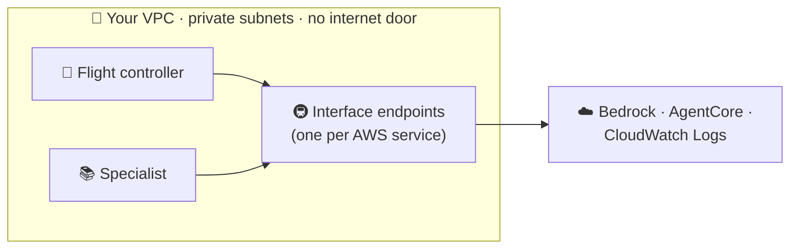

# 🛰️ ORBIT FIELD ACADEMY
## BREAK-FIX E · CLOSE THE EXPOSED HYPERSPACE LANES
### Both agents talk to AWS over the public internet. Move them into a private network and give them private lanes to every service they need.

> **LEVEL:** Break-fix · **TARGET TIME:** 45 minutes · **ENVIRONMENT:** AWS Console · your own VPC is already built for you
>
> **THE STORY:** OrbitOps works, but security command isn't happy: both AI agents send their traffic over public network paths. The order is to move them into **private subnets** with no route to the internet, and still keep every feature working. Cargo routes aren't the only routes that need protecting.
>
> **SKILLS:** VPC and private subnets · PrivateLink interface endpoints · Private DNS · Runtime VPC mode

## 🚨 The emergency

This mission starts the other way round: **everything works**, but in the wrong way.

```chat Right now (works, but exposed)
you: Where is shipment SHP-1002?
bot: SHP-1002 is delayed at the Jovian transfer point…
pill+ gateway: 9 tools
pill+ tools called: logistics-target___track_shipment
note: Both runtimes show Network mode: Public. Your VPC has only one endpoint (for S3).
```

**The catch:** the moment you move an agent into a private subnet, it can no longer reach the AWS services it needs: the model, its tools, the other agent, its logs. Your job is to build a **private lane** to each of them *before* things break, or fix them when they do.

## 🏁 The finish line

**You're done when all of these are true:**

- **Both** runtimes, the flight controller and the knowledge-base specialist, show **Network mode: VPC**, use your two **private** subnets, and are `READY`.
- *Where is shipment SHP-1002?* returns shipment data through the Gateway (a `logistics-target___` tool).
- *What does the quality manual say about cryogenic seals?* is answered by the specialist: the **specialist** pill is green.
- Both replies have `warnings: []`, and your private route table still has **no** route to the internet (`0.0.0.0/0`).

```chat When you're done
you: What does the quality manual say about cryogenic seals?
bot: Cryogenic seals must show no micro-fractures under 40x magnification; a single fracture fails the batch…
pill+ specialist: configured
pill+ tools called: consult_manuals
note: Same answers as before, but now every byte travels inside your private network.
```

## 🧠 Ideas you need first

Picture a **secure building**.

- **VPC = your own private building in AWS.** A **Virtual Private Cloud** is a private network that only you control.
- **Subnets = floors.** Your VPC has **public subnets** (with a door to the internet) and **private subnets** (no outside door at all). The private ones are where security wants the agents.
- **VPC mode = moving the agent inside.** Normally an AgentCore Runtime runs outside your network. In **VPC mode**, its *outgoing* calls start from inside your private subnets. Calls *coming in* to the agent (from the chat app) still arrive the same way as before.
- **Interface endpoint = a private tunnel to one AWS service.** With no outside door, how does an agent reach Amazon Bedrock? Through an **interface endpoint** (**AWS PrivateLink**): a private entrance to *one* service, inside your subnets. One service, one endpoint.
- **Private DNS = updating the building directory.** The agent's code calls services by their normal names, like `bedrock-runtime.us-west-2.amazonaws.com`. With **private DNS** switched on, that normal name leads to your private tunnel instead of the public internet, so the code doesn't need to change.
- **Gateway endpoint = a free side door for S3.** Amazon S3 uses a different, free kind of endpoint. Yours already exists.



**Inventory the calls.** From inside the VPC, the two agents call:

| Who calls | What for | AWS service |
|---|---|---|
| Both agents | Ask the AI model to think | Amazon Bedrock Runtime |
| Flight controller | Find and call tools | AgentCore **Gateway** |
| Flight controller | Hand a question to the specialist | AgentCore **data plane** (Runtime, Memory) |
| Specialist | Search the knowledge base | Amazon Bedrock **Agent** Runtime |
| Both agents | Write logs | Amazon CloudWatch Logs |
| Both agents | Read files | Amazon S3 (already covered by the gateway endpoint) |

## 🧰 What you start with

From your mission card, under `solution_resources_vpc`:

| Value | What it is |
|---|---|
| `VpcId`, `VpcCidr` | Your own VPC (DNS support and hostnames are on) |
| `PrivateSubnetIds` | Two private subnets, one per Availability Zone. No internet route; the S3 gateway endpoint is attached. |
| `PublicSubnetIds` | Two public subnets. **Not** for the agents. |
| `PrivateRouteTableId` | The private subnets' route table |
| `SecurityGroupId` | Allows HTTPS (port 443) from inside the VPC, and all outbound traffic |

You also have a working OrbitOps from Missions A to C: login, a Gateway with four targets, the flight controller, and a specialist with a synced knowledge base.

> [!WARNING]
> Interface endpoints cost about **$0.01 per hour each**, per Availability Zone. Create the **five** you need, in **your** VPC, with no duplicates. Each service can only have one private-DNS endpoint per VPC, which is why every student gets their own VPC.

## Phase 1 — Look before you touch (10 minutes)

- [ ] Copy your VPC ID, the two **private** subnet IDs (and their Availability Zones) and the security group ID.
- [ ] Open your private route table (**VPC → Route tables**). Write down what's there, and notice what *isn't*.
- [ ] List the endpoints in your VPC (**VPC → Endpoints**, filter by your VPC ID): type, service name and state.
- [ ] Check the **Network mode** of both runtimes (**Bedrock AgentCore → Runtime**).

**Predict first:** you move the flight controller into a private subnet and create no endpoints. Which question fails first: a tool question, a manuals question, or *every* question? Why?

## Phase 2 — Find and fix (30 minutes)

**Your work order.** This is how the assessment phrases the job. It tells you *what* must be true at the end; the hints help with *how*.

1. In your VPC, create **interface endpoints** for these five services (replace `<region>` with `us-west-2`):

   | AWS service | Service name to search for |
   |---|---|
   | AgentCore Gateway | `com.amazonaws.<region>.bedrock-agentcore.gateway` |
   | AgentCore data plane (Runtime, Memory) | `com.amazonaws.<region>.bedrock-agentcore` |
   | Amazon Bedrock Runtime | `com.amazonaws.<region>.bedrock-runtime` |
   | Amazon Bedrock Agent Runtime | `com.amazonaws.<region>.bedrock-agent-runtime` |
   | Amazon CloudWatch Logs | `com.amazonaws.<region>.logs` |

2. Turn on **private DNS** for each one, and place each in **both private subnets**.
3. Attach the provided **security group** to the endpoints **and** to both runtimes.
4. Change **each** runtime's network mode from **Public** to **VPC**, using the **private subnets**.
5. Wait for **both** runtimes to return to `READY`.

No shortcuts: don't put the runtimes in the public subnets, and don't add a NAT gateway. The point is that every dependency is reachable privately.

### Goal 1 · Build the private lanes

**Expected:** five new interface endpoints in your VPC, each **Available**, each with private DNS on, in both private subnets, with the lab security group.

<details><summary>Hint 1 · Where to look</summary>

**VPC → Endpoints → Create endpoint.** Type the first word of a service name into the service search, and read **all** the results: some AWS services have more than one endpoint name.
</details>

<details><summary>Hint 2 · What to compare</summary>

Compare your call inventory with the endpoint list. S3 is already covered by a *gateway* endpoint; everything else needs an *interface* endpoint. Searching `bedrock-agentcore` returns two names. The flight controller calls two different AgentCore addresses (one for tools, one for the specialist): which name serves which?
</details>

<details><summary>Hint 3 · The nudge</summary>

For each endpoint: type **AWS services**, your VPC, **both** private subnets, the lab security group, and, under the extra settings, the option that makes the service's normal name resolve privately. Without that option the agent's code would need special addresses, which it doesn't use. A new endpoint shows *Pending* for a minute or two before *Available*.
</details>

- [ ] Five interface endpoints are **Available** in my VPC, all with private DNS, both private subnets and the lab security group.

### Goal 2 · Move both agents inside

**Expected:** both runtimes show **Network mode: VPC**, your two private subnets and the lab security group, and are `READY`.

<details><summary>Hint 1 · Where to look</summary>

**Bedrock AgentCore → Runtime →** a runtime **→ Update runtime.** The network section has two modes; the second asks for subnets and security groups.
</details>

<details><summary>Hint 2 · What to compare</summary>

Compare the subnet IDs the form offers with the two **private** IDs on your card: the public ones are there as a trap. Then count: how many runtimes do you have, and how many have you moved? The specialist answers from wherever *it* runs.
</details>

<details><summary>Hint 3 · The nudge</summary>

Saving starts a new version, and the status shows `UPDATING` for several minutes. Don't judge anything until **both** runtimes read `READY`. If a runtime stays `UPDATING` for more than ten minutes, check that the subnets and the security group really are from **your** VPC.
</details>

- [ ] Both runtimes are in VPC mode, in my private subnets, and `READY`.

### Goal 3 · Check every lane

**Expected:** a tool question and a manuals question both answer, with `warnings: []`.

<details><summary>Hint 1 · Where to look</summary>

The chat console's trace, and each runtime's CloudWatch logs (**CloudWatch → Log groups →** `/aws/bedrock-agentcore/runtimes/…`). Ask one tool question and one manuals question, and note *which* fails and *how*.
</details>

<details><summary>Hint 2 · What to compare</summary>

Each feature uses one service. Tools use the Gateway; manuals use the data plane *and* the knowledge-base search; every answer uses the model. Compare what failed with your call inventory: the missing lane is the one that feature needs.
</details>

<details><summary>Hint 3 · The nudge</summary>

A missing lane usually shows up as a **timeout**, not a clear error. Look for a `gateway: <urlopen error timed out>` warning in the trace, or a chat error after about 100 seconds with no trace at all. The runtime's CloudWatch log names the exact address it couldn't reach, and that address matches exactly one endpoint name in the work order.
</details>

- [ ] A tool question and a manuals question both work, with no warnings.

## Phase 3 — Flight test (5 minutes)

- [ ] Tool lane:

  ```text
  Where is shipment SHP-1002?
  ```

  **Expected:** shipment data through a `logistics-target___` tool, and `warnings: []`.

- [ ] Manuals lane:

  ```text
  What does the quality manual say about cryogenic seals?
  ```

  **Expected:** an answer from the manuals; the **specialist** pill is green and `warnings` is `[]`.

- [ ] In **VPC → Route tables**, your private route table has **no** `0.0.0.0/0` route.

**What you just proved:** both agents now run inside a network with no door to the internet, and every service they depend on is still reachable through a private lane.

## 🧭 Stuck?

### Read the signals

| What you see | What it usually means | Go to |
|---|---|---|
| A runtime stuck in `UPDATING` for over 10 minutes | Subnets or security group from the wrong VPC, or only one subnet chosen | Goal 2 |
| **Every** question ends in a chat error after about 100 seconds, with no trace | No lane to the AI model (`bedrock-runtime`), or private DNS is off | Goal 1 |
| Trace warning `gateway: <urlopen error timed out>` | No lane to the Gateway (`…bedrock-agentcore.gateway`) | Goal 1 |
| Tool questions work; manuals questions end in a chat error after about 100 seconds | No lane to the data plane (`…bedrock-agentcore`) or to knowledge-base search (`…bedrock-agent-runtime`), or the specialist is still updating | Goals 1 and 2 |
| Everything works, but a runtime still says **Public** | You moved only one runtime | Goal 2 |
| Endpoint state is *Pending* | Normal for a minute or two | Wait |

### Don't waste time on

- **A NAT gateway.** It would make the timeouts disappear and fail the mission: nothing here needs the public internet.
- **A Cognito endpoint.** The agents never call Cognito in this mission: the token is passed along.
- **The public subnets.** They're there for contrast. The agents don't belong there.
- **Security group rules.** The lab security group already allows what's needed.
- **An S3 interface endpoint.** S3 is already covered by the gateway endpoint.

### Before you ask for help

- Five interface endpoints (`…bedrock-agentcore.gateway`, `…bedrock-agentcore`, `…bedrock-runtime`, `…bedrock-agent-runtime`, `…logs`), all **Available**?
- Each one: private DNS on, both private subnets, the lab security group?
- No duplicates, and none in the public subnets?
- **Both** runtimes: VPC mode, the two private subnets, the lab security group, `READY`?
- The private route table still has no `0.0.0.0/0` route?

<details><summary>Big clue · the fault map</summary>

This diagram marks **what's missing and what's exposed**. It doesn't tell you how to fix it. Use it only after the hints.


</details>

## ⭐ Key takeaways

- **VPC mode changes outgoing traffic, not incoming.** Before you move an agent, list everything it calls.
- **One service, one interface endpoint.** Agents that use both AgentCore tools and the AgentCore data plane need **both** AgentCore endpoints.
- **Private DNS keeps the code unchanged.** The usual service names quietly lead to your private lanes.
- **No NAT needed** when every dependency has its own endpoint and nothing needs the public internet.

## 💬 Think about it

1. Why don't calls *into* the agents (from the chat app) need an endpoint in your VPC?
2. What would go wrong if you created the endpoints without private DNS?
3. A NAT gateway would also have fixed the timeouts. Why is it the wrong answer for this mission?

## 🎓 After the mission

Your instructor walks through the fix live, then shares the debrief guide for this mission. Interface endpoints cost money every hour, so if you're practising in your own account, delete them when you're done.
