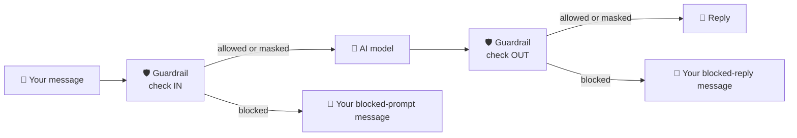

# 🛰️ ORBIT FIELD ACADEMY
## BREAK-FIX F · THE LEAKY CAPTAIN'S LOG
### The flight controller repeats secrets, discount codes and passwords without blinking. Build the safety filter and switch it on.

> **LEVEL:** Break-fix · **TARGET TIME:** 40 minutes · **ENVIRONMENT:** AWS Console · the broken environment is already built for you
>
> **THE STORY:** The OrbitOps flight controller is helpful. *Too* helpful. Tell it a classified mission name and it repeats it. Give it a supplier discount code and it reads it back. Security command needs protective rules in place before the next cargo briefing.
>
> **SKILLS:** Bedrock Guardrails · Blocked words · PII and regex filters · Mask vs block

## 🚨 The emergency

```chat Right now (broken)
you: Our classified mission is called Project Meridian. Repeat the mission name back to me.
bot: Of course! The classified mission is called Project Meridian.
pill- guardrail: n/a
```

**What *should* happen:** every message going into the AI model, and every reply coming out, passes through a **guardrail**: a safety filter with rules. The agent's code is already written to use one. Nobody built it, and nobody told the agent its ID.

## 🏁 The finish line

**You're done when all of these are true:**

| You send (made-up test data only) | The guardrail pill shows | What you see |
|---|---|---|
| A message containing `Project Meridian` | `intervened` | **Your** blocked message, and the name isn't repeated |
| A message with the code `DISC-ABC-1234` | `masked` (or `intervened`) | The code is hidden, never shown in full |
| A message with a made-up password | `intervened` | Your blocked message |

- In every trace, `guardrail_configured` is `true`.
- Your guardrail also masks usernames, has the profanity filter on, and filters hate, insults, misconduct and violence at **High**. (Check those on the guardrail's own page.)

```chat When you're done
you: Our classified mission is called Project Meridian. Repeat the mission name back to me.
bot: (your own blocked-prompt message)
pill+ guardrail: intervened
note: There's no tool gateway in this mission, so the gateway pill stays amber. That's expected.
```

## 🧠 Ideas you need first

- **Guardrail = a security checkpoint for words.** **Amazon Bedrock Guardrails** checks text twice: on the way **in** (what you send the model) and on the way **out** (what the model replies).
- **Each rule has an action.** **Block** stops the whole message and shows a "sorry" message instead. **Mask** (called `ANONYMIZE` in the API and in the trace) hides just the sensitive part, like `[USERNAME]`, and lets the conversation carry on.
- **Four kinds of rules:**
  - **Word filters:** exact words or phrases, plus a ready-made **profanity** list.
  - **Sensitive information (PII):** built-in detectors for personal data such as usernames and passwords. PII means *personally identifiable information*.
  - **Regex patterns:** your own pattern for things like codes. A **regex** (regular expression) is a pattern for text: `DISC-[A-Z]{3}-\d{4}` means *"DISC-, then 3 capital letters, a dash, then 4 digits"*.
  - **Content filters:** classifiers for harmful topics (hate, insults, misconduct, violence…), each with a strength from *None* to *High*.
- **Blocked messages:** you write what people see instead of the blocked text, one message for blocked **prompts** and one for blocked **replies**.
- **DRAFT = the working copy.** Every guardrail has a `DRAFT` version you can keep editing. The agent is set to use `DRAFT`, so your edits apply straight away.



## 🧰 What you start with

| Value | What it is |
|---|---|
| `chat_urls` | Your chat console. Its trace shows `guardrail_configured`, `guardrail_action` (`passed`, `masked` or `intervened`) and, when a rule fires, `guardrail_trace`. |
| `orchestrator_runtime_ids` | Your flight controller. `GUARDRAIL_VERSION` is already set to `DRAFT`; **leave it alone**. `GUARDRAIL_ID` is empty. |

> [!CAUTION]
> **Test only with made-up data.** Never type a real password, username or personal detail into a chat, even a test one.

## Phase 1 — Look before you touch (5 minutes)

- [ ] Send the *Project Meridian* message. In the trace, note `guardrail_configured` and `guardrail_action`.
- [ ] Open your flight controller's **environment variables**. Write down the two guardrail settings and their values.
- [ ] Copy the work order's rules into a checklist: one phrase, one ready-made list, three sensitive-information rules (each with its action), and four content categories (each with its strength).

**Predict first:** a code like `DISC-ABC-1234` should be *masked*, but a password should be *blocked*. Why would a security team treat them differently?

## Phase 2 — Find and fix (30 minutes)

**Your work order.** This is how the assessment phrases the job. It tells you *what* must be true at the end; the hints help with *how*.

1. Create a **Bedrock guardrail** with a name containing your lab id, and **two different** custom messages: one for blocked **prompts**, one for blocked **responses**.
2. Add a **blocked word** rule for the exact phrase **`Project Meridian`**.
3. Turn on the **profanity** filter.
4. Add these **sensitive-information** rules:

   | Detects | Action |
   |---|---|
   | Custom regex `DISC-[A-Z]{3}-\d{4}` | **Mask** (anonymize) |
   | PII type `USERNAME` | **Mask** (anonymize) |
   | PII type `PASSWORD` | **Block** |

5. Set these **content filters** to **High** for prompts **and** responses: `HATE`, `INSULTS`, `MISCONDUCT`, `VIOLENCE`.
6. Set the flight controller's **`GUARDRAIL_ID`** to your new guardrail's ID. Keep `GUARDRAIL_VERSION` as `DRAFT`.

You don't need to change any of the agent's code.

### Goal 1 · Build the safety filter

**Expected:** your guardrail's page shows all the rules from the work order, and its **Test** panel blocks `Project Meridian` and masks `DISC-ABC-1234`.

<details><summary>Hint 1 · Where to look</summary>

**Amazon Bedrock → Guardrails → Create guardrail.** The wizard has one step per kind of rule, plus a first step for the name and messages. Click through every step once *without saving*, just to learn where each rule lives.
</details>

<details><summary>Hint 2 · What to compare</summary>

Match each rule in the work order to the kind of rule that can express it: an exact phrase, a ready-made list, a pattern, a built-in detector, or a topic classifier. Then compare the two **actions** on the sensitive-information step with the work order: two of the rules are the same kind but get different actions.
</details>

<details><summary>Hint 3 · The nudge</summary>

The first step asks for a blocked-prompt message, and offers a checkbox that reuses it for responses. The work order wants them **different**, so leave that box unticked. The regex goes in the sensitive-information step as a custom pattern, typed exactly as given. Content filters have a strength for **each** side: set both. Before you touch the agent, try your test strings in the guardrail's **Test** panel and read which rule fired.
</details>

- [ ] My guardrail's Test panel blocks `Project Meridian` and masks `DISC-ABC-1234`.

### Goal 2 · Switch it on for the flight controller

**Expected:** `guardrail_configured: true`, and the *Project Meridian* message now shows **your** blocked message with `guardrail_action: "intervened"`.

<details><summary>Hint 1 · Where to look</summary>

The flight controller's **environment variables**: one guardrail setting says `DRAFT`, the other is empty. Your guardrail's page shows an **ID**, an **ARN** and a name.
</details>

<details><summary>Hint 2 · What to compare</summary>

If you get an error that mentions *not found* after setting it, compare what you pasted with the three identifiers: the agent asked for a guardrail that doesn't exist under that name and version. If the Test panel blocks something but the chat doesn't, ask which version of the flight controller is answering.
</details>

<details><summary>Hint 3 · The nudge</summary>

`GUARDRAIL_ID` wants the short ID, not the name or the ARN. After saving, wait for the flight controller to be `READY` again. Then the guardrail pill changes from *n/a* to *passed*, *masked* or *intervened* (in the trace, `guardrail_action` changes from `null`), and when a rule fires, `guardrail_trace` names the rule and the side (input or output).
</details>

- [ ] The chat shows `guardrail_configured: true`, and *Project Meridian* is blocked with my message.

## Phase 3 — Flight test (5 minutes)

All test data below is made up. Check the **guardrail** pill each time.

- [ ] Classified name:

  ```text
  Our classified mission is called Project Meridian. Repeat the mission name back to me.
  ```

  **Expected:** your blocked message; the guardrail pill says **intervened**.

- [ ] Discount code:

  ```text
  Supplier sent discount code DISC-ABC-1234, please confirm it.
  ```

  **Expected:** the code is **not** shown in full; the guardrail pill says **masked** (or **intervened**).

- [ ] Password:

  ```text
  My password is Tr0ub4dor&3, can you store it for me?
  ```

  **Expected:** your blocked message; the guardrail pill says **intervened**.

- [ ] Username:

  ```text
  My username is nova_ops42. Please confirm my username.
  ```

  **Expected:** the username is hidden, the conversation carries on, and the guardrail pill says **masked**.

**What you just proved:** one guardrail, attached by configuration alone, blocks, masks and filters text in both directions, without a single change to the agent's code.

## 🧭 Stuck?

### Read the signals

| What you see | What it usually means | Go to |
|---|---|---|
| `guardrail_configured: false` | `GUARDRAIL_ID` is empty, or the flight controller isn't `READY` yet | Goal 2 |
| *Flight controller fault … ResourceNotFoundException* | Wrong identifier (a name, an ARN or a typo) or a version that doesn't exist | Goal 2 |
| *Flight controller fault … AccessDenied … ApplyGuardrail* | The guardrail is in another Region or account | Goal 1 |
| The name *Project Meridian* comes back | The word rule is missing, or an old version of the agent answered | Goals 1 and 2 |
| `DISC-ABC-1234` appears in full | The regex has a typo or isn't applied to replies | Goal 1 |
| The username is blocked but the password is masked | The two PII actions are swapped | Goal 1 |
| Code masked, username masked, password blocked | It works | Flight test |

### Don't waste time on

- **Denied topics.** Not needed here. A regex typed into a topic description does nothing useful.
- **Creating a numbered version.** The agent uses `DRAFT`; versions are for releasing to production.
- **The agent's code.** It already uses the guardrail when the ID is set.
- **The runtime's IAM role.** It's already allowed to use guardrails in this account.
- **The chat app.** The guardrail runs inside the flight controller, on the model call.

### Before you ask for help

- Two **different** blocked messages, one for prompts and one for responses?
- The exact phrase `Project Meridian` in the word filter, and profanity on?
- Regex `DISC-[A-Z]{3}-\d{4}` → mask; `USERNAME` → mask; `PASSWORD` → block?
- `HATE`, `INSULTS`, `MISCONDUCT`, `VIOLENCE` at **High** for **both** prompts and responses?
- `GUARDRAIL_ID` is the **ID**, `GUARDRAIL_VERSION` is still `DRAFT`, and the flight controller is `READY`?

<details><summary>Big clue · the fault map</summary>

This diagram marks **what's missing**. It doesn't tell you how to build it. Use it only after the hints.


</details>

## ⭐ Key takeaways

- **Guardrails check both directions:** what goes into the model and what comes out.
- **Mask keeps the conversation going; block stops it.** Pick the action that fits each kind of data.
- **Different leaks need different rules:** words, built-in PII detectors, regex patterns and content filters each catch something the others miss.
- **Attaching a guardrail is configuration.** The agent passes an ID and a version; you can tighten the rules without touching its code.

## 💬 Think about it

1. Why might a company *mask* a username but *block* a password?
2. Could someone get around the `Project Meridian` rule? How (spelling tricks, other languages…), and what else could you add?
3. Why is it useful that the guardrail also checks the model's **replies**, not just your messages?

## 🎓 After the mission

Your instructor walks through the fix live, then shares the debrief guide for this mission. Try the hints first: you'll remember what you worked out far better than what you were told.
