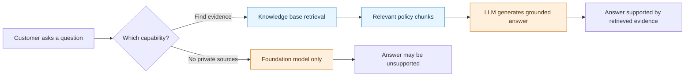
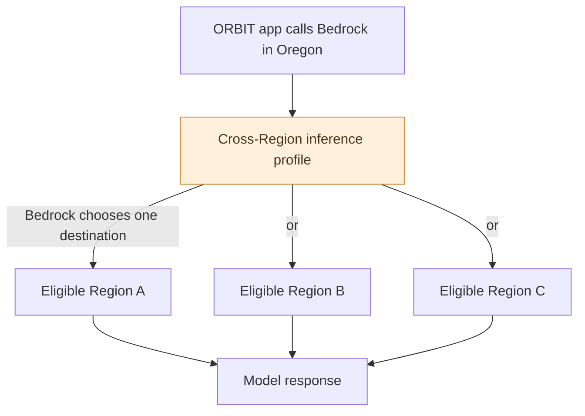
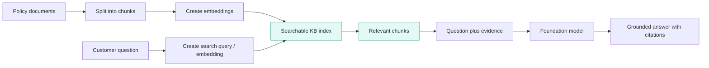
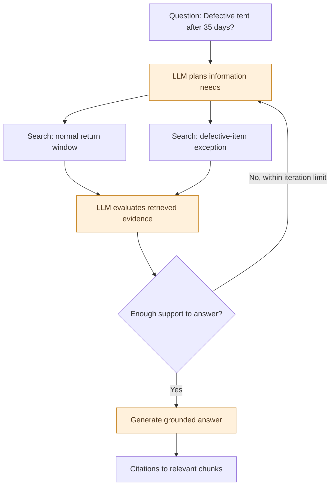

# 🛰️ ORBIT FIELD ACADEMY
## MISSION 03 — THE KNOWLEDGE HEIST
### 🧭 Companion Field Guide: Bedrock, Inference, RAG, and Agentic Retrieval

> **Read alongside:** Mission 03, *The Knowledge Heist*  
> **Environment:** AWS Management Console · Region: `us-west-2` (US West / Oregon)  
> **Mission:** Find out exactly what an AI model knows, what a knowledge base adds, and when a search becomes *agentic*.

---

## 🚀 Your mental model in 30 seconds

An AI model can write convincing answers without knowing ORBIT Outfitters' actual policies. A **knowledge base (KB)** supplies evidence; **retrieval** finds it; an **LLM** can turn it into a conversational answer. **Agentic retrieval** adds planning and potentially several rounds of searching. None of these operations can actually refund a customer.



**The one sentence to remember:** Retrieval finds information; generation explains it; a separate, authorized tool would be needed to *change* an order.

---

## 🧩 Field Map — where everything happens

| When you are in the lab... | What you are really testing |
|---|---|
| **Phase 1: Bedrock Playground** | Can a model answer without ORBIT's private documents? |
| **Phase 2: Create Managed KB** | How does AWS organize and host searchable evidence? |
| **Phase 3: Ingest policies** | How do policy documents become searchable? |
| **Phase 4: Standard vs. agentic retrieval** | What is the difference between finding chunks and reasoning over them? |
| **Phase 5: Evidence challenge** | What happens when evidence changes, is missing, or suggests an exception? |
| **Phase 6: Agents Classic migration** | How does this retrieval capability fit into the next mission's full agent? |

---

# PART I — FOUNDATION MODELS AND INFERENCE

## ❓ 01. What exactly is Amazon Bedrock? Is it itself an LLM?

**No.** Amazon Bedrock is an AWS service for accessing foundation models and building generative AI applications. The models are supplied by Amazon and other model providers. Bedrock handles the API-facing infrastructure and model-serving experience.

- **Foundation model:** Claude or Nova, for example. It generates text or other outputs.
- **Bedrock:** The AWS service through which you invoke a supported model.
- **Playground:** A console interface that lets you experiment without writing an application.
- **Your application:** A future chatbot, website, or agent that sends requests through an API.

Think of Bedrock as a service counter where you can request different models—not as one giant model named "Bedrock."

## ❓ 02. What is *inference*?

Inference is using an already-trained model to produce an output from new input. In Mission 03, when you type a question in the Playground and Nova Lite responds, you've performed inference.

**Inference is not training.** Asking 100 questions does not retrain Nova Lite with ORBIT's policies. Even after you ingest policy documents, you have updated **external knowledge**, not the model's weights.

**Token counts** are the useful meter here: the Playground reports how much input and output the model processed. More tokens often mean more cost; larger prompts also consume more of the model's context window.

## ❓ 03. Why does the model-selection screen offer **On demand** and **Inference profiles**?

These describe *how Bedrock serves or routes inference requests*, not which policy documents the model can read.

| Choice | What it means | Typical reason to choose it |
|---|---|---|
| **Direct on-demand** | Use shared, AWS-managed model capacity in the selected Region, where supported | Simple experiments and supported Regional calls |
| **Cross-Region inference profile** | Send a request from your source Region; Bedrock selects from a defined set of destination Regions | Broader capacity availability and throughput |
| **Application inference profile** | An application-owned resource for usage/cost tracking; can point to a Regional model or a cross-Region profile | Track spending by app or workload |

**Important:** A cross-Region profile still uses usage-based, on-demand inference. “On demand” and “cross-Region” are **not opposing pricing models**.

In Phase 1, the lab specifically selects **Nova Lite 1.0 → On-demand** in Oregon. Some other models require an inference profile to be invoked; the choices depend on the model and Region.

## ❓ 04. What does a prebuilt inference profile look like?

AWS supplies **system-defined** profiles. A US profile for Nova Lite can be identified by an ID such as:

```text
us.amazon.nova-lite-v1:0
```

That is an *inference profile identifier*, not a model hosted on your own EC2 instance. The exact available profiles and destination Regions should be checked in **Bedrock → Inference profiles** or in the model's Regional availability details.

A conceptual profile looks like this:

```yaml
Profile: US Nova Lite                     # Illustrative structure
Model: Amazon Nova Lite
Scope: US cross-Region inference
Destination_Regions:
  - Eligible destination A
  - Eligible destination B
Routing: Managed by Bedrock
```

The destination labels are intentionally placeholders; **do not assume** that a specific model has replicas in every US Region or that its destinations match another model's.

## ❓ 05. Does cross-Region inference mean the model runs in another Region? Why care—is it for latency?

**Yes.** Bedrock can process the request in one of the profile's allowed destination Regions, while your application continues using a Bedrock endpoint in the source Region.

**Primary motivation:** more available capacity, improved throughput, and fewer capacity-related throttling problems. **Latency:** sometimes improved under congestion, but the extra distance can also add network delay. A profile is *not* a guarantee that one request will finish faster.



**Three terms to distinguish:**

- **Latency:** how long one request takes.
- **Throughput:** how much work can be handled over time.
- **Availability:** whether enough serving capacity is available to process your request.

**Security checkpoint:** The allowed destination Regions matter for data residency. Inspect the profile before processing regulated or sensitive data. AWS documents how to query the actual destination Region list; do not guess from a `us.` or `global.` prefix alone.

## ❓ 06. If I select direct on-demand in `us-west-2`, is inference limited to that Region?

**For a direct Regional model invocation, yes:** Bedrock uses model-serving capacity in that Region. This is different from invoking a cross-Region profile, which can route to its eligible destination Regions.

One important nuance: your app's **source Region** and the **processing Region** are distinct concepts once cross-Region inference enters the picture.

---

# PART II — FROM DOCUMENTS TO ANSWERS

## ❓ 07. Why did Nova Lite struggle to answer ORBIT's returns question in Phase 1?

Because ORBIT's private training policy was not in the prompt and the model had no connection to a knowledge base. A fluent sentence is not evidence that the model knows an actual company policy.

Mission 03 asks about a **35-day-old tent**. The policy later ingested into the KB says:

- Unused tents with tags: **standard return within 30 calendar days**.
- Beyond 30 days: **not eligible for a standard return unless defective**.
- Defective item: **may be escalated for review within 90 days**, not automatically refunded.
- Refund execution requires verified authorization and confirmation from the order system.

The policy text is **fictional training data**, not real ORBIT operations or real customer records.

## ❓ 08. What is RAG—and what does the "retrieval" part do?

**Retrieval-Augmented Generation (RAG)** adds relevant external evidence to a model's prompt before an answer is generated.



The diagram separates two time periods: **ingestion** of documents occurs when policies are added; **query-time retrieval** happens when a question arrives.

A KB can also use keyword or hybrid retrieval features, depending on configuration. Embeddings explain the core semantic-search idea, not every possible retrieval technique.

## ❓ 09. What is an embedding, and why not just search exact keywords?

An **embedding** is a numeric representation of content, produced by an embedding model. Similar meaning often leads to nearby vectors in the embedding space.

A question such as “Is my tent returnable after five weeks?” can find a passage containing “30 calendar days” even if the question never used the exact phrase “return window.”

An embedding model is an AI model, but **it is not the same thing as the generative LLM writing the final answer**.

**Remember:** Similar meaning is not the same as factual correctness. The KB can confidently return a stale or malicious policy chunk if that is what was ingested.

## ❓ 10. What does *managed knowledge base* mean in this lab?

In **AgentCore → Built-in tools → Knowledge Bases (KB)**, you create `orbit-MY_ID-kb` with a **Custom** data source. You paste two policy documents inline: the returns policy and shipping policy.

AWS handles the managed indexing and retrieval service. You still control **which documents exist**, **which version they contain**, **who can access the KB**, and **how answers should be interpreted**.

**Why Custom?** It allows entering documents in the AWS Console without creating an S3 bucket. Your document IDs—such as `returns-MY_ID-v1`—belong to your own data source.

## ❓ 11. Does standard retrieval mean *no LLM at all*?

**Not quite.** Be precise about which API and which kind of model you mean.

| Mode or API | Generative LLM? | Output |
|---|---|---|
| `Retrieve` — **Standard retrieval only** | **Not needed** to generate the retrieval results; embedding/search models may still be involved | Source chunks and metadata |
| `RetrieveAndGenerate` — conventional Bedrock KB API | **Yes**, for answer generation | Retrieved evidence plus a generated answer |
| `AgenticRetrieveStream` — agentic retrieval | **Yes**, for planning, evaluation and optionally generating an answer | Planned/multi-round retrieval and optionally an answer/citations |

**Important lab-specific detail:** In your **managed KB's test console**, **Standard retrieval with answer generation** is disabled in the documented Mission 03 workflow. You use **Standard retrieval only** or **Agentic retrieval with answer generation**. `RetrieveAndGenerate` is a useful concept and API in broader Bedrock Knowledge Bases, **not a button that works in this particular managed-KB lab**.

## ❓ 12. Does standard retrieval always involve one trip to an LLM?

**No.** A plain `Retrieve` call does not require an answer-generating LLM invocation. It runs retrieval and returns passages. A separate application could then choose to send those passages to an LLM, or simply display them.

Standard retrieval is commonly **one retrieval operation**, but that is not identical to **one model call**. Query rewriting, reranking, embeddings, and later answer generation depend on the actual configuration and application pipeline.

A handy rule: **Count the real operations; don't infer the number of LLM calls from the number of API calls.**

## ❓ 13. What's different about **agentic retrieval with answer generation**?

Agentic retrieval is a **specialized agent-like loop for finding evidence**. The service can break a complicated question into subqueries, inspect results, decide whether another retrieval round is needed, and then answer with citations.



**Crucial nuance:** These are *possible* planner actions, not a promise that Bedrock will always create exactly two searches or perform a second round. You can configure **Maximum agentic iterations** (set to **5** in Mission 03).

## ❓ 14. When you say the system "plans searches," what is it actually planning?

It chooses **what information needs to be found** and writes targeted retrieval queries. For the 35-day defective tent, plausible queries are:

1. `unused tent returns original tags 30 calendar days`
2. `defective item exceptions 90-day review window`
3. `refund authorization and eligibility confirmation`

Then the KB—not the LLM itself—performs the actual retrieval. The model evaluates the returned passages and may search again if the evidence is incomplete.

**The interesting twist:** Bedrock may perform an initial **speculative retrieval** *before* its explicit plan to reduce latency. Therefore a trace does not necessarily begin with Planning.

## ❓ 15. How would I see the planned searches and results?

In Mission 03 Phase 4, after running **Agentic retrieval with answer generation**, inspect **Trace details** and **View source chunks** in the KB test page.

The agentic API can emit several trace-event types:

| Trace step | What it can reveal |
|---|---|
| **Speculative retrieval** | An early search before explicit planning |
| **Planning** | Planned subqueries and retrieval actions |
| **Retrieval** | Query inputs, results, source, errors/warnings |
| **Full document expansion** | When a whole document is requested rather than only chunks |
| **Session history load** | Only when AgentCore Memory session binding is configured |

The exact visible detail depends on the console and which actions the system actually performed. If you don't see multiple searches, **do not invent them**; a simple question may need only one pass.

### 🔎 Can I see the **system prompt** Bedrock uses internally for agentic retrieval?

**Not the full service-managed internal prompt in this console exercise.** The KB test console can show retrieved chunks, citations, and agentic trace information such as planner queries and retrieval steps. That is **not** the same as revealing all hidden model instructions and internal orchestration prompts.

For managed agentic retrieval, AWS controls the built-in planning/evaluation behavior. More advanced API options, such as **retrieval instructions**, can steer supported search and answer behavior—but they don't imply you can inspect or replace every AWS-managed internal prompt.

**Contrast with Mission 04:** There you explicitly enter your own **Harness system prompt** and can inspect the configured instructions in the Harness and its playground configuration.

## ❓ 16. Isn't one `AgenticRetrieveStream` API call just one LLM call?

**No.** One API request can contain multiple internal activities: an initial retrieval, one or more planning/evaluation passes, repeated retrieval, full-document fetches, and generation.

Compare:

- **One customer question:** a single user-facing task.
- **One Bedrock API invocation:** a service request.
- **Multiple internal operations:** possible LLM decisions and retrieval rounds *inside* that request.

A similar distinction becomes important again in Mission 04, where one request to the **Harness** can trigger several model/tool cycles.

---

# PART III — EVIDENCE, MEMORY, AND SAFETY

## ❓ 17. If retrieval returns the right source, does that guarantee the final answer is correct?

**No.** An LLM can still misread, omit a qualification, or confidently overstate the evidence. Your job is to inspect **the actual chunk**, not just the citation number.

Use the lab's defective-tent case:

> Policy says: **A defective item may be escalated for review within 90 calendar days of delivery.**

A good answer is **"Eligible to be escalated for review"**, *not* **"Refund approved"**. The second answer invents a decision the policy never made.

## ❓ 18. In Phase 5, why does the answer change when I replace the policy document?

Because the evidence in the KB changed. It is **not fine-tuning**.

```text
Before: Returns policy v1 → 30-day standard return window
After:  Returns policy v2 → 45-day standard return window
Same model + new retrieved policy → different answer
```

The lab asks you to restore **Version 1** after the experiment because Mission 04 relies on the original 30-day policy. Check that the replacement document returns to **INDEXED** before continuing.

## ❓ 19. Could the knowledge base issue a refund if I tell it to?

**No.** Retrieval provides text evidence. It is not connected to a write-capable order system. The model might *claim* it refunded you, but that text cannot substitute for an authorized system-of-record operation.

Think in three layers:

| Layer | Example | Can it change an order? |
|---|---|---|
| **Knowledge** | Returns policy says 30 days | No |
| **Read-only tool** | Look up order `ORB-1002` | No |
| **Write-capable tool** | Create a refund in the real order system | Potentially yes, if explicitly authorized |

Mission 04 will give the agent the **read-only lookup** tool. It still **cannot issue a refund**.

## ❓ 20. Was there memory in Mission 03?

**Not a dedicated AgentCore Memory resource in this lab.** Mission 03 creates a managed knowledge base and tests retrieval; it does not configure AgentCore Memory.

But do not confuse these concepts:

- **Playground chat history:** The visible conversation may supply context during the current chat.
- **Knowledge base:** Stores reference documents—ORBIT policies, not the customer's conversation history.
- **AgentCore Memory:** A separate service for storing session events and extracting durable memories.

The `AgenticRetrieveStream` API *can optionally* integrate with AgentCore Memory, but **Mission 03 does not set that up**. Mission 04 explicitly creates managed memory for its Harness.

## ❓ 21. How is agentic retrieval different from a real Harness agent?

This is the central bridge between the two missions.

| Agentic retrieval in Mission 03 | Harness agent in Mission 04 |
|---|---|
| Plans how to **find evidence** | Plans how to **use general tools** |
| Searches a knowledge base | Can call a KB **and** a Lambda order lookup |
| Retrieval-oriented loop | General tool-calling loop |
| No order-changing operations connected | Still read-only in our lab; other agents could use authorized write tools |
| Works through KB retrieval APIs | Runs as a managed agent on AgentCore Runtime |

**An agentic retrieval system is genuinely doing some planning.** It is simply more specialized than the general-purpose agent you construct next.

---

# 🧪 FIELD CHALLENGES — TEST YOUR UNDERSTANDING

Try answering each before reading the explanation.

### Challenge A — The convincing lie

**Question:** Nova Lite says: "ORBIT accepts all tent returns for 60 days." Is that evidence?

**Answer:** No. Without a connected ORBIT source, it is just generated text. Ask for the actual policy document and inspect it.

### Challenge B — Is this an automatic refund?

**Question:** The defective tent is 35 days old. The policy permits defect escalation within 90 days. Can the chatbot say the refund is approved?

**Answer:** No. It can say review/escalation may be available, not that approval occurred.

### Challenge C — What did the LLM do?

**Question:** Standard retrieval returns policy chunks, but no prose answer. Was a generative LLM necessarily called?

**Answer:** No. Embeddings/search may have been used, but generating a conversational answer is a separate step.

### Challenge D — Bigger model or better evidence?

**Question:** The old 30-day rule is still in the KB, but ORBIT adopted a 45-day policy. Would switching to a bigger model solve stale answers?

**Answer:** Not reliably. Update and re-index the correct source document, then re-test retrieval and citations.

### Challenge E — The profile trap

**Question:** Does choosing `us.amazon.nova-lite-v1:0` guarantee lower latency than direct Oregon on-demand inference?

**Answer:** No. It enables Bedrock-managed routing among the profile's supported destination Regions. Its benefit is often capacity and throughput, not faster single-request latency.

### Challenge F — One request, many actions

**Question:** A client sends a single `AgenticRetrieveStream` request. Could there be multiple KB searches?

**Answer:** Yes. The service can plan and iterate internally, subject to its configured limits.

---

## 🧠 The six distinctions worth memorizing

1. **Bedrock service ≠ foundation model.**
2. **Inference ≠ training.**
3. **Embedding/search model ≠ generative answer LLM.**
4. **Retrieved evidence ≠ guaranteed truth.**
5. **Knowledge base ≠ conversational memory.**
6. **Agentic retrieval loop ≠ general-purpose Harness agent loop.**

### ✅ Mission 03 readiness check

- [ ] I can explain direct on-demand and cross-Region inference without promising lower latency.
- [ ] I can distinguish `Retrieve`, conventional `RetrieveAndGenerate`, and `AgenticRetrieveStream`.
- [ ] I know what the planner is deciding and where to inspect its trace.
- [ ] I know the difference between a policy chunk and an actual order-system action.
- [ ] My lab policy is restored to **30 days**, and my documents are **INDEXED**.
- [ ] I've recorded my unique `MY_ID` and KB ID for Mission 04.

---

## 📚 Reference shelf

**Course source:** *Mission 03 — The Knowledge Heist* (ORBIT Field Academy; console workflow verified October 20, 2026). The explanations here distinguish what the lab configures from additional AWS features.

- [Amazon Bedrock Playgrounds](https://docs.aws.amazon.com/bedrock/latest/userguide/playgrounds.html)
- [Use agentic retrieval to query a knowledge base](https://docs.aws.amazon.com/bedrock/latest/userguide/kb-test-agentic-retrieve.html)
- [Route requests with cross-Region inference](https://docs.aws.amazon.com/bedrock/latest/userguide/cross-region-inference.html)
- [Supported Regions for inference profiles](https://docs.aws.amazon.com/bedrock/latest/userguide/inference-profiles-support.html)
- [Create application inference profiles](https://docs.aws.amazon.com/bedrock/latest/userguide/inference-profiles-create.html)
- [AgentCore Memory types](https://docs.aws.amazon.com/bedrock-agentcore/latest/devguide/memory-types.html)

> **Next mission:** Move from "search for policy evidence" to "let an agent decide whether it needs policy evidence, order data, or both." → **Mission 04: Launch Control**
